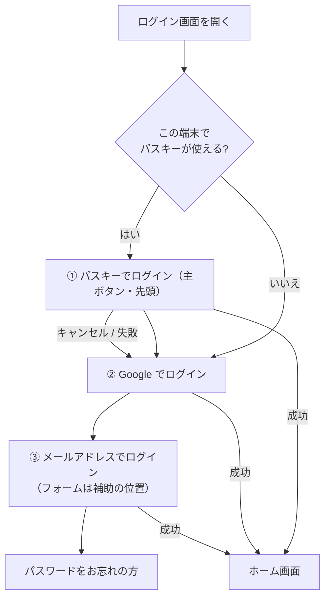
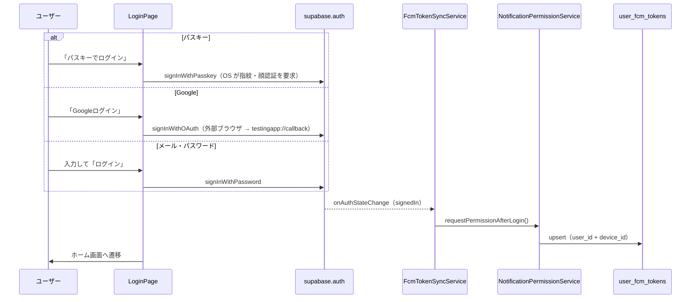
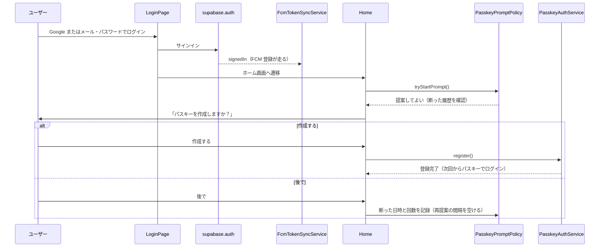
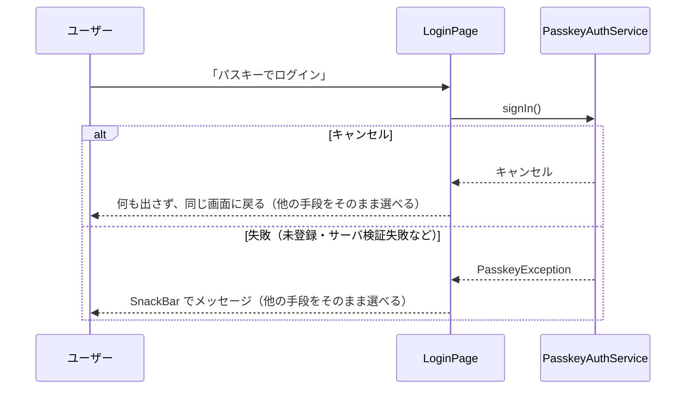

# 0002: ログイン手段の整理（役割分担と画面の優先順位）

| 項目 | 内容 |
|---|---|
| ステータス | **Implemented** |
| 作成者 | — |
| 作成日 | 2026-10-24 |
| 課題・見直しの管理 | 親 Issue [#1064](https://github.com/eno-conan/flutter-starbucks-clone/issues/1064)（残作業は、サブ Issue で管理する） |
| 関連設計書 | [0001: パスキー導入](0001-passkey-introduction.md)（本書は、その導入後の整理） |
| 影響度ティア | **standard**（変更は `lib/screens/**` のみ） |
| ティアの格上げ条件 | `lib/services/**`・`lib/core/services/**` を触る場合は **critical**（code-reviewer + qa-agent + security-agent） |

!!! warning "最重要の制約: FCM トークン登録・プッシュ通知を壊さない"
    - 通知は、このアプリの主要機能。ログイン画面の変更で、通知が届かなくなってはならない。
    - 本書の変更は、画面の見せ方だけに閉じる。FCM 登録の仕組みには触れない（3.4）。

## 要約（TL;DR）

- 何を変えるか: ログイン画面で、3 つの手段（パスキー / Google / メール・パスワード）の**役割と並び順**を整理する。
- なぜ変えるか: パスキー導入後、手段の関係（指紋とパスキー、Google とパスキー）が分かりにくく、画面上の優先度も見えない。
- 方針:
    - 指紋は、独立した経路にしない。**パスキーに一本化**する（指紋は、パスキーを使うときの「鍵の解錠」）。
    - Google は、**残す**。パスキーは新規ユーザーを作れないため、最初の 1 回の入口として必要。
    - メール・パスワードは、**常に表示する**。会員登録で作ったアカウントは、会員登録の完了後にこの画面から入るため。見せ方だけ整理する。
- 変更範囲: ログイン画面（`login.dart`）の並び順と見せ方のみ。認証・FCM 登録のロジックは変えない。

## 1. 背景

### 1.1 現状のログイン手段

- ログイン画面には、3 つの手段がある（`lib/screens/starbucks_user_side/signin/login.dart`）。
- 旧「指紋ログイン」（`local_auth`）は、0001 で廃止済み。設定画面にも、指紋の切り替えは無い。

| 手段 | 画面上の位置 | 表示条件 | 主な用途 |
|---|---|---|---|
| メール・パスワード | 先頭（フォームと「ログイン」ボタン） | 常に表示 | 会員登録直後のログイン、デバッグ |
| Google | 2 番目 | 常に表示 | 外部ブラウザ経由の OAuth。新規登録の入口にもなる |
| パスキー | 3 番目（最後） | 端末が対応している場合のみ | 登録済みユーザーの日常のログイン |

### 1.2 問題

| # | 問題 | 詳細 |
|---|---|---|
| 1 | 最も安全で手軽な手段が、画面の一番下にある | パスキーは、パスワード入力が要らず、フィッシングにも強い。それが最後に置かれ、端末が対応していない場合は出ない |
| 2 | 「指紋」と「パスキー」の関係が分かりにくい | ボタンのアイコンは指紋（`Icons.fingerprint`）だが、旧「指紋ログイン」は廃止済み。利用者にも開発者にも「指紋ログインはまだあるのか」と見える |
| 3 | 「Google があれば、パスキーは要らないか（逆も）」が曖昧 | 3 手段の役割が、どこにも定義されていない |
| 4 | メール・パスワードの位置づけが未定 | デバッグでは必要だが、利用者にとって常に必要とは限らない。それでも、会員登録で作ったアカウントは、この手段で入る |

### 1.3 現状の確認結果（コードで確認した事実）

- FCM トークン登録の入口は、`FcmTokenSyncService` の 1 箇所だけ。`requestPermissionAfterLogin()` の呼び出し元は、このサービスしか無い。
- パスキー登録の提案は、ログイン画面ではなくホーム画面で行う（Google 認証は外部ブラウザ経由で、ログイン画面に戻らないため）。
- メール・パスワードは、次の場所で使われている。
    - ログイン画面（`LoginPage`）。
    - 会員登録（`AuthService.signUp`）。登録の完了後は自動ログインせず、完了画面（`SignUpCompletion`）へ進む。登録したアカウントは、ログイン画面から入る。
- 店舗側には、専用のログイン画面が無い。店舗側も `LoginPage` を使う（#1072）。
    - 店舗側の注文一覧（`orders.dart`）の「ログイン」ボタン（`ButtonLogin`）は、未ログインのときだけ出す。固定のアカウントでサインインせず、`LoginPage` へ進む（クエリ `redirect` に店舗側の注文一覧のパスを付ける）。
    - ログインに成功すると、`LoginPage` は `redirect` の指す店舗側の注文一覧へ戻す。指定が無い、または許可していないパスのときは、ホームへ進む。許可しているのは店舗側の注文一覧だけ（`auth_routes.dart`）。
    - 戻っても、下にあった店舗側の画面は作り直されない（`context.go` は、同じ画面の State を再利用する）。そのため、注文一覧が認証状態（`authStateProvider`）の変化に追従して、表示を切り替え、注文一覧を再取得する。
    - よって、ログイン画面の変更は、店舗側にも影響する。
    - 店舗側のログインでは、画面のタイトルを「店舗ログイン」にする（`redirect` が許可されたパスのとき。会員側と同じ画面を使うため、区別を出す）。
    - 店舗側のログインでは、Google ログインを出さない（`redirect` が許可されたパスのとき）。Google で入ると、店舗のアカウントとは別のアカウントができ、`store_profiles` に紐づかず、店舗側を使えないため。Google 認証は外部ブラウザ経由でこの画面に戻らないので、`redirect` も効かない。
    - ランチャー画面の「店舗」アイコンを、未ログインで押したときは、注文一覧を挟まず、ログイン画面へ `push` で進む（`redirect` は店舗側の注文一覧。ログイン画面で戻ると、ランチャー画面に戻る）。注文一覧の未ログインの表示（下の表）は、ランチャー画面を通らずに着く場合（セッション切れ・店舗側の画面を開いたままの再起動など）のために残す。
    - 注文一覧の表示は、状態ごとに決まる。

    | 状態 | 表示 |
    |---|---|
    | 未ログイン | 「ログインは済んでいますか？」と「ログイン」ボタン。歯車は出さない |
    | ログイン済みの店舗アカウントで、注文が無い | 「現在、注文はありません」 |
    | ログイン済みの店舗アカウントで、注文がある | 店舗名と注文の一覧 |
    | ログイン済みだが、店舗アカウントでも管理者でもない（`store_profiles` に紐づかず、`app_metadata.role` が `store_admin` でない） | 「このアカウントは店舗側では利用できません」。注文は取得しない |
    | ログイン済みの管理者（`app_metadata.role = 'store_admin'`。`store_profiles` の行は無い） | 「管理者アカウントです。右上の設定から店舗アカウントを追加できます」。注文は取得しない |

    - ログイン中は、右上に歯車（設定）を出す。設定画面（`starbucks_store_side/setting`）は、利用者側とは独立で、パスキーの登録・管理と、ログアウトを持つ。ログアウトは、確認ダイアログのあとにサインアウトし、ランチャー画面（会員・店舗・POC を選ぶ画面）へ進む（会員側のログアウトと同じ遷移先。会員側と店舗側の操作を続けて行うときに、そのまま、どちらのログインにも入れるようにするため）。パスキーの画面は、利用者側のもの（`PasskeySetting`）を、店舗側のパス（`/starbucks_store_side_setting/passkey`）でそのまま使う。
- 結合テストが、メール・パスワードのフォームのキー（`login_form_email` / `login_form_password`）に依存している（`integration_test/helpers/auth_helper.dart` ほか）。

## 2. ゴールと非ゴール

**ゴール:**

- 3 つの手段の**役割**を、1 つの表で定義する。
- ログイン画面の**優先順位**を、役割に合わせる（パスキーが先頭）。
- 「指紋」を独立した経路にせず、パスキーに一本化する方針を明文化する。
- **FCM トークン登録・プッシュ通知の挙動を、変えない。**

**非ゴール:**

| 非ゴール | 理由 |
|---|---|
| メール・パスワードをリリースビルドで隠す | 会員登録で作ったアカウントは、メール・パスワードでしか入れないため。隠すと、新規ユーザーが入れなくなる（4. 代替案 B） |
| 旧「指紋ログイン」の復活 | 端末にパスワード原本を保存する方式は、0001 で廃止した（4. 代替案 A） |
| Google ログインの廃止 | パスキー単独では、新規ユーザーを作れない（3.1） |
| 認証ロジック・`AuthService`・`FcmTokenSyncService` の変更 | 通知を壊さないため。画面の見せ方だけに閉じる |
| iOS のパスキー対応 | 0001 の非ゴールのまま |
| 店舗側のログイン方式の変更 | 当初は、店舗側が `LoginPage` を使わないため、本書の対象外として触らなかった。その後 #1072 で、固定のアカウントをやめ、`LoginPage` 経由にした（1.3 と 8. を参照） |

!!! note "店舗側のログイン（#1072 で対応）"
    - 当初は、店舗側の `ButtonLogin` が固定のアカウントでサインインしていた。リリースビルドからも到達できた。
    - いまは、`ButtonLogin` は `LoginPage` へ進む形に変わった。固定の認証情報は、アプリに無い。
    - 店舗アカウントかどうかは、メールの形ではなく、`store_profiles` の行の有無で判定する（[0009](0009-navigation.md) の 3.2）。
    - 店舗アカウントは、利用者側へ入れない。ランチャー画面には店舗側の項目だけを出し、利用者側のシェル（ホームなど 5 タブ）は `StoreAccountGuard` が店舗側の注文一覧へ戻す（[0009](0009-navigation.md) の 3.2）。利用者側のログイン画面で、店舗アカウントのメールとパスワードを入れても、同じように戻される。
    - RPC `get_store_order_list` は、本人の `user_id` でしか行を返さない（[0010](0010-database.md) の 3.5）。
    - 店舗アカウントは、ホーム画面のパスキー登録の案内が届かないため、店舗側の設定画面の「パスキー」から登録する。

!!! tip "店舗アカウントの作り方（SQL の手作業ではなく、画面から作る）"
    - 管理者が、店舗側の設定画面（歯車）の「店舗アカウントを追加」から、メール・店舗番号・初期パスワードを入れて作る。
    - 管理者は `app_metadata.role = 'store_admin'` のユーザーで、メールの形では判定しない（利用者の新規登録でも同じ形のメールを作れるため）。最初の管理者への付与は手動で、手順は [functions/README.md](https://github.com/eno-conan/flutter-starbucks-clone/blob/main/supabase_schema/supabase/functions/README.md#店舗アカウント作成-createstoreaccount) に書く。付与したあとはログインし直す。
    - 同じ店舗番号に既存のアカウントがあるときは、確認ダイアログを出す。関数が 409 `Store already has account` を返し、確認後に再送する。同じ店舗番号に複数のアカウントを作れる。
    - 初期パスワードは管理者が決めて店舗に伝える。店舗は、下の運用どおりパスキーを登録し、パスワードを長いランダムな値へ変える。
    - 理由: 作成を Edge Function `createStoreAccount` に集め、管理者の確認・重複の確認・レート制限（管理者ごとに 1 時間 20 件）を関数の中で行うため。
    - 管理者には MFA（TOTP。認証アプリの 6 桁コード）を必須にする（#1205）。関数が、MFA を済ませたセッション（`aal2`）だけを通し、パスワードだけのセッション（`aal1`）は 403 `MFA required` を返す。管理者がログインした直後に、コードを入れる画面へ進み、未登録なら登録の画面になる。スマホ 1 台でも登録できるよう、QR のほかに、シークレットのコピーと「認証アプリで開く」を出す。端末をなくしたときの復旧は [functions/README.md](https://github.com/eno-conan/flutter-starbucks-clone/blob/main/supabase_schema/supabase/functions/README.md#店舗アカウント作成-createstoreaccount)（「管理者の MFA（TOTP）と復旧」の節） に書く。仕組みとシーケンス図は [0012](0012-admin-mfa.md)。店舗アカウントと利用者には MFA を求めない。

!!! tip "店舗アカウントのパスキー運用（メール・パスワードは、初回と復旧のためだけに残す）"
    - パスキーは、ログイン済みのユーザーに追加する形のため、初回だけ、管理者がメール・パスワードで入り、設定の「パスキー」から登録する（0001 の 3.1.3）。
    - 登録のあと、パスワードを、推測できない長いランダムな値に変える。その値は使わない。店舗側のログイン画面でも、メール・パスワード欄は隠さない（初回の登録と、パスキーが使えないときの復旧に必要なため）。
    - 端末には、画面ロックを必ず設定する。共有の端末では、画面ロックを解除できる人は、誰でもパスキーを使える（個人は区別できない）。
    - パスキーは複数の端末へ同期できる。店舗の端末は、個人の Google アカウントではなく、専用の Google アカウントで使う。

## 3. 設計

### 3.1 各手段の役割

- 手段を、「いつ使うか」で分ける。

| 手段 | 役割 | 使う場面 | 単独で足りるか |
|---|---|---|---|
| **パスキー** | 日常のログイン（既定） | 2 回目以降。パスキー登録済みの端末 | **足りない**。既存アカウントに追加する手段で、新規ユーザーは作れない |
| **Google** | 入口・復旧 | 初回登録、機種変更、パスキーが無い端末、他の端末 | 足りる（自身で完結） |
| **メール・パスワード** | 基本の手段・補助 | 会員登録直後、デバッグ、Google を使わない人 | 足りる（自身で完結） |
| 指紋・顔認証 | **独立した手段ではない** | パスキーを使うときに、OS が出す解錠の画面 | — |

!!! success "決め手: 指紋は「パスキーの一部」"
    - パスキーのボタンを押すと、OS が指紋や顔の認証を求める。利用者から見ると「指紋でログイン」と同じ体験になる。
    - 指紋を別の経路にすると、旧方式（端末にパスワードを保存）に戻る。指紋の強さは、パスキーが既に活かしている。

### 3.2 ログイン画面の構成（案）

- 並び順を、「安全で手軽な順」にする。
- メール・パスワードは**常に表示**する。位置と見た目で、優先度を下げる。



- 案の要点:
    - パスキーが使える端末では、「パスキーでログイン」を先頭の主ボタンにする。使えない端末では、表示しない（現行どおり）。
    - Google は、2 番目に置く。
    - メール・パスワードは、最後の「メールアドレスでログイン」の位置に置く。
    - 文言は、現行の「パスキーでログイン」のまま変えない（7. #1）。
- 各ボタンの**キーとハンドラは変えない**（結合テストへの影響を避ける。5. 参照）。

!!! success "メール・パスワードは、折り畳まず、画面の一番下へ移動する（決定）"
    - フォームは折り畳まない。入力欄とボタンは、そのまま常に表示する。
    - 結合テスト（`login_form_email` を直接入力する）は、キーを変えないため、そのまま動く見込み。
    - 折り畳みが必要になったときは、デバッグビルドでは常に展開する案を、改めて検討する。

### 3.3 処理の流れ（シーケンス図）

#### 3.3.1 3 つの手段は、同じ `signedIn` に合流する

- 手段が何であっても、サインイン成功後の流れは同じ。FCM 登録は、手段ごとに書かない。



#### 3.3.2 新しい端末（パスキー未登録）の流れ

- 最初は Google かメール・パスワードで入り、ホームでパスキーを作る。
- 提案は、ログイン手段を問わずホーム画面で出る（`maybePromptPasskeyRegistration`）。



#### 3.3.3 パスキーが使えない・失敗したときの流れ

- 必ず、他の手段へ戻れる。画面に出ている手段が、そのままフォールバックになる。



### 3.4 FCM トークンを壊さないための不変条件（最重要）

- 本書の変更は、画面の並び順と見せ方だけ。次の不変条件を、変更の前後で保つ。

| # | 不変条件 | 本書での担保 |
|---|---|---|
| 1 | FCM 登録の入口は、`FcmTokenSyncService` の 1 箇所だけ | ログイン画面に FCM 登録を足さない。`requestPermissionAfterLogin()` の呼び出し元を増やさない |
| 2 | 登録の契機は、`signedIn` と `initialSession` | 認証の呼び出し（`signInWithPassword` / `signInWithOAuth` / `signInWithPasskey`）を変えない |
| 3 | `user_id` は、手段が変わっても不変 | 認証プロバイダを変えない（Supabase のまま） |
| 4 | ログアウト時に、その端末の `fcm_token` を空にする（行は残す） | `signOutWithEmailAndPassword()` に触れない |
| 5 | パスキー登録は、ログイン完了と FCM 登録の**後**に行う | 提案はホーム画面で行う現行の構成を維持する |

!!! danger "この変更でやってはいけないこと"
    - ログイン画面や新しいウィジェットの中で、`requestPermissionAfterLogin()` を直接呼ぶ。
    - ボタンのハンドラを書き換えるついでに、`AuthService` の認証メソッドの中身を変える。
    - 「手段を減らすついで」に、認証経路（OAuth のコールバック、`app.dart` の処理）を整理する。

- レビューの確認コマンド（変更後に、呼び出し元が増えていないこと）:

```bash
grep -rn "requestPermissionAfterLogin" lib --include=*.dart
# 期待: 定義（notification_permission_service.dart）と fcm_token_sync_service.dart のみ
```

### 3.5 変更するファイル

| ファイル | 区分 | 内容 |
|---|---|---|
| `lib/screens/starbucks_user_side/signin/login.dart` | 変更 | ボタンの並び順、パスキーボタンの主ボタン化、区切り・文言の整理。キーとハンドラは変えない |
| `lib/screens/starbucks_user_side/signin/widgets/` | 追加 | 認証手段ごとの部品を `login.dart` から分離する（#1071）。`passkey_login_button.dart` / `google_login_button.dart` / `email_password_login_form.dart` / `reset_password_link.dart`。パスキーボタンは別ファイルから使うため `PasskeyLoginButton` に公開化。他のクラス名・キー・ハンドラは変えない |
| `test/screens/starbucks_user_side/signin/` | 変更（必要なら） | 並び順の変更に伴う Widget テストの調整。`google_login_button_test.dart` は import 先を `widgets/google_login_button.dart` に変更 |
| `docs/content/starbucks_user_side/signin/ui-specification.md` | 変更 | ログイン画面の構成を、実装に合わせる |

## 4. 検討した代替案

| 案 | 長所 | 短所 | 判断 |
|---|---|---|---|
| **A. 設定で指紋が有効なら指紋、無ければパスキー** | 指紋の安心感がある | 指紋の経路を別に持つと、旧方式（端末にパスワードを保存）に戻る。サーバ認証にならず、フィッシング耐性が無い。設定項目と画面分岐も増える | **不採用**。指紋は、パスキーの中で既に使われている |
| **B. メール・パスワードをリリースで隠す（デバッグのみ表示）** | 画面が簡潔になる | 会員登録直後のユーザーが入れなくなる。Google もパスキーも無いユーザーが、ログイン不能になる | **不採用**。表示は常にし、見せ方だけ整理する |
| **C. パスキーがあれば Google を無くす** | 手段が減る | パスキーは新規ユーザーを作れない。機種変更や、パスキーの無い端末で入口が無くなる | **不採用** |
| **D. 現状維持（3 手段を並列のまま）** | 変更が無い | 問題 1〜4 が残る | **不採用** |
| **採用: 役割を定義し、並び順だけを整える** | 通知・認証ロジックに触れない。戻しやすい | メール・パスワードは常時表示のまま、優先度は位置で示す（折り畳まない） | **採用** |

## 5. 横断的関心事

| 観点 | 検討内容 |
|---|---|
| セキュリティ | パスワードを端末に保存しない方針（0001）は変えない。パスキーを先頭にして、安全な手段へ誘導する。手段を減らさないため、攻撃面は増えない |
| プライバシー | 取得・保存する情報は変えない |
| 互換性 | 既存ユーザーのログイン手段は、すべて残る。`user_id` も不変 |
| 通知（FCM） | 3.4 の不変条件を守る。回帰検証は 6.2。通知設定は端末単位（[0001 の 3.4.1](0001-passkey-introduction.md)） |
| テスト | 結合テストが `login_form_email` などのキーに依存している。**キーを変えない**。折り畳むなら、デバッグでの常時展開か、テスト側の展開操作が必要 |
| アクセシビリティ | ボタンの文言は、アイコンだけに頼らず、テキストで手段を示す |
| 可観測性 | 新しいログは不要。既存の `LoggerService` の方針のまま。パスキーの機密情報は出さない |

## 6. 移行とロールアウト

### 6.1 実装の順序

| フェーズ | 内容 | 完了条件 |
|---|---|---|
| 0. 論点の決定 | 7. の論点 #1〜#2 を決める | 決定事項を 8. に記録 |
| 1. 画面の並び替え | 並び順・区切り・文言の変更。キーとハンドラは維持 | `dart analyze` と関連 `flutter test` が通る |
| 2. 回帰検証 | 6.2 の項目を実機で確認 | 全項目 pass |
| 3. 仕様書の更新 | `ui-specification.md` を実装に合わせる | 実装とのずれが無い |

### 6.2 回帰検証項目（FCM を中心に）

- 0001 の 3.8 の項目のうち、ログイン手段に関わるものを再確認する。
- **全項目 pass が完了条件。**

| # | シナリオ | 期待結果 |
|---|---|---|
| 1 | メール・パスワードでログイン | `user_fcm_tokens` に該当 `(user_id, device_id)` 行が upsert される |
| 2 | Google でログイン | 同上 |
| 3 | パスキーでログイン | 同上（`user_id` が 1 と同一） |
| 4 | 各手段でログイン後に、プッシュ通知を送信 | 端末で受信できる |
| 5 | アプリ再起動（セッション保持） | `initialSession` で再登録され、通知が届く |
| 6 | ログアウト → 別の手段で再ログイン | 同じ行に `fcm_token` が再設定され、通知が届く |
| 7 | パスキーのキャンセル → 他の手段でログイン | キャンセルで状態が壊れず、他の手段でログインでき、通知が届く |
| 8 | 並び替え後の画面で、ボタンが押せる（小さい画面幅を含む） | 3 手段のボタンが、すべて表示・操作できる |

### 6.3 戻し方

- 画面の変更だけなので、コミットを戻せば元に戻る。
- 認証ロジック・DB・FCM 登録には触れないため、データの移行や復旧は要らない。

## 7. 論点と決定

| # | 論点 | 選択肢 | 推奨 | 状況 |
|---|---|---|---|---|
| 1 | パスキーボタンの文言とアイコン | (a) 「パスキーでログイン」（現行） (b) 「指紋・顔認証でログイン」 (c) 併記 | 当初は (c) を推奨 | **決定: (a)**。現行のまま変えない |
| 2 | メール・パスワードのフォームを折り畳むか | (a) 常に展開（並び順だけ変える） (b) 折り畳む（デバッグでは常に展開） (c) 折り畳む（テストで展開操作を足す） | 当初は (a) を推奨 | **決定: (a)**。折り畳まず、画面の一番下へ移動する |

!!! success "論点 #1・#2 は決定済み（8. を参照）"
    - フェーズ 0 の完了条件は、満たした。

## 8. 決定事項と実装時の差分

- 2026-10-24: メール・パスワードは**常に表示し、見せ方だけ整理する**ことに決定。
- 2026-10-24: 指紋は独立した経路にせず、パスキーに一本化する方針で合意。
- 2026-10-24: パスキーボタンの文言は、現行の「パスキーでログイン」のまま変えない。
- 2026-10-24: メール・パスワードのフォームは折り畳まず、画面の一番下へ移動する。
- 2026-10-24: 店舗側 `orders.dart` の固定アカウントのボタンは、現状のまま残す（スコープ外）。
- 2026-10-31: #1072 の段階 1。店舗側の `ButtonLogin` から固定のアカウント（直書きのメール・パスワード）を削除し、`LoginPage`（クエリ `redirect`）経由にした。店舗側の端末は 1 店舗 1 台で、店舗ごとのアカウントを使う方針（案 Y）。理由: 固定の認証情報は、リリースビルドから到達でき、アプリ内に置く限り取り出せるため。
- 2026-10-31: #1072 の段階 2・3。店舗アカウントの判定を、メールの接頭辞（`0011`）から `store_profiles` の行の有無に変えた。理由: 店舗番号ごとのメールでは、店舗を増やすたびに判定を直す必要があるため。あわせて、RPC `get_store_order_list` が呼び出し元を確認せず、`anon` も実行できた点を直した（本番の権限を確認して判明）。
- 2026-11-01: #1072。実機で見つかった不具合と要望を反映した。①ログイン後も注文一覧が古い表示のままになる不具合（`go` は下の画面を作り直さない）を、認証状態への追従で直した。②注文が無いときの表示を足した。③ログアウトを画面の中央から、店舗側の設定画面（歯車）へ移した。④店舗側のログインでは Google ログインを出さない。⑤店舗アカウントでないユーザーには、利用できない旨を出し、注文を取得しない。⑥店舗側の設定に「パスキー」を追加した（利用者側のパスキー設定画面を再利用）。理由: 店舗側がメール・パスワードだけでは、共有の端末での入力・フィッシング・2 要素目の無さが弱いため。店舗側のログイン画面でも、メール・パスワード欄は隠さない（初回の登録と復旧に必要なため。運用は 1.3 を参照）。
- 2026-11-02: 実機で、店舗側のログイン画面のタイトルが「会員ログイン」のままで、店舗側のログアウト後に注文一覧へ戻るため、会員側と店舗側の操作を続けて行いにくい、という指摘があった。①店舗側から来たときの、ログイン画面のタイトルを「店舗ログイン」にした（`LoginPage.title`。別の画面は作らず、会員側と同じ画面を使う）。②店舗側のログアウト後を、会員側と同じく、メニュー（会員・店舗・POC を選ぶ画面）へ進むようにした。理由: 会員側と店舗側を行き来する操作で、ログアウトのあと、そのまま、どちらのログインにも入れるため。
- 2026-11-02: 未ログインで、メニューの「店舗」アイコンを押したときは、注文一覧（「ログイン」ボタンだけの画面）を挟まず、ログイン画面へ直接進むようにした（`ItemTile` が、行き先が店舗側の注文一覧のときだけ、ログイン状態を見て分ける）。理由: 注文一覧は、未ログインではボタンしか出さず、手順が 1 つ余計なため。`push` にして、戻るとメニューに戻る。注文一覧の未ログインの表示は、セッション切れなどのために残す。
- 2026-11-01: #1072。店舗アカウントは、利用者側に入れないことにした。理由: 店舗の端末は、店舗側だけを使い、利用者側（ホーム・支払い・モバイルオーダーなど）を、店舗のアカウントで使う場面が無いため。メニューの出し分けと、シェルの見張り（`StoreAccountGuard`）で行う。データの守りは、これまでどおり RLS と RPC が行う。
- 2026-10-24: 訂正。店舗側は `LoginPage` を使わないため、「店舗側アプリで必要」を、メール・パスワードを残す理由から外した。理由は、会員登録で作ったアカウントがメール・パスワードで入ること。
- 2026-11-01: #1072 の続き。店舗アカウントの作成を、手作業の SQL から、管理者だけが呼べる Edge Function `createStoreAccount` と店舗側の設定画面（「店舗アカウントを追加」）に変えた。管理者は `app_metadata.role = 'store_admin'` で判定する。理由: 利用者の新規登録でも同じ形のメールを作れるため、メールの形では管理者を判定できないため。
- 2026-11-02: #1205。管理者に MFA（TOTP）を必須にした。`createStoreAccount` が `aal2` のセッションだけを通し、ログイン直後と「店舗アカウントを追加」の画面から、認証アプリでの確認へ進む。理由: パスワードだけで通った管理者のセッションが盗まれると、任意の店舗番号の店舗アカウントを作られ、他人の注文情報を読まれ・書き換えられるため（`createStoreAccount` の独立レビューで medium の指摘）。同じスマホで登録する人は自分の画面の QR を読み取れないため、シークレットのコピーと「認証アプリで開く」も出す。

## 9. 参考

- [0001: パスキー導入（ログイン認証フロー刷新）](0001-passkey-introduction.md)
- `lib/screens/starbucks_user_side/signin/login.dart`
- `lib/services/fcm_token_sync_service.dart`
- `lib/shared/widgets/dialogs/passkey_registration_prompt.dart`
- [設計書テンプレート](template.md)
