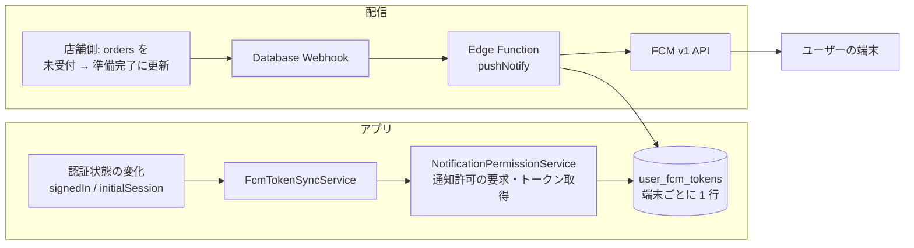
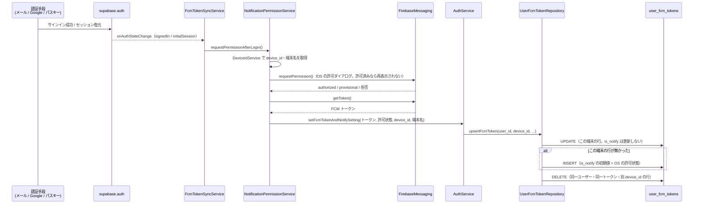
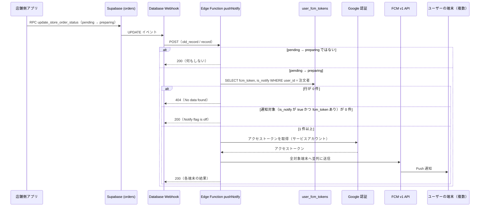
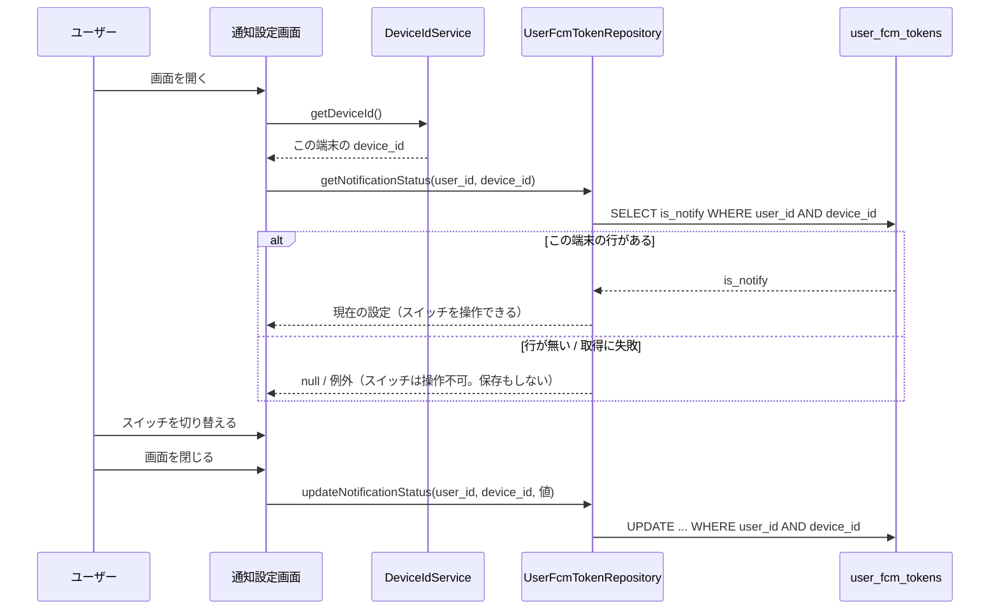

# 0003: Push 通知（FCM トークン登録・配信・通知設定）

| 項目 | 内容 |
|---|---|
| ステータス | **Implemented** |
| 影響度ティア | **critical**（`lib/services/**`・`supabase_schema/supabase/functions/**` を含む） |
| 課題・見直しの管理 | 親 Issue [#1087](https://github.com/eno-conan/flutter-starbucks-clone/issues/1087)（課題は、サブ Issue で管理する）。移行元は [#1076](https://github.com/eno-conan/flutter-starbucks-clone/issues/1076) |
| 関連設計書 | [0001: パスキー導入](0001-passkey-introduction.md)（FCM 登録の一元化、`device_id` の設計） |
| 置き換え | 旧 `project/push-notification.md`（本書へ移動） |

**実装との対応（実装後は、コードを正とする）:**

| 役割 | ファイル |
|---|---|
| 登録の起点（認証状態の監視） | `lib/services/fcm_token_sync_service.dart` |
| 通知許可の要求とトークン取得 | `lib/services/notification_permission_service.dart` |
| トークンの保存 | `lib/services/auth_service.dart`（`setFcmTokenAndNotifySetting`）→ `lib/data/repository/user_fcm_tokens.dart` |
| 端末 ID・端末名 | `lib/core/services/device/device_id_service.dart` |
| 通知設定画面 | `lib/screens/starbucks_user_side/setting/switch_notify_setting/main.dart` |
| 端末での受信 | `lib/config/fcm_initializer.dart` / `lib/config/app_initializer.dart` |
| 配信（Edge Function） | `supabase_schema/supabase/functions/pushNotify/index.ts` |
| 店舗側の更新（配信の起点） | `lib/data/repository/store_order_repository.dart` |

## 要約（TL;DR）

- 何を実現するか: 店舗の担当者が「準備完了を通知」を押し、注文が「未受付 → 準備完了」になったとき、注文したユーザーのすべての端末へ Push 通知を送る。
- 仕組み: 店舗側の更新（`orders`）→ Database Webhook → Edge Function `pushNotify` → FCM v1 API → 端末。
- 登録: ログイン手段に依存せず、認証状態の変化（`signedIn` / `initialSession`）を起点に FCM トークンを登録する。
- 設定: 通知のオン/オフは**端末ごと**。同じユーザーでも、端末ごとに異なる設定ができる。

## 1. 背景

- 注文の進み具合を、アプリを開いていないユーザーにも伝えたい。
- ユーザーは複数の端末でログインしうる。通知は、端末ごとに届ける。
- FCM トークンは、端末ごと（アプリのインストールごと）に決まる。ユーザーと端末の対応をサーバ側に持つ必要がある。

## 2. ゴールと非ゴール

**ゴール:**

- ログイン手段（メール・パスワード / Google / パスキー）によらず、FCM トークンが登録される。
- 1 ユーザーの複数端末へ、それぞれ通知が届く。
- 通知をオフにした端末へは送らない。設定は端末ごとに独立している。
- ログアウトした端末へは、通知が届かなくなる。

**非ゴール:**

| 非ゴール | 理由 |
|---|---|
| キャンペーンなどの一斉配信 | 現状は、注文の状態変化に連動した通知だけ |
| 通知の履歴をアプリ内に保存する | 配信側（`pushNotify`）は、履歴を保存しない |
| 通知タップで特定の画面を開く | 通知には `order_id` を載せているが、受け取って遷移する処理は、コードに見当たらない |

## 3. 設計

### 3.1 全体像

### 3.2 FCM トークンの登録

- 登録の起点は `FcmTokenSyncService` の 1 箇所だけ（アプリ起動時に `start()` を 1 回呼ぶ）。
- 契機は次の 3 つ。
    - `signedIn`（ログイン成功）
    - `initialSession`（アプリ起動時のセッション復元）
    - FCM トークンのリフレッシュ（`onTokenRefresh`）
- 登録処理は直列に実行する（キューに積む）。サインインとトークン更新が同時に起きても、保存が並行しない。
- 登録中の例外は握りつぶし、ログに残す。キューを壊すと、以降の登録が止まるため。
- `tokenRefreshed`（認証トークンの更新）では、登録しない。

- `user_id` は、`supabase.auth.currentUser.id`。ユーザーが未ログインなら、保存しない。
- `is_notify` は、**この端末の初回登録時の初期値**にだけ使う。
    - OS の通知が許可されていれば `true`、拒否されていれば `false`。
    - 2 回目以降（再ログイン時）は、保存済みの値を維持する。利用者が通知設定画面でオフにした設定を、ログインで書き換えない。
- トークンは取得できたが OS が通知を拒否している場合も、行は保存する（`is_notify = false`）。
- 最後の DELETE は、同じインストールが過去に別の `device_id` で登録した古い行を消す。放置すると、同じ端末へ通知が二重に届く。失敗しても、登録の成否には影響させない。

### 3.3 データ

- `user_fcm_tokens` は、端末ごとに 1 行を持つ。

| カラム | 型 | 備考 |
|---|---|---|
| `user_id` | uuid | 主キー（複合）。`auth.users.id` への外部キー。**退会時は一緒に削除**（`ON DELETE CASCADE`） |
| `device_id` | text | 主キー（複合）。端末ごとに一意な ID |
| `device_name` | text | 端末名（Android は `製造元 モデル`、iOS は端末名） |
| `fcm_token` | text | FCM トークン |
| `is_notify` | boolean | 通知設定。既定 `false`、NOT NULL |
| `created_at` / `updated_at` | timestamptz | 既定 `now()` |

- 主キーは `(user_id, device_id)`。同じユーザーが複数端末を持てる。
- `device_id` は、Android では初回に生成した UUID v4 をセキュアストレージに保存して使う。iOS は `identifierForVendor`（詳細は 0001 の 3.4.4）。
- RLS: 自分の行（`auth.uid() = user_id`）だけを、読み書きできる。

### 3.4 通知の配信

- 配信の起点は、店舗側が `orders.provided_status` を `pending`（未受付）から `preparing`（準備完了）に更新したとき。
    - 操作: 店舗の担当者が、注文の詳細画面で「準備完了を通知」を押す（[0011](0011-store-order-detail.md)）。
    - 確認ダイアログ: 「お客様に通知が届きます。取り消せません。」を出す。
    - 更新は RPC `update_store_order_status` で行う。アプリの `StoreOrderRepository.updateProvidedStatus` がこれを呼ぶ（0011）。
    - `preparing` から `pending` へは戻せない（DB の防御トリガーで強制）。そのため、1 注文の Push は 1 回しか送られず、再送できない。
    - 通知の文面は、準備完了を伝えるものとして合っているので、変えない（4 の記録）。
    - 受取済（`preparing → provided`）に変わったときは、通知しない。
- Database Webhook が `orders` の UPDATE を `pushNotify` に渡す。
- Webhook は、マイグレーション `20261031120000_define_database_webhook_triggers.sql` のトリガー（`trg_orders_update_push_notify`）で定義する。Vault の URL と `service_role` キーを読んで `pushNotify` を呼ぶ。設定内容と Vault の登録手順は、[`functions/README.md`](https://github.com/eno-conan/flutter-starbucks-clone/blob/main/supabase_schema/supabase/functions/README.md#database-webhooksの設定) に書いてある。

**pushNotify の仕様:**

| 項目 | 内容 |
|---|---|
| 場所 | `supabase_schema/supabase/functions/pushNotify/index.ts` |
| 通知の条件 | `old_record.provided_status = 'pending'` かつ `record.provided_status = 'preparing'` |
| 送信先 | 注文者（`orders.user_id`）の `user_fcm_tokens` のうち、`is_notify = true` かつ `fcm_token` がある端末 |
| 通知の内容 | title: `【受取番号:<pickup_number>】` / body: `商品のご用意ができました！お待ちしております` / data: `order_id` |
| 認証情報 | 環境変数 `FIREBASE_SERVICE_ACCOUNT`（Supabase Secrets）。未設定または形式不正なら、起動時に停止する |
| DB アクセス | `SUPABASE_SERVICE_ROLE_KEY`（RLS を通らない）で `user_fcm_tokens` を読む |
| ログ | 構造化ログ。利用者 ID・FCM トークン・リクエスト本文は出さない |

**レスポンス:**

| 状況 | ステータス |
|---|---|
| 通知の条件に当たらない | 200（空の JSON） |
| 注文者の端末行が無い | 404 |
| 通知対象が 0 件（すべてオフ、またはトークン無し） | 200 |
| 送信した | 200（各端末の FCM のレスポンス） |

### 3.5 端末での受信

- **フォアグラウンド**: `FirebaseMessaging.onMessage` で受け取り、`flutter_local_notifications` でローカル通知を表示する。
    - 通知チャンネルは `high_importance_channel`（重要度: 高）。ロック画面にも内容を表示する。
    - ローカル通知の初期化は、Android の設定だけを行っている。
- **バックグラウンド・終了時**: `onBackgroundMessage` にハンドラを登録している。ハンドラは Firebase の初期化だけを行い、OS が通知を表示する。
- 通知の `data.order_id` を使った画面遷移は、行っていない。

### 3.6 通知設定（端末単位）

- 通知設定画面は、**この端末の行（`user_id` と `device_id`）だけ**を読み書きする。他の端末の設定は変更しない。
- 保存の条件:
    - この端末の通知設定を読み込めている。
    - 利用者がスイッチを操作した。
    - 画面を閉じるときに保存する。
- この端末の行が無い（FCM トークンの登録前など）ときは、スイッチを操作できない。

### 3.7 ログアウト

- `signOutWithEmailAndPassword()` が、サインアウトの前に、この端末の行（`user_id` と `device_id`）の `fcm_token` を空にする。行は削除しない。
    - 通知が止まる理由: `pushNotify` は、`fcm_token` が空の行へ送信しない。
    - 行を残す理由: 行を消すと、この端末の通知設定（`is_notify`）も消える。次のログインで OS の通知許可の状態から作り直され、OFF にしていても ON に戻る。
    - 再ログインでは、既存行の更新経路に乗り、`is_notify` は維持される。
- 空にするのに失敗しても、サインアウトは続行する（ログアウトできないほうが、利用者にとって重大なため）。
- 他の端末の行は、変更しない。

## 4. 検討した代替案

- 登録の起点を、ログイン画面・OAuth コールバック・アプリ起動の 3 箇所に分ける案を、認証状態の変化に集約した（理由と効果は [0001 の 3.4.3](0001-passkey-introduction.md)）。
- 通知の文面（「商品のご用意ができました！お待ちしております」）を、変えない。
    - 理由: 通知は、店舗の担当者が「準備完了を通知」を押したときに送る。「ご用意ができました」は、その意味と合う。
    - 見送った案: 受け取りを促す文面（「カウンターでお受け取りください」）、利用方法（店内・持ち帰り・ドライブスルー）ごとに分ける文面。どちらも、今は必要が示されていない。
    - 以前は、通知の送信が「調理を始めた」ときで、文面は「できあがった」を伝えており、食い違って見えた（Issue #1088）。店舗側の操作を「準備完了を通知」と決めたことで、解消した。
- ほかの代替案の記録は、見つからなかった。

## 5. 横断的関心事

| 観点 | 検討内容 |
|---|---|
| セキュリティ | `user_fcm_tokens` は RLS で本人の行だけ。`pushNotify` は RLS を通らない鍵を使うため、条件（`pending → preparing`）と対象（注文者の行）を関数内で絞る。FCM のサービスアカウントは Secrets で渡し、コードに置かない。`pushNotify` を呼べるのは service_role だけで、公開の anon キーや偽造した JWT は 401 になる（[0010 の 3.4](0010-database.md)） |
| プライバシー | 端末名（製造元・モデル、または端末名）を保存する。退会時は、行が一緒に削除される |
| 互換性 | 1 ユーザーが複数端末を持てる。同一インストールの古い行は、登録時に自動で削除する |
| 性能 | 送信は端末ごとに並列。1 ユーザーの端末数は、少数の想定 |
| 可観測性 | アプリ側は `LoggerService`（機密を出さない）。配信側は、構造化ログ |
| テスト | `UserFcmTokenRepository` の通知設定の読み書きと、通知設定画面は、単体テストがある。`FcmTokenSyncService` ほかは、テスト未整備 |

## 6. 運用: 通知が届かないときの確認

??? question "1. `user_fcm_tokens` に、この端末の行があるか"
    - Supabase Dashboard → Table Editor → `user_fcm_tokens` で、ユーザーの行（`device_id` ごと）を確認する。
    - 行が無い場合は、FCM トークンの登録が走っていない。

??? question "2. `is_notify` が `true` か"
    - `false` の端末には、送られない。端末の通知設定画面で、オンになっているかも確認する。
    - OS の通知を拒否したまま初回登録した端末は、`false` で登録される。

??? question "3. Edge Function のログを確認する"
    - Supabase Dashboard → Edge Functions → `pushNotify` → Logs。
    - `no_fcm_tokens` が出ていれば、注文者の端末行が無い。

??? question "4. OS の通知許可を確認する"
    - 端末の設定 → アプリ → 通知が許可されているか。

??? question "5. FCM トークンを再登録する"
    - アプリを完全に終了して再起動する。`initialSession` を契機に、登録が走る。

## 7. 参考

- [Supabase: Push Notifications（FCM）](https://supabase.com/docs/guides/functions/examples/push-notifications?queryGroups=platform&platform=fcm)
- `supabase_schema/supabase/functions/README.md`（`pushNotify` の節）
- [0001: パスキー導入](0001-passkey-introduction.md)
