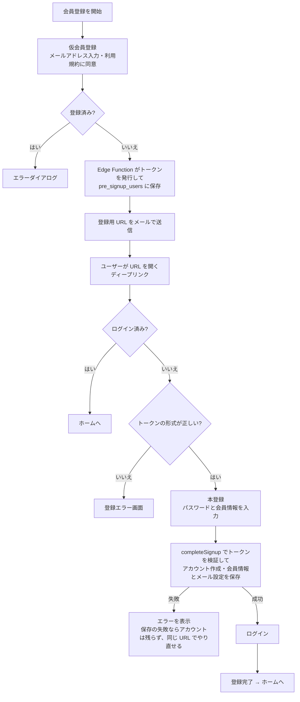
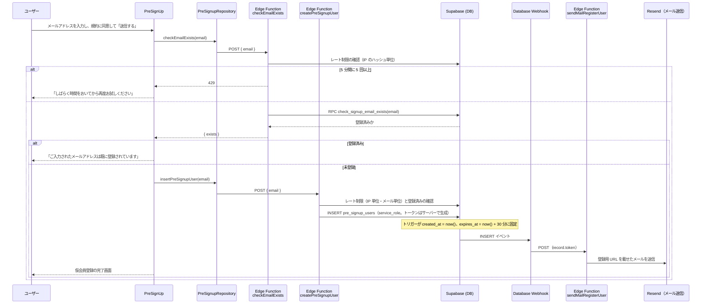
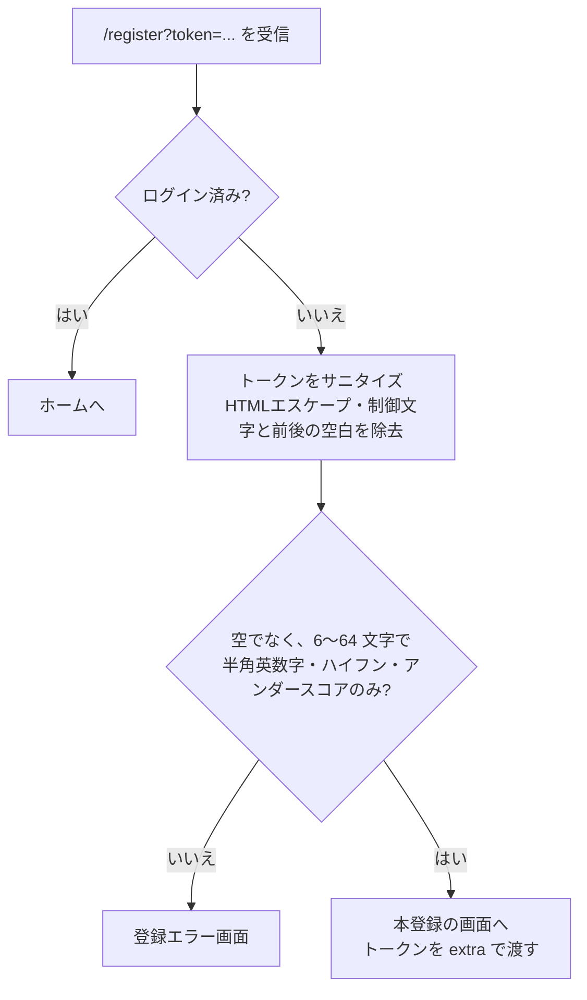
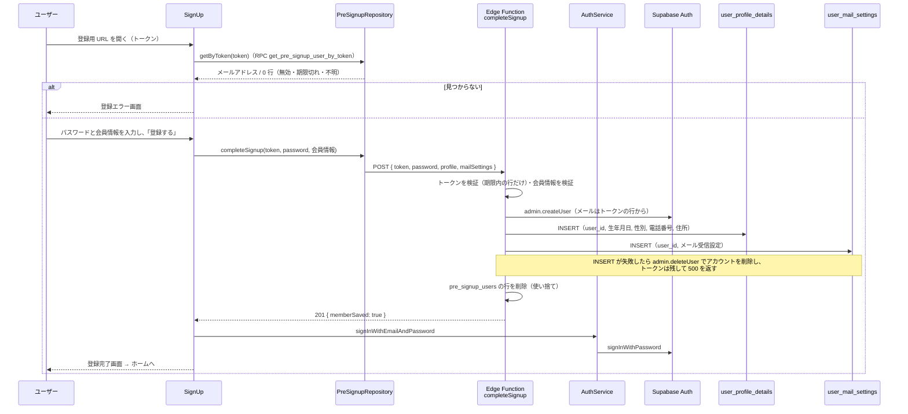

# 0004: 会員登録（仮会員登録〜本登録）

| 項目 | 内容 |
|---|---|
| ステータス | **Implemented** |
| 影響度ティア | **critical**（認証、`supabase_schema/**`、Edge Function を含む） |
| 課題・見直しの管理 | 親 Issue [#1093](https://github.com/eno-conan/flutter-starbucks-clone/issues/1093)（課題は、サブ Issue で管理する）。移行元は [#1074](https://github.com/eno-conan/flutter-starbucks-clone/issues/1074) |
| 関連設計書 | [0001: パスキー導入](0001-passkey-introduction.md) / [0002: ログイン手段の整理](0002-login-methods-organization.md) |
| 置き換え | 旧 `starbucks_user_side/signup_pre/design-specification.md`（画面仕様の `overview.md` / `ui-specification.md` は、そのまま残す） |

**実装との対応（実装後は、コードを正とする）:**

| 役割 | ファイル |
|---|---|
| 仮会員登録の画面（メール入力） | `lib/screens/starbucks_user_side/signup_pre/pre_signup.dart` |
| 仮会員登録の完了画面 | `lib/screens/starbucks_user_side/signup_pre/pre_signup_completion.dart` |
| 本登録の画面（会員情報の入力） | `lib/screens/starbucks_user_side/signup/signup.dart` |
| 本登録の完了・失敗の画面 | `signup_completion.dart` / `signup_error.dart` |
| ディープリンクの受け口 | `lib/config/deep_link_paths.dart` / `lib/app/app.dart` |
| 仮登録テーブルの操作 | `lib/data/repository/pre_signup_repository.dart` |
| プロフィール・メール設定の保存 | `user_profile_details_repository.dart` / `user_mail_settings_repository.dart` |
| メール重複チェック（Edge Function） | `supabase_schema/supabase/functions/checkEmailExists/` |
| 仮登録の作成（Edge Function） | `supabase_schema/supabase/functions/createPreSignupUser/` |
| 本登録（Edge Function） | `supabase_schema/supabase/functions/completeSignup/` |
| 登録メールの送信（Edge Function） | `supabase_schema/supabase/functions/sendMailRegisterUser/` |

## 要約（TL;DR）

- 何を実現するか: 新規ユーザーが、メールアドレスの本人確認を経て会員登録できるようにする。
- 方式: **2 段階**。メールアドレスを入力して仮登録（登録用 URL をメールで受け取る）→ URL を開いて本登録（パスワードと会員情報を入力）。
- 仮登録は、ログイン前のユーザーが行う。32 文字のトークンをサーバー（Edge Function）で発行し、有効期限は 30 分。
- 本登録は、Edge Function `completeSignup` が仮登録トークンを検証し、service_role でアカウント（メール・パスワード）を作り、会員情報を `user_profile_details` と `user_mail_settings` に保存する。保存に失敗したときは、アカウントを削除して、同じ URL でやり直せるようにする。アプリはその後ログインする。

## 1. 背景

- 会員登録は、他人のメールアドレスで登録できないよう、メールの受信確認を挟む。
- 登録前のユーザーはログインしていない。仮登録の操作は、匿名（`anon`）の権限で行う。
- 会員登録で作ったアカウントは、メール・パスワードでログインする（[0002](0002-login-methods-organization.md)）。

## 2. ゴールと非ゴール

**ゴール:**

- メールアドレスの本人確認を経て、アカウントを作る。
- すでに登録済みのメールアドレスでは、登録を進めさせない。
- 登録用 URL に有効期限（30 分）を持たせる。
- 重複チェックの連続実行（メールアドレスの総当たり）を抑える。

**非ゴール:**

| 非ゴール | 理由 |
|---|---|
| パスキー・Google での新規登録 | 認証手段の追加は [0001](0001-passkey-introduction.md)・[0002](0002-login-methods-organization.md) で扱う。本機能は、メール・パスワードのアカウントを作る |
| 氏名・フリガナの保存 | 入力は求めるが、保存先のカラムが無く、現状は保存していない（3.4） |
| メール文面のテンプレート管理 | 文面は、Edge Function の中に直接書いている |

## 3. 設計

### 3.1 全体の流れ

### 3.2 仮会員登録

- 画面: `PreSignUp`（`/starbucks_pre_signup_page`）。
- 「送信する」ボタンは、次の 2 つがそろったときだけ有効になる。
    - メールアドレスの形式が正しい（正規表現 `^.+@.+\..+$`）。
    - 「My Starbucks 利用規約」に同意している。
- 送信ボタンを押すと、次の順に処理する。

- トークンは、Edge Function `createPreSignupUser` がサーバー側で生成する。英数字（大文字・小文字・数字）の 62 文字から 32 桁を、棄却法（偏りを避ける）で選ぶ。メールにだけ載せ、レスポンスには含めない。
- アプリ側は、トークンを生成も送信もしない（メールアドレスだけを送る）。
- メールアドレスの重複チェックは、`auth.users` に同じメールアドレスがあるかで判定する。
- チェックの失敗（サーバーエラー・レート制限・想定外の応答）は、同じ「エラーが発生しました」ダイアログで扱う。
- 登録用 URL: `https://<HOSTING_DOMEIN>/register?token=<トークン>`（環境変数名は、コードのとおりの綴り）。

### 3.3 ディープリンク（登録用 URL の受け取り）

- 登録用 URL は、アプリで開く（Android の App Links / iOS の Universal Links）。アプリは `app_links` で受け取る。
- パス `/register` は、`DeepLinkPath.register` が処理する。

### 3.4 本登録

- 画面: `SignUp`（`/starbucks_signup_page`）。
- 画面を開くと、RPC `get_pre_signup_user_by_token` でトークンを検証し、メールアドレスを取得する。無効・期限切れ・不明のトークンは、どれも 0 行で、区別できない。見つからなければ、登録エラー画面を表示する。
- 登録エラー画面: 無効・期限切れ・使用済み・不明のトークンは、サーバーが区別せず 0 行を返す（トークンの存在を第三者に推測させないため）ので、画面も理由を特定しない。「この登録用URLは、有効期限（30分）が切れているか、すでに使用されています。」と案内し、「会員登録をやり直す」（仮登録画面へ）と「ログインする」のボタンを出す。

**入力項目:**

| 項目 | 必須 | 保存先 | 備考 |
|---|---|---|---|
| パスワード | ○ | `auth.users`（`completeSignup` が作成） | 6〜20 文字。数字または記号、小文字、大文字を、それぞれ 1 文字以上含む |
| 氏名・フリガナ | ○ | **保存していない** | 入力欄はあるが、保存先のカラムが無い |
| 生年月日 | — | `user_profile_details.birthday` | 初期値は 1990-01-01 |
| 性別 | ○ | `user_profile_details.sex` | 未選択 = 0 / 男性 = 1 / 女性 = 2 / その他 = 3。「未選択」のままでは進めない |
| 電話番号 | ○ | `user_profile_details.tele_num` | 3 つの欄を連結して保存 |
| 郵便番号 | ○ | `user_profile_details.postal_code` | 入力すると、住所を自動入力する（下記） |
| 都道府県 | ○ | `user_profile_details.prefecture_id` | |
| 市区町村・番地 | — | `address1` / `address2` | 空なら null。番地は `address2` に保存する |
| アパート・マンション名 | — | **保存していない** | 入力欄はあるが、保存先が無い |
| メール受信設定（3 つ） | — | `user_mail_settings` | リワード関連、商品先行告知、HTML メール。初期値はすべて ON |

- 郵便番号の自動入力: 形式 `NNN-NNNN` のとき、外部の郵便番号 API（`jp-postal-code-api.ttskch.com`）に問い合わせ、都道府県・市区町村・番地を入力する。失敗しても、手入力で続けられる。
- 「登録する」ボタンは、パスワードの要件を満たし、必須項目がすべて入力されたときだけ有効になる。

**失敗したときの挙動（[#1096](https://github.com/eno-conan/flutter-starbucks-clone/issues/1096)）:**

- アカウントの作成と会員情報の保存は、サーバー（`completeSignup`）が 1 回の呼び出しで行う。クライアントが `user_profile_details` / `user_mail_settings` を直接書くことはない。
- 会員情報（プロフィール・メール設定）のどちらかの保存に失敗すると、サーバーが作ったアカウントを削除して 500 を返す。2 つのテーブルの行は、アカウントの削除に連動して消える。
- このときトークンは消さないので、利用者は同じ URL で、もう一度登録できる。
- 失敗した場合は、ローディングを閉じて、原因に応じた案内を出す（3.8）。登録完了画面へは進まない。
- ログイン（`signInWithPassword`）だけが失敗したときは、アカウントはできている。ダイアログでその旨を伝え、ログイン画面へ移る。

!!! warning "アカウントの削除（巻き戻し）にも失敗した場合"
    - 会員情報のないアカウントだけが残る。同じ URL での再試行は、登録済み（409）になる。
    - ログ（`outcome: rollback_error`）で検知し、手で復旧する。発生は、保存の失敗と削除の失敗が重なったときに限られる。

### 3.5 データ

| テーブル | 役割 | 主な列 |
|---|---|---|
| `pre_signup_users` | 仮会員。本登録前のメールアドレスとトークン | `token`（32 文字・一意）、`email`（128 文字以内・形式チェックあり）、`expires_at` |
| `email_check_rate_limits` | メール重複チェックのレート制限。`service_role` だけがアクセスできる | `ip_hash`、`created_at` |
| `user_profile_details` | 会員のプロフィール詳細 | `user_id`（一意）、`birthday`、`sex`、`tele_num`、`postal_code`、`prefecture_id`、`address1`、`address2` |
| `user_mail_settings` | メール受信設定 | `user_id`（一意）、`is_send_related_rewards`、`is_send_advance_product_announce`、`is_html_mail` |

- `created_at` と `expires_at` は、行の作成時にトリガー（`set_expires_at`）がサーバー時刻（`now()`、`now() + 30 分`）に固定する。クライアントが `created_at` を指定して期限を延ばすことはできない。
- 退会時（`auth.users` の削除時）は、`user_profile_details` と `user_mail_settings` の行が一緒に削除される。
- 期限切れの仮登録は、期限から 24 時間を過ぎたものを、日次のジョブ（`cleanup_expired_pre_signup_users`）が削除する。猶予を置いた当初の目的は、期限切れ直後に URL を開いた人へ理由を案内するためだったが、現在は理由を区別しない（3.4）。

### 3.6 アクセス制御

**`pre_signup_users`（RLS 有効。[#1094](https://github.com/eno-conan/flutter-starbucks-clone/issues/1094) で変更）:**

| 項目 | 変更前 | 現状 |
|---|---|---|
| `anon` / `authenticated` の SELECT | 全行を読める（`USING (true)`） | 不可。ポリシー 0 件、テーブル権限なし |
| `anon` / `authenticated` の INSERT | 可（`WITH CHECK (true)`） | 不可。書き込みは `service_role`（Edge Function）だけ |
| UPDATE / DELETE / TRUNCATE / REFERENCES / TRIGGER | 権限が付いたまま | 外す |
| トークンの検証 | クライアントが表を直接 SELECT（`expires_at` を見ていない） | RPC `get_pre_signup_user_by_token(p_token)`。`SECURITY DEFINER`、`search_path` 固定。有効期限内の行だけを対象に、`email` と `expires_at` だけを返す。無効・期限切れ・不明は 0 行で区別しない |
| トークンの生成 | クライアントが生成して直接 INSERT | Edge Function `createPreSignupUser` がサーバー側で生成 |
| 有効期限 | `created_at` をクライアントが指定でき、期限を延ばせた | トリガーが `now()` に固定。RPC も整合を確認（`created_at <= now()`、`expires_at <= created_at + 30 分`） |

**本登録（[#1145](https://github.com/eno-conan/flutter-starbucks-clone/issues/1145)）:**

- Supabase Auth の `signUp` は仮登録トークンを検証しない。クライアントから直接呼べると、メール確認が無効（`enable_confirmations = false`）の環境で、任意のメールアドレスのアカウントを先取り登録できる。
- そのため、本登録は Edge Function `completeSignup`（3.7）だけが行い、`[auth.email] enable_signup = false` でクライアントからの `signUp` を拒否する。メール確認の設定には依存しない。
- 本番への適用は、`completeSignup` のデプロイ → 新アプリの配布 → Auth 設定（"Allow new users to sign up" を無効化）の順。無効化すると、旧アプリの本登録は失敗する。
- 登録後にトークンの行を削除するため、トークンは使い捨てになる（#1094 本文の 4）。会員情報の保存に失敗したときは、アカウントを削除してトークンを残す（#1096）。

**適用順序（運用手順）:**

1. `20261024120000_add_rpc_get_pre_signup_user_by_token.sql`（旧アプリを壊さない追加と強化）と Edge Function `createPreSignupUser` をデプロイする。
2. 新アプリを配布する。旧アプリがほぼ使われなくなるまで待つ。
3. `20261024120100_lock_down_pre_signup_users.sql`（締め付け）を適用する。旧アプリの仮登録・本登録は失敗する。

1 と 3 の間は、全行の email・token の漏洩と、直接 INSERT によるメール送信の悪用が残る。普及後は速やかに 3 を適用する。

**課題（未対応）:**

- 本番の Auth 設定の確認と、`enable_signup` の無効化（上記）。適用するまで、先取り登録は防げない。
- `checkEmailExists` のメール単位の制限は無い（IP 単位のみ）。IP は `cf-connecting-ip` を優先するが、本番でこのヘッダーが付くかは未確認（ログ `client_ip_source` で確認する）。

**メール重複チェック:**

- RPC `check_signup_email_exists` は、`service_role` だけが実行できる（[#1141](https://github.com/eno-conan/flutter-starbucks-clone/issues/1141)）。`PUBLIC` / `anon` / `authenticated` の実行権限は取り消している。
- 以前は `anon` と `authenticated` からだけ取り消しており、新しい関数に既定で付く `PUBLIC` の権限が残っていた。そのため `anon` が直接呼べ、Edge Function のレート制限を迂回できる状態だった。`20261028120000` で `PUBLIC` からも取り消した。
- アプリは、Edge Function `checkEmailExists` を経由する。Edge Function は `service_role` で RPC を呼ぶ。

### 3.7 Edge Function

**`checkEmailExists`:**

| 項目 | 内容 |
|---|---|
| メソッド | POST のみ（それ以外は 405） |
| リクエスト | `{ "email": "<文字列>" }`。不正なら 400 |
| レート制限 | 同じ IP（`cf-connecting-ip`、無ければ `x-forwarded-for` の先頭を SHA-256 でハッシュ化）から、5 分間に 5 回まで。RPC `consume_rate_limit` でアトミックに判定し、失敗したら 503。超えると 429 |
| レスポンス | 200: `{ "exists": true/false }` / 429: 制限超過 / 500: RPC の失敗 |
| ログ | 構造化ログ。メールアドレスと本文は出さない |

**`createPreSignupUser`:**

| 項目 | 内容 |
|---|---|
| メソッド | POST のみ |
| 処理 | メールアドレスを検証し、登録済みなら 409。トークンをサーバーで生成して `service_role` で `pre_signup_users` に INSERT する |
| レート制限 | IP 単位で 5 回 / 5 分、全体で 100 件 / 60 分、メール単位で 3 件 / 60 分（`+` 以降と Gmail のドットは同一視）。RPC `consume_rate_limit` でアトミックに判定し（`email_check_rate_limits` を `pre_signup:` の名前空間で共用）、失敗したら拒否する（503）。超過は 429 |
| レスポンス | トークンを含めない |

**`completeSignup`:**

| 項目 | 内容 |
|---|---|
| メソッド | POST のみ |
| リクエスト | `{ "token", "password", "profile", "mailSettings" }`。`profile` と `mailSettings` は、2 つとも指定するか、2 つとも省略する（旧アプリは省略）。形式不正・パスワード要件違反・会員情報の検証エラーは 400 |
| 処理 | `pre_signup_users` をトークンで検索（期限内の行だけ）→ `auth.admin.createUser`（`email_confirm: true`。メールは行の値）→ 会員情報を保存（失敗したらアカウントを削除して 500。トークンは残す）→ 行を削除 |
| レスポンス | 201: `{ "status": "created", "memberSaved": <サーバーが会員情報を保存したか> }` / 409: 登録済み / 410: 無効・期限切れ・不明（区別しない） / 500: 保存などの失敗 |
| ログ | 構造化ログ。メール・トークン・パスワードは出さない |

**`sendMailRegisterUser`:**

| 項目 | 内容 |
|---|---|
| 起動 | Database Webhook 相当のトリガー（`pre_signup_users` への INSERT）。マイグレーション `20261031120000_define_database_webhook_triggers.sql` で定義し、Vault の URL と `service_role` キーを読んで呼ぶ。設定内容は [`functions/README.md`](https://github.com/eno-conan/flutter-starbucks-clone/blob/main/supabase_schema/supabase/functions/README.md#database-webhooksの設定) |
| 認可 | 呼べるのは service_role だけ。公開の anon キーや偽造した JWT は 401（[0010 の 3.4](0010-database.md)） |
| 処理 | `record.token` から登録用 URL を作り、Resend の API でメールを送る |
| 件名 | 会員登録手続きのご案内 |
| 環境変数 | `RESEND_API_KEY` / `TEST_MAIL_ADDRESS` / `HOSTING_DOMEIN` |
| 送信元・宛先 | 送信元は `onboarding@resend.dev`。**宛先は、環境変数 `TEST_MAIL_ADDRESS`**（入力されたメールアドレスではない） |

### 3.8 エラーの表示

| 場面 | 表示 |
|---|---|
| メールアドレスの形式が不正 | 入力欄の下に「不正なメールアドレス」 |
| 登録済みのメールアドレス | ダイアログ「ご入力されたメールアドレスは既に登録されています。」 |
| サーバーエラー・レート制限 | ダイアログ「エラーが発生しました。しばらく時間をおいてから再度お試しください。」 |
| 仮会員の保存（`createPreSignupUser`）に失敗 | 409（登録済み）はダイアログ「ご入力されたメールアドレスは既に登録されています。」、429（回数超過）・503（障害）・その他はダイアログ「エラーが発生しました。しばらく時間をおいてから再度お試しください。」。ログには status だけを記録する |
| トークンが不正・見つからない | 登録エラー画面 |
| 本登録: 登録用 URL が無効・期限切れ・使用済み（410） | 登録エラー画面（3.4） |
| 本登録: すでに登録済み（409） | ダイアログ「このメールアドレスは、すでに会員登録されています。ログインしてください。」 |
| 本登録: サーバーの検証エラー（400） | ダイアログ「入力内容に誤りがあります。内容を確認して、もう一度お試しください。」 |
| 本登録: 会員情報の保存の失敗などのサーバーエラー（500・通信エラー） | ダイアログ「エラーが発生しました。会員登録は完了していません。しばらく時間をおいてから、もう一度お試しください。」。アカウントは残らず、同じ URL でやり直せる |
| 本登録後のログインに失敗 | ダイアログ「会員登録は完了しています。ログイン画面から…」のあと、ログイン画面へ |
| 上記すべて | ローディングを必ず閉じてから表示する。ログには種類と status だけを記録する |

## 4. 検討した代替案

- メールアドレスの重複チェックは、クライアントから RPC を直接呼ぶ方式をやめ、Edge Function（レート制限つき）を経由する方式にした。
- ほかの代替案の記録は、見つからなかった。

## 5. 横断的関心事

| 観点 | 検討内容 |
|---|---|
| セキュリティ | トークンは `Random.secure()` の 32 文字、有効期限 30 分。重複チェックは IP 単位でレート制限。`pre_signup_users` は、クライアントから読み書きできない（3.6）。トークンの検証は RPC、作成は Edge Function（レート制限つき）を経由する。未対応の課題は 3.6 |
| プライバシー | 生年月日・電話番号・住所を保存する。郵便番号は、住所の自動入力のために外部 API へ送る |
| 互換性 | 登録用 URL は、App Links / Universal Links でアプリが開く。ドメインは `HOSTING_DOMEIN` |
| 可観測性 | Edge Function は構造化ログ。アプリ側は `LoggerService` |
| テスト | `pre_signup_users` の権限・RPC は pgTAP、`createPreSignupUser` は node:test、`PreSignupRepository` は Dart のテストで検証する。会員登録の画面・結合テストは、見当たらない |
| 運用 | 期限切れの仮登録は日次で削除。スケジュールは、ダッシュボードの SQL Editor で登録する（`supabase_schema/cron/archive_data.sql`） |

## 6. 参考

- 画面仕様: [仮会員登録 概要](../starbucks_user_side/signup_pre/overview.md) / [UI仕様](../starbucks_user_side/signup_pre/ui-specification.md)
- `supabase_schema/supabase/functions/README.md`（`checkEmailExists` の節）
- [0001: パスキー導入](0001-passkey-introduction.md)
