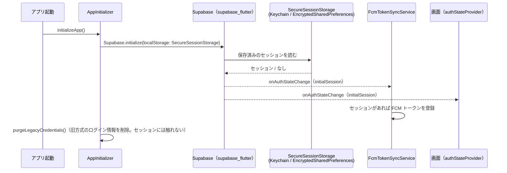
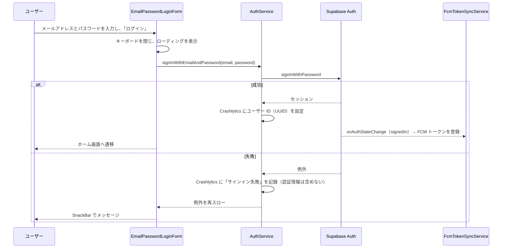
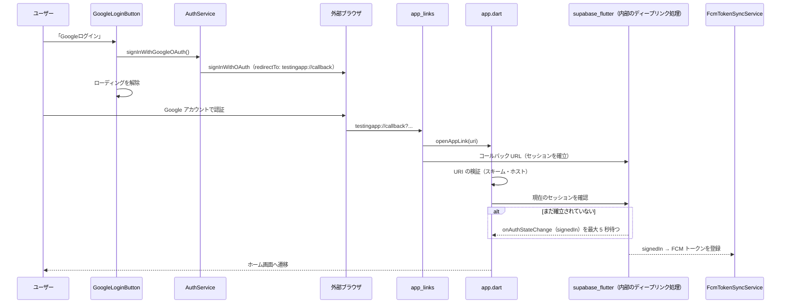

# 0005: ログインとセッション管理（メール・パスワード / Google）

| 項目 | 内容 |
|---|---|
| ステータス | **Implemented** |
| 影響度ティア | **critical**（認証、`lib/services/**` を含む） |
| 課題・見直しの管理 | 親 Issue [#1101](https://github.com/eno-conan/flutter-starbucks-clone/issues/1101)（課題は、サブ Issue で管理する）。移行元は [#1075](https://github.com/eno-conan/flutter-starbucks-clone/issues/1075) |
| 関連設計書 | [0001: パスキー導入](0001-passkey-introduction.md)（パスキーの認証）/ [0002: ログイン手段の整理](0002-login-methods-organization.md)（画面の並び順）/ [0003: Push 通知](0003-push-notification.md)（ログイン後の FCM 登録）/ [0004: 会員登録](0004-member-registration.md) |
| 置き換え | 旧 `starbucks_user_side/signin/authentication-flow.md` |

**実装との対応（実装後は、コードを正とする）:**

| 役割 | ファイル |
|---|---|
| ログイン画面 | `lib/screens/starbucks_user_side/signin/login.dart` |
| 認証の処理 | `lib/services/auth_service.dart` |
| OAuth コールバック・ディープリンク | `lib/app/app.dart` |
| Supabase の初期化 | `lib/config/app_initializer.dart` |
| セッションの保存 | `lib/core/services/auth/secure_session_storage.dart` |
| 認証状態の監視（画面用） | `lib/provider/auth_state_provider.dart` |
| ログイン・新規登録のボタン（未ログイン時） | `lib/shared/widgets/auth_state_fab.dart` |
| ログアウト | `lib/screens/starbucks_user_side/setting/main.dart` |

## 要約（TL;DR）

- 認証基盤は Supabase Auth。ログイン手段は、メール・パスワード、Google（OAuth）、パスキー（0001）の 3 つ。
- 本書は、メール・パスワードと Google のログイン、セッションの保存と復元、認証状態の監視、ログアウトを扱う。
- セッションは、端末の暗号化ストレージに保存する（Android: EncryptedSharedPreferences / iOS: Keychain）。
- どの手段でログインしても、成功後の処理（FCM トークン登録など）は、認証状態の変化（`signedIn` / `initialSession`）を起点に行う。ログイン画面から個別には呼ばない。

## 1. 背景

- ユーザーは、会員登録で作ったメール・パスワードのアカウントでも、Google アカウントでも、ログインできる。
- Google のログインは外部ブラウザを経由するため、ログイン画面に結果が戻らない。アプリは、ディープリンクで結果を受け取る。
- ログイン状態は、アプリを閉じても保持したい。

## 2. ゴールと非ゴール

**ゴール:**

- メール・パスワードと Google の両方でログインできる。
- ログイン状態を、アプリの再起動後も保持する。
- 認証状態の変化を、画面と各サービスが同じ入口（`onAuthStateChange`）で受け取る。
- ログアウトでは、この端末のセッションと FCM トークンを消す。

**非ゴール:**

| 非ゴール | 理由 |
|---|---|
| パスワードの端末保存・指紋による自動ログイン | 廃止済み（0001）。パスキーに置き換えた |
| ルートごとの認証ガード（未ログインの画面遷移の制限） | ルーターのリダイレクトは、ログ出力のみ。画面側で、未ログインの扱いを決める |
| アプリ内でのパスワード再設定 | 「パスワードをお忘れの方」のリンクは、Starbucks の Web ページを開く |

## 3. 設計

### 3.1 アプリの起動とセッションの復元

- `Supabase.initialize` で、セッションの保存先に `SecureSessionStorage` を指定する。
- 保存済みのセッションがあれば、起動時に復元され、`initialSession` が発火する。
- FCM トークンの登録は、この `initialSession` を契機に走る（0003）。

### 3.2 メール・パスワードでログイン

- 入力は、メールアドレスとパスワード。どちらも空でなければ、「ログイン」ボタンが有効になる。
- 送信すると、`AuthService.signInWithEmailAndPassword` が `signInWithPassword` を呼ぶ。
- 成功すると、Crashlytics にユーザー識別子（UUID）を設定する。失敗すると、「サインイン失敗」を記録する（メールアドレス・パスワードは記録しない）。

- すでにログイン済みの状態で、この画面のログインボタンを押すと、サインアウトとして動く（`retrieveLoginUser()` がメールアドレスを返したとき）。

### 3.3 Google でログイン

- 「Googleログイン」を押すと、`signInWithOAuth(google, redirectTo: 'testingapp://callback')` で外部ブラウザを開く。
- リダイレクト先は、debug / release 共通でカスタムスキーム `testingapp://callback`。
- ブラウザを開いた時点で、ログイン画面のローディングを解除する。結果は、ログイン画面には戻らず、ディープリンクで `app.dart` が受け取る。
- 認証の方式は PKCE。セッションの確立は、`supabase_flutter` 内部のディープリンク処理が行う。`app.dart` は、セッションの確立を呼び直さず、`signedIn` を待つだけにする（二重に呼ぶと、後から来た側が `flow_state_not_found` で失敗するため）。

**ディープリンクの受け付け:**

| 項目 | 内容 |
|---|---|
| 受け取る経路 | 起動時の初期リンク（`getInitialLink`）と、起動中のストリーム（`uriLinkStream`） |
| 許可するスキーム | `testingapp`、または `https`（ホストが `FIREBASE_HOSTING_DOMAIN` と一致するものだけ） |
| OAuth コールバック | `testingapp://callback`、または `https://<許可したホスト>/callback` |
| 会員登録の URL | `/register`（0004） |
| 上記以外 | ランチャー画面へ遷移する |

- セッションが 5 秒以内に確立しなかった場合は、ホームへ遷移せず、ログ（`OAuth session が存在しません`）を残す。

### 3.4 認証状態の監視

- 画面は、`authStateProvider` で認証状態を購読する。`onAuthStateChange` のイベントを、`User?` に変換する。

| イベント | 画面の `User?` |
|---|---|
| `initialSession` / `signedIn` / `tokenRefreshed` / `userUpdated` / `passwordRecovery` / `mfaChallengeVerified` | セッションのユーザー |
| `signedOut` / `userDeleted` | `null`（未ログイン） |

- ストリーム自体のエラー（セッションのリフレッシュ失敗など）が出たときは、未ログイン（`null`）として扱う。
- 初回の状態は、`initialAuthStateProvider` が、現在のセッションから直接取得する。
- 画面右下のボタン（`SignupSignInFloatingActionButton`。ホームや共通ヘッダーの画面で使う）は、未ログインなら「ログイン」と「新規会員登録」を、ログイン済みなら残高と支払いを表示する。

### 3.5 ログアウト

- 設定画面の「ログアウト」から、`AuthService.signOutWithEmailAndPassword()` を呼ぶ。
- 処理の順序:
    1. この端末の FCM トークンを空にする（行は残す。失敗しても続行する）。
    2. Crashlytics のユーザー識別子を消す。
    3. `signOut` を呼ぶ。
- 完了後、`initialAuthStateProvider` を無効化し（認証状態を取り直せるようにし）、ランチャー画面へ遷移する。
- `signOut` で `signedOut` が発火すると、`supabase_flutter` が `SecureSessionStorage` の保存済みセッションを削除する。
- 失敗したときは、進行中のダイアログを閉じ、SnackBar「サインアウトに失敗しました。」を出す（3.7）。

### 3.6 セッションの保存

| 項目 | 内容 |
|---|---|
| 保存先 | `flutter_secure_storage`（キー: `supabase_session`） |
| Android | EncryptedSharedPreferences |
| iOS | Keychain（`first_unlock_this_device`。この端末だけ、初回のアンロック後に読める） |
| 既定の保存先を使わない理由 | 既定の `SharedPreferences` は平文のため |

!!! danger "`supabase_session` は、消さない"
    - これを消すと、全ユーザーが強制ログアウトになり、FCM の再登録が一斉に走る。

### 3.7 エラーの表示

| 場面 | 表示 |
|---|---|
| メール・パスワードのログイン失敗（`PlatformException`） | SnackBar「認証処理に失敗しました(メールアドレス)」 |
| メール・パスワードのログイン失敗（その他の例外） | SnackBar「<例外の内容>:認証処理に失敗(メールアドレス)」 |
| Google のブラウザ起動の失敗 | SnackBar「認証処理に失敗しました(PlatformException)」または「<例外の内容>:認証処理に失敗しました(OtherException)」 |
| 設定画面でのログアウトの失敗 | ダイアログを閉じ、SnackBar「サインアウトに失敗しました。」（実装: `setting/main.dart`） |
| 認証状態の取得の失敗 | 未ログインとして扱う（ログに記録） |

- いずれの失敗でも、ローディングは解除する。
- 非同期処理のあとに画面を操作するときは、`mounted` / `context.mounted` を確認する。

## 4. 検討した代替案

- 認証後の処理（FCM トークンの登録など）を、ログイン画面と OAuth コールバックの両方に書く案を、認証状態の変化に集約した（[0001 の 3.4.3](0001-passkey-introduction.md)）。
- ほかの代替案の記録は、見つからなかった。

## 5. 横断的関心事

| 観点 | 検討内容 |
|---|---|
| セキュリティ | セッションは暗号化ストレージ。OAuth は PKCE。ディープリンクは、スキームとホストを検証する。認証情報（メールアドレス・パスワード）は、Crashlytics に記録しない |
| プライバシー | Crashlytics に、ユーザー ID（UUID）を設定する |
| 互換性 | リダイレクト先は、debug / release 共通のカスタムスキーム。`https://<ドメイン>/callback` も受け付ける |
| 可観測性 | `LoggerService`（機密を出さない）と Crashlytics。サインイン失敗とサインアウトを記録する |
| テスト | `AuthService` と OAuth コールバックの単体テストは、見当たらない。ログイン画面は、Widget テストと結合テスト（`integration_test/login_flow_cases.dart`）がある |

## 6. 参考

- 画面仕様: [ログイン UI 仕様](../starbucks_user_side/signin/ui-specification.md)
- [0001: パスキー導入](0001-passkey-introduction.md) / [0002: ログイン手段の整理](0002-login-methods-organization.md)
