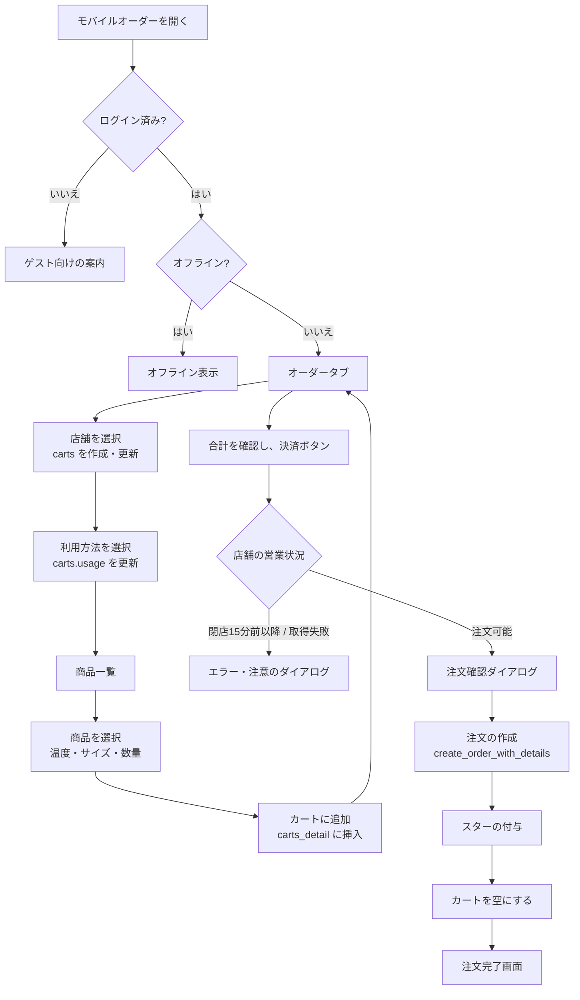
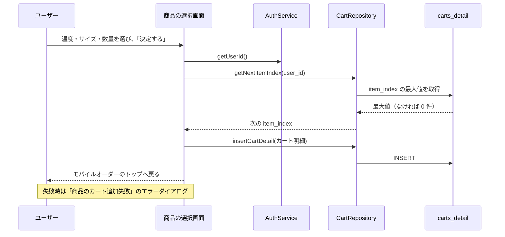
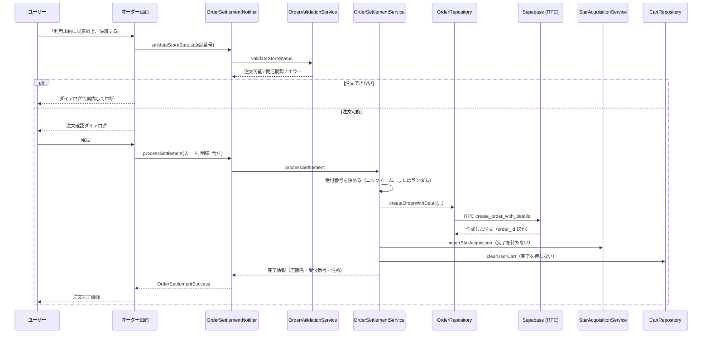
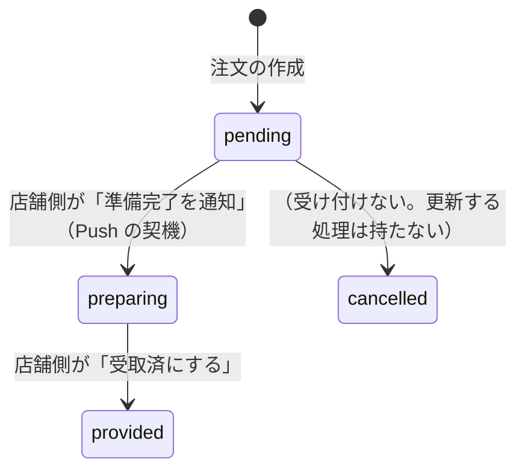
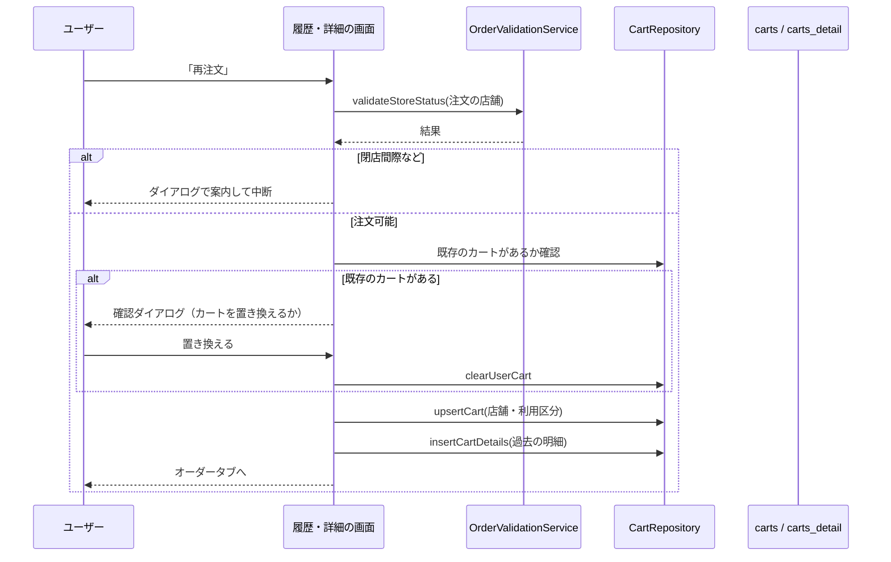

# 0006: モバイルオーダー（店舗選択・商品・カート・注文確定・履歴）

| 項目 | 内容 |
|---|---|
| ステータス | **Implemented** |
| 影響度ティア | **critical**（`lib/services/**`、RPC、`supabase_schema/**` を含む） |
| 課題・見直しの管理 | 親 Issue [#1106](https://github.com/eno-conan/flutter-starbucks-clone/issues/1106)（課題は、サブ Issue で管理する）。作成元は [#1078](https://github.com/eno-conan/flutter-starbucks-clone/issues/1078) |
| 関連設計書 | [0003: Push 通知](0003-push-notification.md)（注文の状態変化で通知）/ [0005: ログインとセッション管理](0005-login-and-session.md) |
| 対象外 | 会話注文（音声注文）、店舗検索の詳細（マップ・近隣店舗・お気に入り）、店舗側の画面、スターの仕組み、支払い（カード）の画面。それぞれ別の設計書で扱う |

**実装との対応（実装後は、コードを正とする）:**

| 役割 | ファイル |
|---|---|
| タブの親（オーダー / 履歴・再注文） | `lib/screens/starbucks_user_side/mobile_order_pay/mobileorder_tab_container.dart` |
| オーダー画面（カート・合計・決済） | `.../tab_order/order.dart` と `order/*.dart` |
| 利用方法の選択 | `.../tab_order/pickup_method.dart` |
| 商品一覧・商品の選択 | `.../tab_order/products.dart` / `product_selected.dart` と `product_selected/*.dart` |
| 店舗の選択 | `.../store/store_selection.dart` ほか |
| 履歴・再注文 | `.../tab_histories/*.dart` |
| 注文完了画面 | `.../order_success_screen.dart` |
| 決済の状態管理 | `lib/provider/order_settlement_provider.dart` |
| 注文の確定 | `lib/services/mobile_order_pay/order_settlement_service.dart` / `order_creation_service.dart` |
| 営業時間の検証 | `.../order_validation_service.dart` / `store/store_availability_service.dart` |
| スターの付与 | `.../star_acquisition_service.dart` |
| データ操作 | `lib/data/repository/cart.dart` / `order.dart` / `product.dart` / `store.dart` |

## 要約（TL;DR）

- 何を実現するか: ログイン済みのユーザーが、店舗と利用方法を選び、商品をカートに入れて、注文を確定する。注文は店舗側に届き、状態が変わると通知される（0003）。
- 流れ: 店舗を選ぶ → 利用方法（店内 / 持ち帰り / ドライブスルー）を選ぶ → 商品を選んでカートへ → オーダー画面で合計を確認 → 営業時間を検証 → 確認ダイアログ → 注文の作成 → スターの付与 → カートの消去 → 完了画面。
- 金額（小計・税・合計）は、アプリ側で計算し、注文の作成時にサーバーへ渡す。
- **現状は、カード残高を差し引かない。** 残高は、決済ボタンの有効判定にだけ使う（3.5）。

## 1. 背景

- 店舗で並ばずに注文できるようにする。ユーザーが受取番号（またはニックネーム）を受け取り、店舗側がそれを見て用意する。
- カートは、ユーザーごとに 1 つ。サーバー側（`carts` / `carts_detail`）に保存する。アプリを閉じても、カートは残る。
- 利用方法によって、消費税率が変わる（店内飲食は標準税率、持ち帰りとドライブスルーは軽減税率）。

## 2. ゴールと非ゴール

**ゴール:**

- 店舗と利用方法を決めて、複数の商品をカートに入れ、まとめて注文できる。
- 閉店間際の店舗では、注文させない。
- 過去の注文から、同じ内容を再注文できる。
- 注文時点の商品名・単価・税率を、注文に残す（その後の商品改定に影響されない）。

**非ゴール:**

| 非ゴール | 理由 |
|---|---|
| 実際のカード決済・残高の差し引き | 現状は、決済の処理を持たない。支払い方法は「クレジットカード」の固定値を保存する |
| 注文のキャンセル | 注文後はすぐに調理を始めるため、注文後のキャンセルは受け付けない。注文確定の前に、確認ダイアログで伝える（3.6）。キャンセルに進める処理は持たない。店舗側が `pending → preparing → provided` に進める処理はある（3.7、[0011](0011-store-order-detail.md)） |
| 会話注文・店舗検索・スター・店舗側画面 | 別の設計書で扱う |

## 3. 設計

### 3.1 画面と責務

| 画面 | ルート | 責務 |
|---|---|---|
| モバイルオーダー（親） | `/mobileorder_pay_top` | 「オーダー」「履歴・再注文」の 2 タブ。オフライン・未ログインのときは、専用の表示に切り替える |
| オーダー（タブ） | 同上 | 利用店舗、利用方法、選んだ商品、合計、お支払い、決済ボタン、ニックネーム |
| 店舗の選択 | `StoreSelect`（近隣店舗・お気に入りのタブ） | 店舗を選ぶと、`CartService` がカートを作成・更新する（利用区分は 1 = 店内飲食で作る） |
| 利用方法の選択 | `MobileOrderPickupMethod` | 店内飲食 / 持ち帰り / ドライブスルー。ドライブスルーは、選んだ店舗が対応している場合だけ表示する |
| 商品一覧 | `MobileOrderProducts` | カテゴリ別に商品を表示する |
| 商品の選択 | `MobileOrderSelectedProduct` | 温度・サイズ・数量を選び、カートに追加する |
| 履歴・再注文（タブ） | 同上 | 受取待ちの注文の一覧。再注文ボタン |
| 履歴の詳細 | `MobileOrderPayTabHistoriesHistoryDetail` | 注文の内容と、再注文ボタン |
| 注文完了 | `OrderSuccessScreen` | 受取番号、店舗情報、待ち時間 |

### 3.2 全体の流れ

### 3.3 カートへの追加

- 商品の選択画面で「決定する」を押すと、`carts_detail` に 1 行追加する。
- 行の番号（`item_index`）は、そのユーザーの最大値 + 1 で採番する。件数で採番すると、途中の商品を削除したあとの追加で、主キー `(user_id, item_index)` が重複するため。
- 温度・サイズは、選択肢の並び順ではなく、カタログの ID（`temperature_type_id` / `size_id`）で保存する。
- 税抜小計は、`商品の価格（選んだサイズ） × 数量` をアプリ側で計算して保存する。

### 3.4 金額の計算

| 項目 | 計算 |
|---|---|
| 税抜合計 | カート明細の税抜小計の合計 |
| 税率 | 利用区分で決まる。店内飲食 = 10%、持ち帰り・ドライブスルー = 8% |
| 消費税 | `税抜合計 × 税率` を整数に切り捨てる |
| 税込合計 | 税抜合計 + 消費税 |

- 計算は、オーダー画面（アプリ側）で行う。税抜合計・税込合計・税率は、そのまま注文の作成に渡す。
- 注文の保存では、DB の CHECK 制約が、`price_with_tax >= price_without_tax`（`orders`）と、明細の `小計 = 単価 × 数量`（`orders_detail`）などを守る。RPC `create_order_with_details` の本体は、入力の中身を検証する（#1214 の段階 B。3.6 を参照）。RPC `create_order_with_details` が、商品マスタの価格と照合し、一致しなければ拒否する（#1248。3.6）。カートの小計はクライアントの値のままなので、価格の改定後に古い小計で注文すると拒否される。

### 3.5 決済ボタンと残高

- 決済ボタンは、次の条件がそろったときだけ有効になる。
    - カート明細がある。
    - メインカードが登録されている。
    - カード残高が、税込合計以上である。
- カードの残高は、**表示と、この有効判定にだけ使う**。注文を確定しても、`cards` の残高は更新しない（更新する処理が、コードにもマイグレーションにも無い）。
- 支払い方法は、注文に `クレジットカード` の固定値で保存する。

### 3.6 注文の確定

- 決済ボタンを押すと、次の順に処理する。
    1. 店舗情報の確認（カートに店舗が設定されているか）。
    2. 店舗の営業状況の検証。閉店 15 分前以降、または閉店時刻が取得できないときは、注文を進めさせない。
    3. 注文確認ダイアログ。「注文確定後は、すぐに調理を始めるため、キャンセルできません。」と伝える。
    4. 注文の作成と、スターの付与、カートの消去。
- 注文の作成は、RPC `create_order_with_details` が 1 トランザクションで行う（注文のヘッダーと明細）。
- 注文の作成は RPC だけになる。REST の直接 INSERT は、権限で閉じた（#1214 の段階 A。マイグレーション `20261102150000_lock_down_orders_writes.sql`）。
- RPC の入力の検証（#1214 の段階 B。マイグレーション `20261103100000_validate_create_order_with_details.sql`。段階 A・B の本番への適用状況は、[0011](0011-store-order-detail.md) の 8 を参照）。違反は、ERRCODE `22023` と日本語の文言で失敗し、注文の行は残らない。

    - 明細: 配列で 1 件以上 100 件以下（小計 0 の明細を無制限に並べて `orders_detail` を肥大させないため）。各要素が JSON オブジェクトで、`count`（1 以上の整数）と `subtotal_without_tax`（0 以上の整数）を JSON の数値で持つ。
    - 税抜金額: 0 より大きく、明細の `subtotal_without_tax` の合計と一致する。
    - 税率: `usage` が 1 なら 10%、2・3 なら 8%。`p_tax_rate` が NULL でなければ、この税率と一致する。`orders.tax_rate` には、この税率を保存する。
    - 税額: `税込 - 税抜 = floor(税抜 × 税率 / 100.0)`（`p_tax_rate` が NULL のときも同じ）。
    - 支払い方法は `クレジットカード` のみ。受取番号は NULL でなく、前後の空白を除いて空でない。
    - 支払い方法を増やすときは、アプリと RPC の両方を変える。
    - 注文全体の商品数（全明細の `count` の合計）は 10 点まで（#1256。実装済み・本番未適用）。超えると ERRCODE `22023` で拒否する。
    - 同じ利用者の注文は 1 時間に 3 件まで（#1256。実装済み・本番未適用）。4 件目は ERRCODE `54000` で拒否する。
    - 商品マスタとの照合（#1248。適用済み）。明細ごとに `product_sizes` の `(product_id, size_id)` と照合し、次の順に検査する。違反は同じく ERRCODE `22023` で失敗する。

    1. `product_id`・`size_id` が JSON の整数でない → 「order_details の商品IDとサイズIDは整数で指定してください」
    2. 小計（`subtotal_without_tax`）が 0 → 「明細の税抜小計は 0 より大きい値で指定してください」
    3. `product_sizes` に `(product_id, size_id)` が無い → 「商品とサイズの組合せが見つかりません」
    4. 小計 ≠ マスタの価格 × 数量 → 「明細の税抜小計が商品の価格と一致しません」

    - 単価: `orders_detail.unit_price_without_tax` には、マスタの価格を保存する。クライアントの単価は読まない（アプリは送っていない）。
- 注文 ID は、アプリ側で `order_<ランダム16文字>_001` の形式で生成する。

**受付番号（`pickup_number`）:**

- ニックネームが登録されていれば、それを使う。
- なければ、半角カナの国名 30 種類から 1 つ、`01`〜`09` から 1 つを選び、`国名*番号`（例: `ｱﾒﾘｶ*03`）の形にする。

**営業状況の検証:**

- 店舗の閉店時刻を取得し、閉店の 15 分前以降なら、注文不可（`StoreClosingSoon`）にする。
- 閉店時刻が取得できない場合は、安全のため注文不可にする。
- 再注文の前にも、同じ検証を行う。

**スターの付与:**

- 獲得スターは、サーバー（RPC `handle_star_acquisition`）が、注文の税込合計 ÷ 60 を小数第 1 位で切り捨てて計算し、登録する（#1249。[0007](0007-star-rewards.md) の 3.1）。アプリは `p_user_id` と `p_order_id` だけを送る。
- 登録の完了は待たず、結果（成功 / 失敗）も確認しない。

### 3.7 注文の状態

- `orders.provided_status` は、`pending`（未受付）/ `preparing`（準備完了）/ `provided`（受取済）/ `cancelled`（キャンセル）の 4 値（`provided_status_enum`）。
- 注文の作成時は、`pending`。
- 店舗の担当者が、詳細画面で「準備完了を通知」を押すと、`pending` から `preparing` に変わる。この更新を契機に、Push 通知が送られる（0003）。
- 店舗の担当者が、詳細画面で「受取済にする」を押すと、`preparing` から `provided`（受取済）に変わる（0011）。
- 店舗側の状態の更新は、RPC `update_store_order_status` 経由で行う（0011）。遷移は DB でも強制される（防御トリガー `trg_orders_guard_update`）。戻す遷移・飛ばす遷移は拒否される。
- `cancelled` に更新する処理は、持たない。注文後はすぐに調理を始めるため、キャンセルは受け付けない（2 の非ゴール）。値 `cancelled` は、列挙値として残す。

### 3.8 履歴と再注文

- 「履歴・再注文」タブは、RPC `get_user_orders` の結果を表示する。対象は、**状態が `pending` か `preparing` の注文**で、**直近 1 か月分**。
- 受取済（`provided`）の注文は、このタブに出さない。店舗側が「受取済にする」を押すと、タブから消える。キャンセル（`cancelled`）も出さない。
    - 理由: このタブは、いま受け取る注文（受取待ち）を見せる役割にした。受取済の注文を残す設計には、していない。
    - 状態の表示は、持たない。出ている注文はすべて受取待ちで、`pending` と `preparing` を区別しない（`get_user_orders` は状態を返さない）。
    - 表示期間（直近 1 か月）は、そのまま。
- 明細の商品名・単価は、注文時点のスナップショット（`orders_detail`）から取る。商品マスタの改定や非公開化が、過去の注文の表示に影響しない。
- 履歴の注文に「再注文」ボタンがある（一覧と詳細の両方）。ボタンが出るのは、受取待ちの注文だけ。

!!! question "タブ名「履歴・再注文」と、中身が合っていない"
    - 中身は受取待ちの注文だけ。受取済の注文から再注文することは、今はできない。
    - 受取済も見せる案（B）は、見送った。やるなら、`get_user_orders` が状態を返すように作り直す（店舗側の一覧 RPC `get_store_order_list` と同じ DROP → CREATE と権限の付け直し）ことと、画面で状態を見分ける表示が要る。
    - タブ名を変えるかどうかは、別に決める。

### 3.9 データ

| テーブル | 役割 | 主な列 |
|---|---|---|
| `carts` | ユーザーごとのカート（1 ユーザー 1 カート） | `user_id`（主キー）、`store_number`、`usage`（1: 店内 / 2: 持ち帰り / 3: ドライブスルー）、`payment_method` |
| `carts_detail` | カートの明細 | `(user_id, item_index)`（主キー）、`product_id`、`temperature_type_id`、`size_id`、`count`、`subtotal_without_tax` |
| `orders` | 注文のヘッダー | `order_id`、`user_id`、`store_number`、`usage`、`order_type`、`pickup_number`、`price_without_tax`、`price_with_tax`、`tax_rate`、`payment_method`、`provided_status` |
| `orders_detail` | 注文の明細 | `order_id`、`product_id`、`count`、`subtotal_without_tax`、`product_name`、`unit_price_without_tax`（`小計 = 単価 × 数量`） |

- 退会時（`auth.users` の削除時）、カートは一緒に削除する。注文は、行を残して `user_id` を NULL にする（匿名化）。
- `orders.order_type` は、モバイルオーダーでは 2 を保存する。
- 古い注文は、アーカイブのジョブが別テーブルへ退避する。

**RPC:**

| RPC | 用途 |
|---|---|
| `create_order_with_details` | 注文と明細を 1 トランザクションで登録する。`auth.uid()` を `user_id` に使う（未認証なら例外） |
| `get_cart_with_store` / `get_cart_details` | カートの概要（店舗名・住所つき）と明細（商品名・画像つき） |
| `get_user_orders` | 履歴（3.8） |
| `get_select_store_drive_thru_status` | 選択中の店舗がドライブスルーに対応しているか |
| `get_store_wait_times` | 店舗の待ち時間（モバイルオーダーを開いたときに取得） |
| `get_products_with_sizes_and_categories` | 商品一覧（サイズ・カテゴリつき） |
| `handle_star_acquisition` | スターの付与 |

### 3.10 画面の状態

| 状態 | 表示 |
|---|---|
| オフライン | オフライン専用の表示（再読み込みボタンつき） |
| 認証状態の確認中 | スプラッシュ |
| 未ログイン | ゲスト向けの案内と、ログイン・新規登録のボタン |
| ログイン済み | 2 タブ（オーダー / 履歴・再注文） |
| 注文の直後 | 完了時刻を記録し、30 秒間はニックネームの登録ダイアログを出さない |

### 3.11 エラーの表示

| 場面 | 表示 |
|---|---|
| 店舗が未設定で決済 | 「店舗情報が登録されていません」 |
| 閉店 15 分前以降 | 「閉店時間間近」のダイアログを出し、注文を中断する |
| 店舗情報・閉店時刻の取得失敗 | エラーダイアログ（「店舗情報が見つかりませんでした」または「ネットワークエラーが発生しました」）を出し、注文を中断する |
| 注文の作成に失敗（3.6 の点数・頻度の上限による拒否を含む） | 「決済処理中にエラーが発生しました」 |
| カートへの追加に失敗 | 「商品のカート追加失敗：<内容>」 |

## 4. 検討した代替案

- 注文のヘッダーと明細は、別々に登録する方式をやめ、RPC で 1 トランザクションにまとめた。
- 履歴タブに、受取済の注文を残す案（B）は、見送った（Issue #1109）。
    - 採った案（A）: 受取待ち（`pending` / `preparing`）だけを出す。今のまま。docs だけの変更で済む。
    - 案 B: `get_user_orders` が `provided_status` を返し、受取済も出す。画面で状態を見分ける表示と、RPC の作り直し（critical）が要る。タブ名と再注文の導線は揃う。
    - 見送った理由: 受取済の注文から再注文する必要が、今は示されていない。必要になったときに、案 B を取り直す。
- 注文後のキャンセルは、受け付けない（Issue #1209）。
    - 理由: 注文後すぐに調理を始める。取り消しを受けると、作り始めた商品が無駄になる。
    - 代わりの対応: 注文確定の前の確認ダイアログで、「キャンセルできません」と伝える。
    - 取り直す条件: 注文後に取り消したい要望が出たとき。そのときは、誰が・どの操作で・いつまでを決める。状態の更新の経路は、eno-conan/flutter-starbucks-clone#1201 と揃える。
- ほかの代替案の記録は、見つからなかった。

## 5. 横断的関心事

| 観点 | 検討内容 |
|---|---|
| セキュリティ | 注文は `auth.uid()` で本人の行に作る。金額は、アプリが計算した値を受け取り、RPC が検証する（3.4・3.6）。明細の単価は、アプリの値を読まず、商品マスタの価格を保存する（#1248）。カートへの INSERT は、RLS で本人の行だけに限る。注文の点数（10 点まで）と頻度（1 時間に 3 件まで）は、RPC が上限で拒否する（#1256。実装済み・本番未適用） |
| プライバシー | 注文には、受付番号（ニックネーム）と店舗を保存する。退会時は匿名化する |
| 互換性 | 利用区分は 1〜3。税率は利用区分から決める。`orders.order_type` は 2 |
| 性能 | オーダー画面の初期表示で、ニックネーム・カード・カートを並列に取得する |
| 可観測性 | 注文の流れを `LoggerService` に記録する。オーダータブの生成・破棄もログに出す |
| テスト | 営業時間の検証、スターの付与、タブの親、オーダー画面の追加セクションに、単体テスト・Widget テストがある。注文の確定（`OrderSettlementService`）、カート操作、再注文は、テストが見当たらない |

## 6. 参考

- [0003: Push 通知](0003-push-notification.md)
- `supabase_schema/supabase/supabase_table_definitions.md`（テーブル定義。自動生成）
