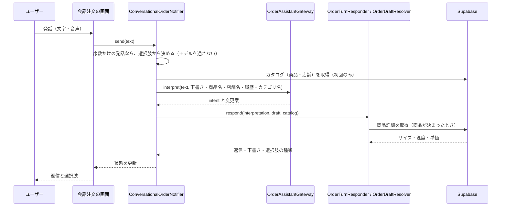
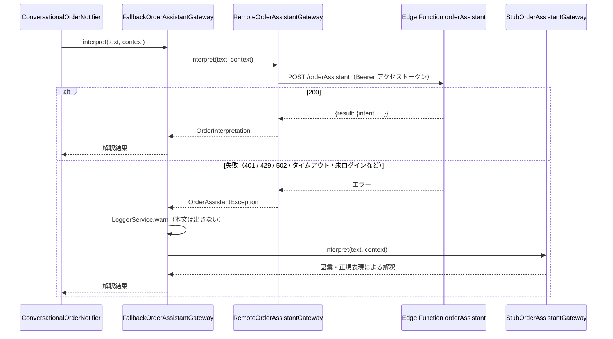
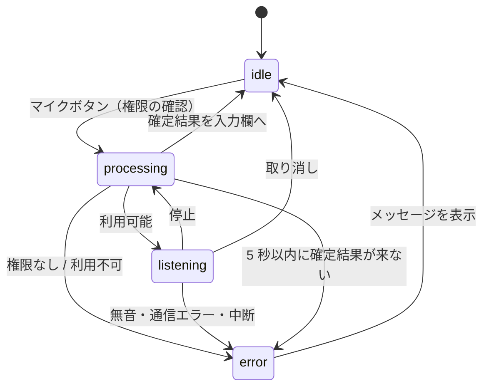
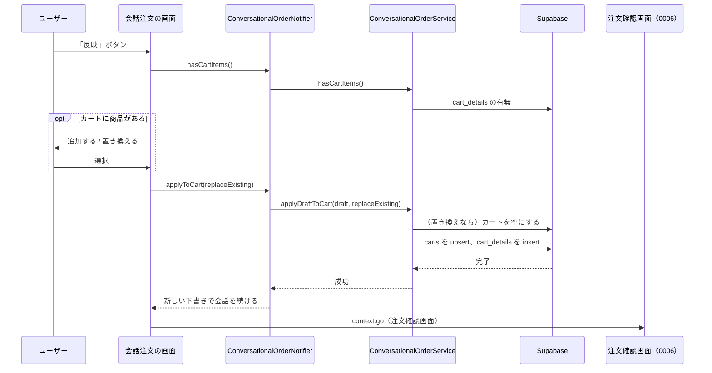

# 0008: 会話注文（チャットと音声で、注文内容を決めてカートへ反映する）

| 項目 | 内容 |
|---|---|
| ステータス | **Implemented**（画面に「試験中」と表示している） |
| 影響度ティア | **critical**（`lib/services/**`、Edge Function、CI を含む） |
| 課題・見直しの管理 | 親 Issue [#1119](https://github.com/eno-conan/flutter-starbucks-clone/issues/1119)（課題は、サブ Issue で管理する）。作成元は [#1083](https://github.com/eno-conan/flutter-starbucks-clone/issues/1083) |
| 関連設計書 | [0006: モバイルオーダー](0006-mobile-order.md)（反映先のカートと、注文確定） |
| 対象外 | 注文の確定・決済（カートへ反映したあとは、0006 の流れ）、複数商品の同時指定、カスタマイズ（ミルク・シロップなど）、ドライブスルー |

**実装との対応（実装後は、コードを正とする）:**

| 役割 | ファイル |
|---|---|
| 画面（チャット・選択肢・音声入力・カートへの反映） | `lib/screens/starbucks_user_side/mobile_order_pay/tab_order/conversational_order.dart` |
| 導線（注文確認画面の「チャットで注文する（試験中）」） | `.../tab_order/order/conversational_order_entry_section.dart` |
| 会話の状態と、1 回の発話の処理 | `lib/provider/conversational_order_provider.dart` |
| 発話の解釈（Gateway） | `lib/services/mobile_order_pay/conversational_order/order_assistant_gateway.dart` / `remote_order_assistant_gateway.dart` / `stub_order_assistant_gateway.dart` |
| 解釈結果の検証と応答 | `.../order_draft_resolver.dart` / `order_turn_responder.dart` / `ordinal_choice_resolver.dart` |
| 初期表示の選択肢 | `.../order_entry_planner.dart` |
| カタログ取得・カート反映 | `.../conversational_order_service.dart` |
| 音声入力 | `.../speech_input.dart` / `speech_to_text_input.dart` / `lib/provider/speech_input_provider.dart` |
| 発話解釈サーバー（本番） | `supabase_schema/supabase/functions/orderAssistant/`（Edge Function。Claude を呼ぶ） |
| 発話解釈サーバー（比較用） | `server/order_assistant/`（Genkit の Dart サーバー） |

## 要約（TL;DR）

- 何を実現するか: 「新宿店でアイスのカフェラテをトール、持ち帰りで」のような発話（文字・音声）から、商品・温度・サイズ・数量・店舗・利用方法を決め、注文確認画面のカートへ反映する。
- 方式: **モデルは、発話の意図（intent）と変更案の抽出だけを行う。** 照合・価格・返信の文面・カート更新は、アプリが決定的に行う。
- 安全の決め手:
    - モデルの出力は、アプリがカタログと全項目を照合する。カタログに無い ID・価格は、下書きに入らない。
    - 注文の確定は、利用者がボタンで行う。モデルは確定できない。
    - サーバーの失敗時は、アプリ内のスタブ（ルールベース）で解釈を続ける。

## 1. 背景

- モバイルオーダーは、店舗・商品・温度・サイズ・利用方法を、画面をたどって選ぶ（[0006](0006-mobile-order.md)）。
- 手順を減らすため、自然な言葉（文字・音声）で、注文内容を決められる入口を試験的に用意している。
- モデルに、価格や在庫、注文の確定を任せない。誤った内容が、そのまま注文にならないようにする。

## 2. ゴールと非ゴール

**ゴール:**

- 1 回の発話で、複数の項目をまとめて指定できる。
- 足りない項目は、選択肢つきで聞き返す。曖昧な指定は、黙って決めず、選び直してもらう。
- 直前の変更を取り消せる。選択肢は、順番（「2 番目」）でも選べる。
- モデルやサーバーが止まっても、会話注文を続けられる。
- 音声入力が使えない端末・権限の場合も、文字入力で続けられる。

**非ゴール:**

| 非ゴール | 理由 |
|---|---|
| 注文の確定・決済 | 利用者が、反映後の注文確認画面で行う |
| 複数商品の同時指定 | 1 回の下書きで選べる商品は 1 つ。反映後に続けて追加する |
| カスタマイズ（ミルク・シロップ・ショットなど）、ドライブスルー | 未対応。`unsupportedRequests` として伝え、反映しない |
| 価格の回答 | 「価格は注文確認画面で表示されます。」と固定で返す |
| 生の音声の保存 | 確定した文字列だけを扱う |

## 3. 設計

### 3.1 全体の構成と責任

| 層 | 責任 | 備考 |
|---|---|---|
| 画面 | 吹き出し・選択肢・入力欄・音声ボタン・カートへの反映ボタン | 「模擬注文：試験中の機能です。」を常時表示 |
| `ConversationalOrderNotifier` | 会話・下書き・取り消し履歴の保持。1 回の発話の処理（`_run`） | 画面を離れても会話を保持する |
| `OrderAssistantGateway` | 発話を意図と変更案に変換する | 実装は、リモート・スタブ・フォールバック |
| `OrderTurnResponder` | 意図ごとの応答（返信・下書き・選択肢の種類）を決める | モデルを使わない |
| `OrderDraftResolver` | 変更案をカタログと照合して、下書きへ適用する | 商品詳細は DB から取り直す |
| `ConversationalOrderService` | カタログ・履歴・店舗の取得、カートへの反映 | `lib/services/**` |
| 発話解釈サーバー | 意図の分類と、変更案の抽出（Claude） | 認証・レート制限・出力の検証を行う |

### 3.2 下書き（`OrderDraft`）

- 会話で決める内容は、1 つの商品の注文（下書き）にまとめる。
- 必須の項目: 商品・温度・サイズ・店舗・利用方法。数量の既定値は 1。
- `isReady`: 必須の項目がそろい、単価が決まっている状態。このときだけ、カートへ反映できる。
- 商品を差し替えると、温度・サイズ・単価は未選択に戻る（商品ごとに選べる値が違うため）。
- 商品が決まる前に受けた温度・サイズの指定は、ヒントとして保持し、商品の確定時に照合する。

### 3.3 意図（intent）

| intent | 意味 | アプリの応答 |
|---|---|---|
| `order` | 値の指定・変更 | 変更案を下書きへ適用し、次の質問を返す |
| `editField` | 項目だけを変えたい（`targetField`: 商品・温度・サイズ・数量・店舗・利用方法） | その項目の選択肢を出す |
| `addItem` | 別の商品を追加で頼みたい | 商品が下書きにあれば、下書きを変えず、反映後に追加できると案内する |
| `undo` | 直前の変更を取り消す | 取り消し履歴から 1 手戻す（最大 10 件） |
| `question` | 商品・店舗・価格の質問（`questionTopic`: menu / store / price / other） | 下書きは変えず、決まった答えと選択肢を返す |
| `proceed` | 注文確認へ進みたい | 足りない項目を伝える。確定はボタンだけ |
| `other` | 雑談・範囲外・意味不明 | 検証を通った返信だけを出し、注文の続きを聞く |

- サーバーの応答に `intent` が無いときは、アプリが `order` として扱う（旧サーバーとの互換）。

### 3.4 1 回の発話の処理

- 画面から発話（文字・音声・選択肢のタップ）が届くと、`ConversationalOrderNotifier._run` が次の順に処理する。

- 選択肢のタップは、モデルを通さず、変更案を直接作って同じ応答処理へ進む。
- 発話の処理中は、次の発話を受け付けない（`isProcessing`）。
- 取り消し・やり直しのあとに遅れて届いた応答は、世代番号で破棄する。
- 失敗したとき（例外）は、「処理に失敗しました。もう一度入力するか、通常の商品選択からご注文ください。」を返し、直前の選択肢を戻す。画面側は、オフラインならオフラインの案内を出す。

### 3.5 発話解釈サーバー（Edge Function `orderAssistant`）

- 呼び出し: `POST {ORDER_ASSISTANT_URL}/orderAssistant`。本文は `{"data": {text, draft, productNames, storeNames, history, categoryNames}}`。応答は `{"result": {intent, …}}`。
- 接続先は、アプリのビルド時の `ORDER_ASSISTANT_URL`（Secrets）で決まる。空ならスタブだけを使う。
- 認証と制限:
    - `verify_jwt = true` に加え、`Authorization` のトークンを `supabase.auth.getUser` で検証する（匿名キーのトークンを弾く）。
    - 利用者ごとに 20 回 / 分（`429` と `Retry-After: 60`）。状態は、インスタンスのメモリだけ（乱用の抑止であり、費用の上限ではない）。
    - 本文の `text` は 200 文字以内。商品名・店舗名の候補は 200 件、履歴は 6 件 × 300 文字、カテゴリは 20 件まで。
- モデル: 既定は `claude-haiku-5-5`（`ORDER_ASSISTANT_MODEL` で変更）。タイムアウト 12 秒（アプリの 15 秒より短い）。再試行しない。
- 応答の検証:
    - 構造化出力（`INTERPRETATION_SCHEMA`）で受け、`sanitizeInterpretation` で許可値・長さ・数量（1〜10）を再検証する。
    - 画面に出してよいモデルの文章は、`intent = other` の `reply` だけ。次の規則を通らなければ捨てる。

| 規則 | 内容 |
|---|---|
| R1 | 80 字以内、改行は 1 つまで |
| R2 | 日本語（かなを含み、英字は 2 割以下） |
| R3 | 価格に触れない |
| R4 | 完了・確定をうたわない |
| R5 | カタログの商品名・店舗名を含まない |
| R6 | 内部情報（項目名・プロンプト・モデル名など）を含まない |

- 失敗時の応答: 401（未認証）/ 405 / 400（入力不正）/ 429 / 500（API キー未設定）/ 502（拒否・途中切れ・不正な出力・モデルの失敗）/ 503（認証基盤の障害）。
- ログ: リクエスト ID・処理時間・トークン量・結果の種別だけ。発話本文と利用者 ID は残さない。

### 3.6 フォールバック（スタブ）

- `orderAssistantGatewayProvider` は、`ORDER_ASSISTANT_URL` が空ならスタブだけ、あれば `FallbackOrderAssistantGateway(primary: Remote, fallback: Stub)` を使う。
- リモートの失敗（未ログイン・通信エラー・200 以外・タイムアウト 15 秒）は、すべてスタブで解釈し直す。利用者には知らせない。ログには、`LoggerService.warn` で残す（発話本文は残さない）。

- スタブは、辞書と正規表現で、温度・サイズ・数量・店舗・利用方法・取り消し・項目変更・追加・質問を解釈する。雑談への返信や、辞書に無い言い回しは、モデルより弱い。

### 3.7 変更案の検証（`OrderDraftResolver.apply`）

- モデル（またはスタブ）が返す変更案は、**候補の文字列**であり、ID や価格は含まない。次の順に照合して、カタログにあるものだけを下書きへ入れる。

| 順 | 項目 | 照合 | 一致しないとき |
|---|---|---|---|
| 1 | 商品 | 商品名の部分一致 | 0 件: 「メニューに見つかりませんでした」/ 複数件: 選択肢で聞き返す（最大 8 件）/ 販売停止: 「現在ご注文いただけません」 |
| 2 | 温度・サイズ | 商品の選べる値 | 選べないサイズは、商品のサイズを選択肢にして聞き返す |
| 3 | 数量 | 1〜10 | 範囲外は、指定し直しを促す |
| 4 | 店舗 | 店名の照合 | 0 件 / 複数件は聞き返す。「駅前」「近く」などの一般語は、現在地から近い順の店舗を提案する |
| 5 | 利用方法 | 店内 / 持ち帰り | — |
| 6 | 未対応の指定 | — | 「まだ対応していないため、反映していません：…」と伝える |

- 価格は、商品詳細（DB）の単価から作る。モデルの出力の価格は使わない。
- 反映後の注文の確定は 0006 の流れで、サーバーは金額を検証しない（[#1107](https://github.com/eno-conan/flutter-starbucks-clone/issues/1107)）。
- 変更があった項目は、「内容を更新しました（…）」で伝える。

### 3.8 初期表示の選択肢

- 会話の開始時、モデルを使わず、履歴・選択中の店舗・お気に入りから、次の選択肢を出す（`OrderEntryPlanner`）。
    - 商品: 「前回と同じ」候補（履歴から作る）と、よく頼む商品。
    - 店舗: 選択中 → 前回の店舗 → お気に入り → 近い順。注文できない店舗（営業時間外、閉店 15 分前以降）は出さない。
- 取得に失敗しても、選択肢が空になるだけで、自由入力は使える。

### 3.9 音声入力

- 画面のマイクボタンで開始する。確定した文字列だけを、入力欄へ流す（途中経過は表示用）。
- `SpeechInput` は、端末の実装に依存しない境界。既定の実装は `SpeechToTextInput`（`speech_to_text`）。言語は `ja-JP`、無音 3 秒で区切り、最長 30 秒。停止後、確定結果を最大 5 秒待つ。

| 失敗の種類 | 利用者への表示 |
|---|---|
| 権限なし | 設定を開く確認ダイアログ |
| 無音 / 通信できない / 中断 / 時間切れ / 利用不可 | SnackBar で理由を伝え、文字入力を案内する |

### 3.10 カートへの反映

- 下書きが `isReady` のとき、「反映」ボタンを押せる。
- 反映の流れ:
    1. カートに商品があれば、「追加する / 置き換える」を選んでもらう（黙って上書きしない）。
    2. `applyDraftToCart`: 置き換えならカートを空にする → `carts` を upsert（店舗・利用方法）→ `cart_details` に 1 行追加。
    3. 成功したら、注文確認画面（モバイルオーダーのトップ）へ戻る。
- 反映後の会話は残し、店舗と利用方法を引き継いだ新しい下書きから、続けて別の商品を追加できる。取り消し履歴は空にする（反映済みの変更は戻せない）。
- 注文が完了したとき、別の利用者に替わったとき、「やり直す」を押したとき、会話は破棄される。

### 3.11 エラーの表示

| 場面 | 表示 |
|---|---|
| 発話の処理に失敗 | 吹き出しで「処理に失敗しました。…」。オフラインならオフラインのダイアログ |
| カート情報の取得に失敗 | 「カート情報の取得に失敗しました」 |
| カートへの反映に失敗 | 「注文内容のカート反映に失敗しました」 |
| 音声入力の失敗 | 3.9 の表 |
| オフラインで導線を押した | オフラインのダイアログ（画面へ遷移しない） |

## 4. 検討した代替案

| 案 | 採否 | 理由 |
|---|---|---|
| モデルに、カタログの ID・価格まで返させる | 不採用 | 誤り・改ざんが、そのまま注文に入る。アプリで再照合する |
| モデルに、返信の文章をすべて作らせる | 不採用 | 価格・完了の誤案内を防げない。`other` の返信だけを、規則で検証して許す |
| クライアントから、Anthropic API を直接呼ぶ | 不採用 | API キーを端末に置けない。認証・レート制限もサーバーで行う |
| Genkit の Dart サーバー（Cloud Run） | 比較用に残置 | intent と reply を返さず、`history` / `categoryNames` も扱わない。契約は同期していない |
| スタブ（ルールベース）だけ | フォールバックとして採用 | モデルが止まっても、注文を続けられる |

## 5. 横断的関心事

| 観点 | 検討内容 |
|---|---|
| セキュリティ | 認証は `getUser` で検証し、本文の利用者 ID は使わない。プロンプトインジェクションは、出力を許可値・カタログで再照合し、`reply` を規則で検証して抑える。注文の確定は、モデルにできない |
| プライバシー | 発話本文は、アプリのログにもサーバーのログにも残さない。ただし、発話・会話履歴・商品名・店舗名は、Anthropic API へ送られる |
| 費用 | 利用者ごとの回数制限は、インスタンスのメモリだけ。費用の上限は、Anthropic Console の支出上限で別に設定する |
| 可用性 | 失敗はスタブに切り替える。ただし、切り替わったことは利用者にも運用にも通知されない（ログのみ） |
| 互換性 | `ORDER_ASSISTANT_URL` が、Edge Function でも Dart サーバーでも動くように、同じ契約（Genkit 形式）で通信する |
| 可観測性 | サーバーは、リクエスト ID・モデル・処理時間・トークン量・結果を構造化ログに出す。アプリは `intent` の種類だけを残す |
| テスト | アプリ側は、Provider・Resolver・Responder・Planner・Gateway・音声入力・画面の単体 / Widget テストがある。Edge Function のテストは `npm run oa:test`（`supabase_schema/`）で動かすが、CI のワークフローには見当たらない（`deploy-edge-functions.yml` は `deno check` のみ）。評価（`oa:eval`）は手動 |
| 移行 | 該当なし（新機能。「試験中」の表示を外す基準は、決まっていない） |

## 6. 参考

- [0006: モバイルオーダー](0006-mobile-order.md)
- `supabase_schema/supabase/functions/README.md`（`orderAssistant` の節: 契約・評価・環境変数）
- `.github/workflows/deploy-edge-functions.yml`、`deploy-order-assistant.yml`
