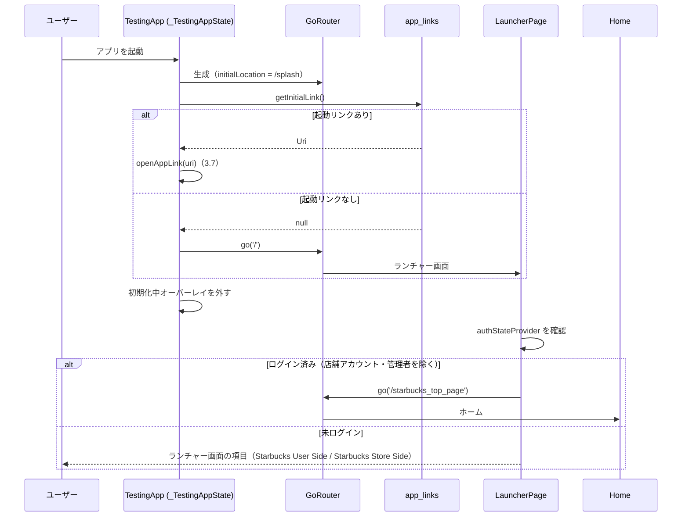
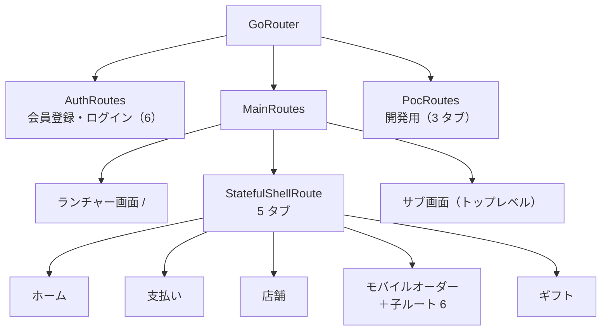
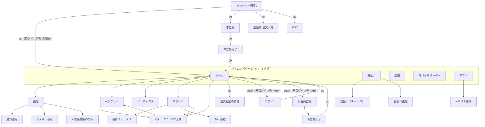
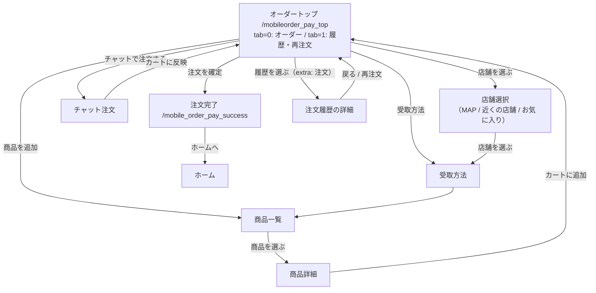
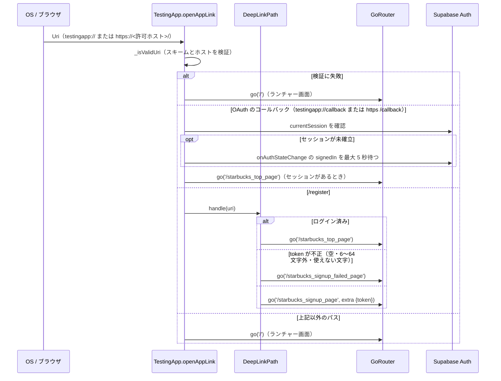

# 0009: 画面遷移（ルート構成・タブ・ディープリンク・遷移の規約）

| 項目 | 内容 |
|---|---|
| ステータス | **Implemented** |
| 影響度ティア | **standard**（`lib/**` のみ。ルート定義の変更は、画面の到達性に影響する） |
| 課題・見直しの管理 | 親 Issue [#1126](https://github.com/eno-conan/flutter-starbucks-clone/issues/1126)（課題は、サブ Issue で管理する）。作成元は [#1085](https://github.com/eno-conan/flutter-starbucks-clone/issues/1085) |
| 関連設計書 | [0004: 会員登録](0004-member-registration.md)（`/register` のディープリンク）/ [0005: ログインとセッション](0005-login-and-session.md)（OAuth のコールバック）/ [0006: モバイルオーダー](0006-mobile-order.md) |
| 置き換えた文書 | `starbucks_user_side/navigation-flow.md`（削除した。パスの表記が実装と食い違っていたため） |
| 対象外 | 各画面の中身、画面内のタブ・ダイアログ・ボトムシートの操作 |

**実装との対応（実装後は、コードを正とする）:**

| 役割 | ファイル |
|---|---|
| `GoRouter` の生成、起動時の遷移、ディープリンクの受け口 | `lib/app/app.dart` |
| ルートの集約 | `lib/config/app_router.dart`（`AuthRoutes` + `MainRoutes` + `PocRoutes`） |
| 認証関連のルート | `lib/config/routes/auth_routes.dart` |
| メイン画面・タブ・サブ画面のルート | `lib/config/routes/main_routes.dart` |
| 開発用（POC）のルート | `lib/config/routes/poc_routes.dart` |
| ディープリンクのパスと処理 | `lib/config/deep_link_paths.dart` |
| ボトムナビゲーションのシェル | `lib/app/app_shell.dart`（`ScaffoldWithCustomNavBar`） |
| 入口のランチャー画面 | `lib/app/launcher.dart` / `lib/constants/launcher_items.dart` |
| ルートのパス文字列 | 各画面クラスの `static String routeName` |

## 要約（TL;DR）

- ルートは `go_router` で定義し、`GoRouter` は `lib/app/app.dart` で 1 つだけ作る。
- 入口は **ランチャー画面**（`/`）。ログイン済みなら、ホームへ自動で進む。
- メイン画面は、5 つのタブ（`StatefulShellRoute.indexedStack`）。モバイルオーダーのタブだけ、子ルートを持つ。
- **パスの文字列は、画面名と一致しない**（例: ホームは `/starbucks_top_page`）。パスは、必ず `routeName` から組み立てる。
- ルーターには、ログインの確認（`redirect`）が無い。未ログインの扱いは、画面ごとに決める。

## 1. 背景

- 画面遷移の文書（`navigation-flow.md`）は、`/home`・`/pay`・`/pre-signup` のようなパスを載せていたが、実装には無い。実際のパスは `/starbucks_top_page` のような文字列になっている。
- ルートの追加やパスの変更のたびに、画面の到達性が変わる。変更前に影響を確認できるよう、現状の構造を 1 か所にまとめる。

## 2. ゴールと非ゴール

**ゴール:**

- 起動から、各画面へ至る流れを、図で示す。
- ルートの一覧（パス・画面・遷移アニメーション・受け渡す値）を、実装と一致させる。
- 遷移の規約（`go` と `push`、子ルートの組み立て方、値の受け渡し）を示す。

**非ゴール:**

| 非ゴール | 理由 |
|---|---|
| 各画面の仕様 | `docs/starbucks_user_side/` と、機能別の設計書で扱う |
| ルートのパスの命名変更 | 現状の記録が目的。変更は、別の作業 |
| ルーターでのログイン確認の導入 | 現状は無い（3.9）。見直しは Issue で管理する |

## 3. 設計

### 3.1 ルーターの構成

- `GoRouter` は `lib/app/app.dart` の `_TestingAppState` で、1 つだけ作る。
- 設定の要点:

| 項目 | 値 |
|---|---|
| `initialLocation` | `/splash`（`SplashScreen.routeName`） |
| `routes` | `AppRouter.routes`（`AuthRoutes` → `MainRoutes` → `PocRoutes`） |
| `redirect` | デバッグ時にログを出すだけで、常に `null`（リダイレクトしない） |
| `errorBuilder` | 警告ログを残し、`ErrorScreen`（「画面を表示できませんでした」）を出す。戻るボタンは、ランチャー画面（`/`）へ |

- `/splash` は、`MainRoutes` に登録している（`SplashScreen` を返す）。起動のたびに「ルートが見つかりません」の警告が出ることはない。

### 3.2 起動から最初の画面まで

- 起動直後は、初期化中のオーバーレイ（白地 + ローディング）が画面全体を覆う。

- ランチャー画面の項目は、`launcherItems`（2 件）。1 回タップすると、そのパスへ `context.go` する。
    - 配置: 画面全体を斜めの線で上下に分ける（上が利用者側の薄い緑、下が店舗側の濃い緑）。横並びのグリッドにはしない（`lib/app/launcher_layout.dart`）。
    - タップした側が広がる動きを、遷移前の演出にする。広がっている間の連打や、別の領域のタップは無視する。
    - 押せることは、各領域の小さな矢印の丸で示す（文字は使わない）。
    - 「視差効果を減らす」設定のときは、動かさずに遷移する。
    - 理由: 項目が 2 つだけになり、グリッドでは横に 2 つ並ぶだけで単調なため。2 回タップする方式は面倒なので、1 回で遷移する。
    - 例外: 未ログインで「店舗」（`StoreSideOrderList.routeName`）を押したときは、店舗側の注文一覧を挟まず、ログイン画面（クエリ `redirect` に店舗側の注文一覧のパス）へ `context.push` する。`push` なので、ログイン画面で戻ると、ランチャー画面に戻る（会員側と店舗側の操作を続けて行うため）。ログイン済みは、これまでどおり注文一覧へ `go` する。

| 項目 | 遷移先 |
|---|---|
| Starbucks User Side | ホーム |
| Starbucks Store Side | 店舗側の注文一覧 |

- SignUp と poc は、ランチャー画面の項目から外した（2026-11-06。しばらく使っていないため）。
    - 外したのは項目だけで、ルート（`/starbucks_signup_page`、`/poc-home`）は残っている。

- 店舗アカウント（`store_profiles` に紐づくユーザー）は、ログイン済みでも、ホームへ自動で進まず、ランチャー画面に留まる。
    - 判定は、`store_profiles` に自分の行があるかで行う（`isStoreAccountProvider`）。メールアドレスの形には依存しない。
    - 店舗を増やすときは、アカウントと `store_profiles` の行を足すだけでよい。
    - 判定に失敗したときは、利用者側として扱い、ホームへ進む。
    - 理由: 店舗側の画面から戻る操作（`/` へ戻る）で、店舗アカウントを利用者側のホームへ飛ばさないため。
- 店舗アカウントは、利用者側へ入れない。
    - ランチャー画面: 店舗アカウントには、店舗側の項目（Starbucks Store Side）だけを出す（`storeSideLauncherItems`）。利用者側の項目（Starbucks User Side）は出さない。店舗側の 1 項目だけを、画面いっぱいに出す。
    - ボトムナビのシェル（利用者側の 5 タブ）: ルート定義（`main_routes.dart` の `StatefulShellRoute`）で、`StoreAccountGuard` が包み、店舗アカウントなら、店舗側の注文一覧へ `go` する。ログイン画面や OAuth・ディープリンクの戻りで、ホームへ進んでも、ここで店舗側へ戻される。
    - `StoreAccountGuard` は、店舗かどうかの判定が終わるまでは、利用者側の画面をそのまま出す（利用者の起動を遅らせないため）。店舗アカウントでは、判定が終わるまでの短い間、利用者側の画面が見える。
    - 判定に失敗したときは、利用者側として扱う。店舗アカウントでも、判定に失敗すると、利用者側に入れてしまう（画面の出し分けであり、データは RLS と RPC が守る）。
- 管理者（`app_metadata.role = 'store_admin'` のユーザー）も、店舗アカウントと同じく利用者側へ入れない。`StoreAccountGuard` が店舗側の注文一覧へ戻す。
    - 管理者は `store_profiles` の行を持たないため、店舗かどうかの判定（`store_profiles` の行）と、管理者かどうかの判定（`app_metadata.role`）は別々に行う。

### 3.3 ルートの一覧

- パスは、各画面の `routeName`。子ルートは、親のパスに続けて組み立てる。
- 全体の構造:

??? info "ルートの一覧（認証・メイン・タブ・サブ画面、28 件）"
    | パス | 画面 | 遷移アニメーション | 受け渡す値 |
    |---|---|---|---|
    | `/starbucks_pre_signup_page` | 仮会員登録 `PreSignUp` | 下から上 | なし |
    | `/starbucks_pre_signup_completed_page` | 仮登録完了 | 標準 | extra `{email}` |
    | `/starbucks_signup_page` | 本登録 `SignUp` | 標準 | extra `{token}`（ディープリンクから） |
    | `/starbucks_signup_failed_page` | 登録失敗 | 標準 | なし |
    | `/starbucks_signup_completion_page` | 本登録完了 | 標準 | なし |
    | `/starbucks_login_page` | ログイン `LoginPage` | 標準 | query `redirect`（任意。ログイン後の遷移先。許可するのは `/starbucks_store_side_home` だけで、他は無視してホームへ進む。許可されたときは Google ログインを出さない） |
    | `/splash` | 初期化中の画面 `SplashScreen`（初期ルート） | 標準 | なし |
    | `/` | ランチャー画面`LauncherPage` | 標準 | extra `{showSnackBar, stayOnLauncher}`（いずれも任意。`stayOnLauncher` が `true` のときは、ログイン済みの一般ユーザーも、ホームへ進まずランチャー画面に留める。利用者側のホーム・POC・店舗側の注文一覧の「戻る」が付ける） |
    | `/starbucks_top_page` | ホーム（タブ 1） | シェル | なし |
    | `/starbucks_pay_top_page` | 支払い（タブ 2） | シェル | なし |
    | `/starbucks_map_top_page` | 店舗 `Store`（タブ 3） | シェル | なし |
    | `/mobileorder_pay_top` | モバイルオーダー（タブ 4） | シェル | query `tab`（0: オーダー / 1: 履歴・再注文） |
    | `/starbucks_e_gift_top` | ギフト（タブ 5） | シェル | なし |
    | `/starbucks_setting_page` | 設定 | 標準 | なし |
    | `/starbucks_eticket_top` | e チケット | 標準 | なし |
    | `/starbucks_inbox` | インボックス | 標準 | なし |
    | `/starbucks_reward_exchange_list_page` | スターリワードに交換 | 標準 | extra なし（保有スターは画面が自分で取得する） |
    | `starbucks_eticket_available_use_in_store` | e チケットの店内利用 | 右から左 | なし（先頭の `/` が無く、呼び出し元も見当たらない） |
    | `/starbucks_rewards_page` | リワード | 右から左 | なし |
    | `/under_development` | 未実装機能の案内 | 右から左 | query `feature`（機能名。サニタイズする） |
    | `/pay_payment_page` | 支払い（チャージ） `PayPayment` | 標準 | なし |
    | `/pay_setting_page` | 支払い設定 | 標準 | なし |
    | `/mobile_order_pay_success` | 注文完了 | 標準 | extra `{store: MobileOrderCompletion}`（必須） |
    | `/starbucks_gift_egift_top` | e ギフト作成 | 右から左 | なし |
    | `/starbucks_store_side_home` | 店舗側の注文一覧 | 標準 | なし |
    | `/starbucks_store_side_order_detail` | 店舗側の注文の詳細（一覧のカードから `push<bool>`。更新に成功すると `true` で戻る） | 標準 | extra `StoreOrder`（必須） |
    | `/starbucks_store_side_setting` | 店舗側の設定（パスキーとログアウト。注文一覧の歯車から `push`） | 標準 | なし |
    | `/starbucks_store_side_setting/passkey` | 店舗側のパスキー設定（利用者側の `PasskeySetting` を再利用。設定から `push`） | 下から上 | なし |

??? info "子ルートの一覧（親のパスに続けて組み立てる、10 件）"
    | 親 | 子の `routeName` | 画面 | 遷移アニメーション | 受け渡す値 |
    |---|---|---|---|---|
    | `/mobileorder_pay_top` | `/store_select_top` | 店舗選択 | 標準 | なし |
    | `/mobileorder_pay_top` | `/mobile_order_pickup_method` | 受取方法 | 標準 | なし |
    | `/mobileorder_pay_top` | `/mobile_order_products` | 商品一覧 | 標準 | なし |
    | `/mobileorder_pay_top` | `/mobile_order_product_select` | 商品詳細 | 標準 | なし（選択は Provider が保持する） |
    | `/mobileorder_pay_top` | `/mobile_order_conversation` | チャット注文（[0008](0008-conversational-order.md)） | 標準 | なし |
    | `/mobileorder_pay_top` | `/starbucks_mobileorder_history_detail` | 注文履歴の詳細 | 標準 | extra `MobileOrderHistory`（必須） |
    | `/starbucks_setting_page` | `setting_page_switch_notify_setting` | 通知設定 | 下から上 | なし |
    | `/starbucks_setting_page` | `setting_page_passkey_setting` | パスキー設定 | 下から上 | なし |
    | `/starbucks_rewards_page` | `starbucks_rewards_member_status_page` | 会員ステータス | 下から上 | なし |
    | `/starbucks_rewards_page` | `starbucks_star_reward_expiration_date_retained_stars_histories` | Star 獲得・交換・失効履歴 | 標準 | なし |

??? info "開発用（POC）のルート（9 件）"
    - 3 タブのシェル（`ScaffoldWithNavBar`）: `/poc-home`、`/search`、`/profile`（query `tab`）。
    - `/profile` の子: `tab1/widget-b`（子: `widget-c`、query `data`）、`tab2/widget-e`（子: `widget-f`、`widget-g`（子: `widget-h`、query `data`））。
    - ランチャー画面の「poc」から入る。ランチャー画面の項目は、リリースビルドでも表示される（課題）。

### 3.4 メイン画面の遷移図（ユーザー側）

- 実線は `context.push`（戻れる）、`go` は置き換え。図では、矢印のラベルに `go` と書いたものだけが `go`。

- 注文の完了画面（`/mobile_order_pay_success`）は、注文確認画面から `go` で入り、「ホームへ」で `go(ホーム)`。
- 未ログインのとき、ホームには、ログイン・仮会員登録へ進む FAB（`AuthStateFab`）が出る。

### 3.5 ボトムナビゲーション（シェル）

- 5 つのタブは、`StatefulShellRoute.indexedStack` の枝。タブを切り替えても、各タブの画面の状態は保たれる。

| 番号 | ラベル | ルート |
|---|---|---|
| 0 | Home | `/starbucks_top_page` |
| 1 | Pay | `/starbucks_pay_top_page` |
| 2 | Stores | `/starbucks_map_top_page` |
| 3 | Order | `/mobileorder_pay_top` |
| 4 | Gift | `/starbucks_e_gift_top` |

- タブのタップ（`_handleTabTap`）:
    - `goBranch(index, initialLocation: 現在のタブと同じか)` で切り替える。同じタブを押すと、そのタブの最初の画面に戻る。
    - 続けて、位置情報（`locationProvider`）と店舗（`storeProvider`）を更新する。
    - 番号 0（Home）と 2（Stores）では、オフラインならオフラインのダイアログを出す。
    - Firebase Performance で、タブ切り替えの時間を計測する。
- システムの「戻る」は、`PopScope(canPop: false)` で止め、ランチャー画面（`/`）へ `go` する。ホームタブからの「戻る」は、`stayOnLauncher` を付けて `go` する（一般ユーザーがホームへ戻されず、ランチャー画面に着くため）。タブの中の画面階層は、戻らない。

### 3.6 モバイルオーダーの子ルート

- 注文の流れは、`/mobileorder_pay_top` の子ルートを、`context.go('${親}${子}')` で進む。`go` のため、戻る操作は画面側の矢印アイコン（`go`）で行う。

- 店舗選択の 3 つのタブ（MAP・近くの店舗・お気に入り）は、画面内のタブで、ルートではない。検索（`StoreSearch`）も同じ。
- 注文履歴の詳細へは、`extra` に `MobileOrderHistory` を渡す（ホームのモバイルオーダー欄からも同じ）。

### 3.7 ディープリンク

- 入口は `openAppLink(uri)`。起動時のリンク（`getInitialLink`）と、起動後のリンク（`uriLinkStream`）の両方が通る。

- 許可するホストは、`AppConstants.firebaseHostingDomain` の 1 つだけ。
- 登録済みのディープリンクのパスは `/register` だけ（`DeepLinkPath`）。追加するときは、enum に値を足し、`handle` に分岐を足す。

### 3.8 値の受け渡し

| 方法 | 使う場面 | 注意 |
|---|---|---|
| クエリパラメータ | タブの番号（`tab`）、案内する機能名（`feature`）、POC の `data` | 読むときは、`SanitizationUtils.sanitizeQueryParameter` を通す |
| `extra` | 注文履歴、完了画面の店舗、仮登録のメール、本登録のトークン | `extra` は、リンクでの直接遷移などでは渡されない。必須の画面（注文履歴の詳細・注文完了）は、`extra` が無い・型が違うと、警告ログを出して `ErrorScreen`（ホームへ戻るボタン付き）を返す |
| Provider | 商品詳細の選択、カート、下書き | 画面を作り直しても、値は残る |

- `extra` を必須として読む画面: 注文履歴の詳細（`MobileOrderHistory`）、注文完了（`extra['store']` の `MobileOrderCompletion`）。型の確認は `is` で行い、合わなければ `ErrorScreen` を返す（`MainRoutes._invalidExtraScreen`）。
- `extra` を任意として読む画面: ランチャー画面（`showSnackBar` と `stayOnLauncher` が無ければ、どちらも `false`）。

### 3.9 遷移の規約

- 使い分け（`lib/` 内の呼び出しの傾向）:

| 操作 | 使う | 理由 |
|---|---|---|
| タブ内の流れ（モバイルオーダー、登録、ログイン後のホーム） | `go` | 履歴を積まず、行き先を明示する |
| ホームから開く補助画面（設定・e チケット・インボックス・リワード・交換）、支払いのサブ画面、ギフト | `push` | 戻る操作で、元の画面へ戻れる |

- 子ルートのパスは、`'${親.routeName}${子.routeName}'`（子が `/` で始まるとき）または `'${親.routeName}/${子.routeName}'`（子が `/` で始まらないとき）で組み立てる。パスを文字列で直書きしない。
- 遷移アニメーションは、`MainRoutes` / `AuthRoutes` の `_buildPageWithAnimationFrom…`（下から上、右から左）。指定が無い画面は、標準。

### 3.10 ログインの確認

- ルーターの `redirect` は常に `null` で、ログインの有無でルートを制限しない。
- 画面ごとの扱い:

| 画面 | 未ログインのとき |
|---|---|
| ランチャー画面 | 項目の一覧を出す。ログイン済みなら、ホームへ進む |
| ホーム | 表示できる。ログイン・仮会員登録への FAB を出す |
| 支払い・e チケット・モバイルオーダーなど | 各画面が、認証の状態に応じて表示を決める |

### 3.11 エラー時の挙動

| 場面 | 挙動 |
|---|---|
| 未登録のパスへ遷移 | 警告ログ + `ErrorScreen`（戻るボタンでランチャー画面へ） |
| 無効なディープリンク | 黙ってランチャー画面へ |

## 4. 検討した代替案

- 検討の記録は、見つからなかった。
- 現状のルート構成は、`go_router` の `StatefulShellRoute.indexedStack` に、タブごとの状態保持を任せる形になっている。

## 5. 横断的関心事

| 観点 | 検討内容 |
|---|---|
| セキュリティ | ディープリンクは、スキームとホストを検証する。トークンとクエリは、サニタイズする。ルーターには、ログインの確認が無い（3.10） |
| 互換性 | パス文字列は、メールのリンクと OS の設定に関わる。変更するときは、`/register` のリンクを確認する（[0004](0004-member-registration.md)） |
| 性能 | タブの状態を保持し、切り替えを速くする。タブ切り替えのたびに、位置情報と店舗を更新する |
| 可観測性 | 未登録のパスは警告ログに残す。Firebase Performance で、タブ切り替えとシェルの構築を計測する |
| テスト | ルート定義（`AppRouter`）を検証するテストは、見当たらない。画面の Widget テストは、`test/helpers/tier1_screen.dart` で組み立てた小さなルーターを使う |
| 移行 | 該当なし（現状の記録） |

## 6. 参考

- [0004: 会員登録](0004-member-registration.md)
- [0005: ログインとセッション](0005-login-and-session.md)
- [0006: モバイルオーダー](0006-mobile-order.md)
- [0008: 会話注文](0008-conversational-order.md)
