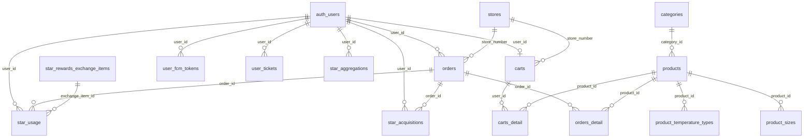
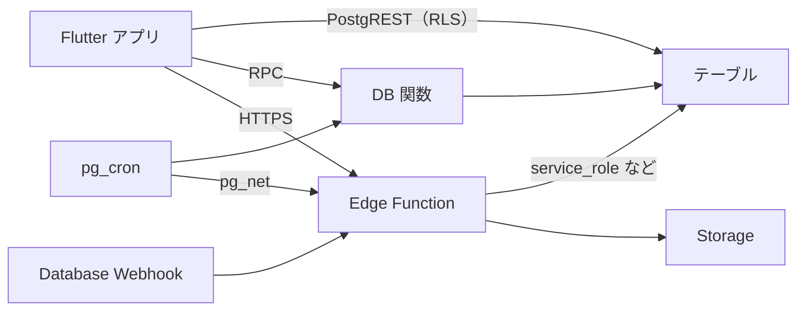
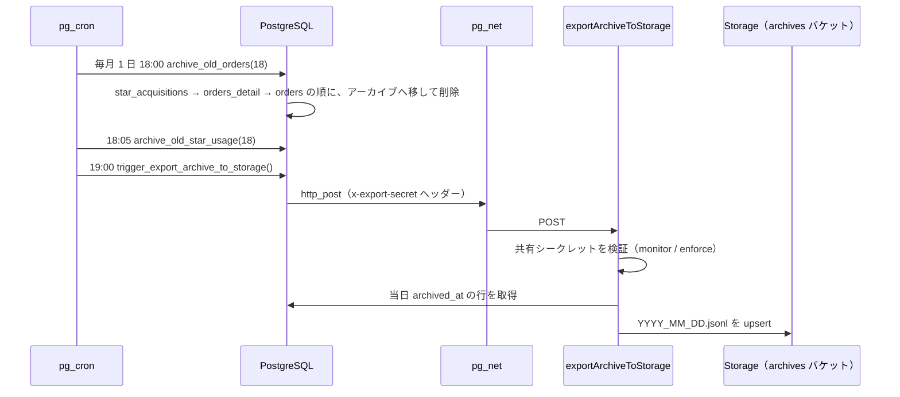
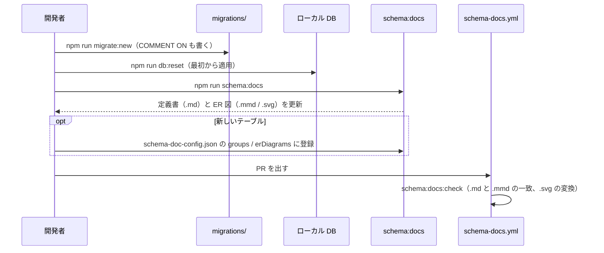

# 0010: データベース設計（構成・アクセス経路・運用・文書の置き場）

| 項目 | 内容 |
|---|---|
| ステータス | **Implemented** |
| 影響度ティア | **critical**（`supabase_schema/**`、RPC、cron を含む） |
| 課題・見直しの管理 | 親 Issue [#1133](https://github.com/eno-conan/flutter-starbucks-clone/issues/1133)（課題は、サブ Issue で管理する）。作成元は [#1086](https://github.com/eno-conan/flutter-starbucks-clone/issues/1086) |
| 関連設計書 | [0003: Push 通知](0003-push-notification.md) / [0004: 会員登録](0004-member-registration.md) / [0006: モバイルオーダー](0006-mobile-order.md) / [0007: スター・リワード](0007-star-rewards.md) |
| 対象外 | 個々のテーブル・カラムの定義（自動生成物が正）、各機能の処理の流れ（機能別の設計書） |

**実装との対応（実装後は、コードを正とする）:**

| 役割 | 場所 |
|---|---|
| スキーマの正（テーブル・制約・RLS・関数・トリガー） | `supabase_schema/supabase/migrations/`（116 ファイル） |
| ローカル / Edge Function の設定 | `supabase_schema/supabase/config.toml` |
| 定期ジョブ（pg_cron）の定義 | `supabase_schema/cron/` |
| DB のテスト（pgTAP） | `supabase_schema/supabase/tests/database/` |
| 定義書・ER 図の生成 | `supabase_schema/scripts/generate-schema-docs.js` / `render-er-diagrams.js` / `schema-doc-config.json` |
| 生成物 | `supabase_schema/supabase/supabase_table_definitions.md` / `entity_relationship/*.mmd`・`*.svg` |
| アプリ側の RPC 名・テーブル名の定数 | `lib/constants/supabase_rpcs.dart` / `lib/constants/supabase_tables.dart` |

## 要約（TL;DR）

- 何を実現するか: Supabase（PostgreSQL）に、会員・商品・注文・スター・e チケット・店舗のデータを持つ。35 テーブルとマテリアライズドビュー 1 件。
- アクセスは 3 経路: ①アプリから PostgREST で直接（RLS で本人の行に限る）②RPC（複数テーブルをまたぐ処理）③Edge Function / Database Webhook / cron（サーバー側の処理）。
- **文書の正は、種類で分ける**: テーブル定義は自動生成物、処理の流れは機能別の設計書、運用手順は各ガイド。
- 文書は、いまの場所（`supabase_schema/supabase/`）に置いたままにする（3.1）。

## 1. 背景

- DB に関する文書が、`docs/`（サイトの元）と `supabase_schema/supabase/` に分かれていた。
- 文書ごとに「正の所在」「手で編集してよいか」が違うため、混ぜて 1 か所に移すと、生成物の手編集や、古い手順の放置につながる。
- 設計レビュー（Issue #938）で決めた方針が、マイグレーションのコメントにだけ残っている。

## 2. ゴールと非ゴール

**ゴール:**

- DB の構成と、アクセスの経路を、1 枚で把握できる。
- 文書ごとの「正の所在」と「手で編集してよいか」を決める。
- スキーマ変更の手順と、検証の方法を示す。

**非ゴール:**

| 非ゴール | 理由 |
|---|---|
| テーブル・カラムの定義を、この文書に書き写す | 自動生成物（`supabase_table_definitions.md`）が正。写すと古くなる |
| 各機能の処理の流れ | 機能別の設計書（0003〜0008）で扱う |
| パーティショニングの導入 | 参考資料のみで、導入していない（4） |

## 3. 設計

### 3.1 文書の置き場と、正の所在

- 方針: **文書は、生成元・運用対象の近く（`supabase_schema/supabase/`）に置いたままにする。** サイトの `docs/` へは移さない。この設計書が、入口として、各文書へのリンクを持つ。
- 理由:
    - テーブル定義と ER 図は、`npm run schema:docs` が上書きし、CI（`schema-docs.yml`）が一致を確認する。`docs/` へ移すと、生成先と CI の設定を変える必要があり、得るものが少ない。
    - 運用ガイドは、マイグレーションと cron のファイル名を参照しており、それらと同じ場所にあるほうが、変更時に気づきやすい。

| 文書 | 正の所在 | 手で編集 | 扱い |
|---|---|---|---|
| [`supabase_table_definitions.md`](https://github.com/eno-conan/flutter-starbucks-clone/blob/main/supabase_schema/supabase/supabase_table_definitions.md) | 実スキーマ（マイグレーション + `COMMENT ON`） | 不可（「主な更新点」と冒頭の説明だけ可） | 設計書にしない。リンクで参照する |
| [`entity_relationship/`](https://github.com/eno-conan/flutter-starbucks-clone/tree/main/supabase_schema/supabase/entity_relationship)（`.mmd` / `.svg` / `ER_README.md`） | 実スキーマ + `schema-doc-config.json` | 不可（`ER_README.md` は可） | 同上 |
| [`data_archive_guide.md`](https://github.com/eno-conan/flutter-starbucks-clone/blob/main/supabase_schema/supabase/data_archive_guide.md) | 運用手順（人が書く） | 可 | 運用ガイド。構成は 3.6 に要約 |
| [`partitioning_archiving_guide.md`](https://github.com/eno-conan/flutter-starbucks-clone/blob/main/supabase_schema/supabase/partitioning_archiving_guide.md) | 参考資料（人が書く） | 可 | 前半は未導入の計画（4）。後半（2-C）は Storage エクスポートの実装済みの手順 |
| [`mv_products_catalog_guide.md`](https://github.com/eno-conan/flutter-starbucks-clone/blob/main/supabase_schema/supabase/mv_products_catalog_guide.md) | 運用手順（人が書く） | 可 | 運用ガイド |
| [`functions/README.md`](https://github.com/eno-conan/flutter-starbucks-clone/blob/main/supabase_schema/supabase/functions/README.md) | Edge Function の仕様・運用（人が書く） | 可 | 先頭の「最終更新」が古い（2026-02-23。内容は `orderAssistant` など新しい関数まで含む） |

### 3.2 テーブルの構成

- 35 テーブル + マテリアライズドビュー `mv_products_catalog`。機能ごとのグループは次のとおり（生成物の「テーブル概要」と同じ分類）。

| グループ | テーブル | 関連する設計書 |
|---|---|---|
| ユーザー管理 | `user_profile_details`、`user_mail_settings`、`user_nickname`、`user_fcm_tokens`、`pre_signup_users` | [0003](0003-push-notification.md)、[0004](0004-member-registration.md) |
| 商品・カテゴリ | `products`、`categories`、`sizes`、`temperature_types`、`product_sizes`、`product_temperature_types`（+ `mv_products_catalog`） | [0006](0006-mobile-order.md) |
| 注文・カート | `orders`、`orders_detail`、`carts`、`carts_detail` | [0006](0006-mobile-order.md) |
| 店舗 | `stores`、`store_profiles`、`prefectures` | [0006](0006-mobile-order.md) |
| スタッフ・シフト | `staff`、`staff_schedules` | — |
| スター・リワード | `star_acquisitions`、`star_aggregations`、`star_usage`、`star_rewards_exchange_items` | [0007](0007-star-rewards.md) |
| e チケット | `e_tickets_promotions`、`e_tickets_special_offers`、`user_tickets` | — |
| 決済・カード | `cards` | — |
| キャンペーン | `campaign_settings` | — |
| アーカイブ | `orders_archive`、`orders_detail_archive`、`star_acquisitions_archive`、`star_usage_archive` | 3.6 |
| その他 | `email_check_rate_limits`、`poc_realtime` | [0004](0004-member-registration.md) |

- 主な関連（利用者 `auth.users` を中心にした全体像。属性は、生成物の ER 図を見る）:

- お気に入り店舗は、サーバーのテーブルではなく、**端末のローカル DB（SQLite の `favorite_stores`）** に持つ。端末をまたいでは共有されない。サーバー側の `favorite_stores` は削除済み。

### 3.3 設計の原則（Issue #938 の設計レビューで決めたこと）

| 原則 | 内容 | 反映した場所 |
|---|---|---|
| 整合性は DB が守る | 重複インデックスの削除、金額・数量・期間・座標の CHECK、型とフラグの統一（例: `orders.provided_status` を enum に） | `20260820*` のマイグレーション |
| 履歴はスナップショット | 注文明細は、注文時点の商品名・単価を持つ。マスタの改定で過去が変わらない | `orders_detail`（`product_name`、`unit_price_without_tax`） |
| 退会時の扱い | 個人設定・保有物は CASCADE で消す。取引履歴は行を残して `user_id` を NULL にする。集計は CASCADE（再計算できるため） | `20260820100003_step3_user_deletion_policy.sql` |
| RLS は全テーブルで有効 | 本人の行だけ読み書きできる。マスタは参照のみ | マイグレーション |
| GRANT は明示する | Data API の自動 GRANT が無くなるため、明示的に付ける | `20261020120000_add_explicit_grants_for_data_api.sql` |
| 論理名は `COMMENT ON` | 新しいカラム・テーブルは、同じマイグレーションに `COMMENT ON` を書く（無いと生成が失敗する） | `.claude/rules/supabase/update-db-schema.md` |

### 3.4 アクセスの経路

| 経路 | 使う場面 | 認可 |
|---|---|---|
| PostgREST（アプリから直接） | 1 テーブルの読み書き（プロフィール、FCM トークン、仮登録など） | RLS（`auth.uid() = user_id`）。仮登録は未ログインでも INSERT できる（[0004](0004-member-registration.md)） |
| RPC | 複数テーブルをまたぐ処理、集計、トランザクションが必要な処理 | 関数の権限（`SECURITY INVOKER` が既定）と RLS。呼び出し側のロールに付けた GRANT |
| Edge Function | 外部サービス（FCM、メール、Claude）、未ログインの確認、Storage | `config.toml` の `verify_jwt` と、関数側の検証 |
| Database Webhook | テーブルの変更を契機にした Edge Function の呼び出し（`orders` の UPDATE → `pushNotify`、`pre_signup_users` の INSERT → `sendMailRegisterUser`） | Edge Function 側の `verify_jwt` に加え、関数の入口で、Bearer が関数の service_role キーと完全一致するかを検証する（公開の anon キーでは呼べない。Issue #1194）。Webhook 相当のトリガー（`invoke_edge_function_webhook`）はマイグレーションで定義し、URL と `service_role` キーは Vault から読む。設定内容は [`functions/README.md`](https://github.com/eno-conan/flutter-starbucks-clone/blob/main/supabase_schema/supabase/functions/README.md#database-webhooksの設定) に書いてある（[0003](0003-push-notification.md)、[0004](0004-member-registration.md)） |
| pg_cron | 定期的な退避・削除 | DB 内（`service_role` 相当） |

- `orders` の BEFORE UPDATE トリガー `trg_orders_guard_update`（関数 `guard_orders_update`）が、REST・RPC・`service_role` のどこからの更新も検査する（[0011](0011-store-order-detail.md)）。
    - 段階 2 のあと、anon・authenticated は `orders` の UPDATE 権限が無いため、REST の更新は権限で止まる（トリガーに届かない）。トリガーは、権限が誤って付いた場合の多層防御として残る。
    - 不変の列（`id`・`order_id`・`store_number`・`usage`・`order_type`・`pickup_number`・金額・税率・`payment_method`・`created_at`）の変更を拒否する。
    - `user_id` の変更を拒否する。NULL にする更新は、クライアント以外、または本人なら許す（退会時の ON DELETE SET NULL を壊さないため）。
    - `provided_status` は `pending → preparing` と `preparing → provided` だけ許す。クライアント経由のときは、担当店舗（`store_profiles`）であることも要求する。
- `orders` の INSERT は、#1214 の段階 A で、anon・authenticated から権限を外した（実装済み・本番未適用）。注文の作成は RPC `create_order_with_details` だけになる（[0006](0006-mobile-order.md)）。
    - 同じ段階 A で、`orders` の INSERT・DELETE・TRUNCATE・TRIGGER・REFERENCES の権限を外した。`orders_detail` の INSERT・UPDATE・DELETE などの権限も外した。SELECT は残す。
- 商品マスタ系の 6 テーブル（`categories`、`products`、`sizes`、`temperature_types`、`product_sizes`、`product_temperature_types`）は、#1251 で、anon・authenticated の INSERT・UPDATE・DELETE・TRUNCATE・TRIGGER・REFERENCES の権限を外した（適用済み）。SELECT と service_role の権限は残す。
    - 理由: 作成時に全権限が付いたままで、書き込みを防ぐのは RLS だけだった。`product_sizes.price` は注文の金額の根拠（#1248）で、TRUNCATE は RLS の対象外。
- スター 3 表（`star_acquisitions`・`star_aggregations`・`star_usage`）は、#1249 で、PUBLIC・anon・authenticated の INSERT・UPDATE・DELETE・TRUNCATE・TRIGGER・REFERENCES の権限を外した（適用済み）。SELECT と service_role の権限は残す。
    - 理由: スターを増やす・使う処理は RPC（`handle_star_acquisition`・`use_star_points`、SECURITY DEFINER）だけに限る（[0007](0007-star-rewards.md) の 3.1・3.5）。
- `create_order_with_details` は、#1214 の段階 B で、入力の検証（明細の形、税抜金額と明細の合計、`usage` と税率、税額、支払い方法、受取番号）と、商品マスタ `product_sizes` との照合（#1248。適用済み）を行う（段階 B は実装済み・本番未適用）。違反は ERRCODE `22023`（[0006](0006-mobile-order.md) の 3.6）。
    - 注文全体の商品数（10 点まで）と、同じ利用者の 1 時間あたりの注文数（3 件まで）を検査する（#1256。実装済み・本番未適用）。違反は ERRCODE `22023`（商品数）と `54000`（頻度）。

- Edge Function は 8 つ。

| 関数 | `verify_jwt` | 概要 |
|---|---|---|
| `pushNotify` | true | 注文の状態変化で Push 通知を送る（[0003](0003-push-notification.md)） |
| `sendMailRegisterUser` | true | 仮登録のメール送信（[0004](0004-member-registration.md)） |
| `checkEmailExists` | false | メールアドレスの重複確認。未ログインから呼ぶため、IP ごとのレート制限を持つ |
| `orderAssistant` | true | 会話注文の発話解釈（[0008](0008-conversational-order.md)）。関数内でログイン済みを検証する |
| `exportArchiveToStorage` | false | アーカイブの Storage への退避。共有シークレットで呼び出し元を検証する |
| `createPreSignupUser` | false | 仮会員登録。未ログインから呼ぶため、IP ごと・メールごとのレート制限を持つ（fail-closed）（[0004](0004-member-registration.md)） |
| `completeSignup` | false | 本登録。未ログインから呼ぶため、仮登録トークンを関数内で検証する（[0004](0004-member-registration.md)） |
| `createStoreAccount` | true | 管理者が、メール・店舗番号・初期パスワードで店舗アカウント（auth ユーザー + `store_profiles` の行）を作る。関数内で `auth.getUser` と `app_metadata.role = 'store_admin'` を確かめ、さらに `auth.getClaims` の `aal` が `aal2`（MFA 済み）のセッションだけ通す（#1205） |

### 3.5 アプリが呼ぶ RPC

- アプリは、`lib/constants/supabase_rpcs.dart` の定数で RPC を呼ぶ。

| 機能 | RPC | 設計書 |
|---|---|---|
| 商品 | `get_products_with_sizes_and_categories`、`get_product_by_id` | [0006](0006-mobile-order.md) |
| 店舗 | `get_nearby_stores`、`get_store_wait_times`、`get_select_store_drive_thru_status` | [0006](0006-mobile-order.md) |
| カート・注文 | `get_cart_details`、`get_cart_with_store`、`create_order_with_details`、`get_user_orders` | [0006](0006-mobile-order.md) |
| スター | `handle_star_acquisition`、`use_star_points`、`get_total_points_with_expiration_flag_zero` | [0007](0007-star-rewards.md) |
| e チケット | `get_user_available_tickets`、`get_user_used_tickets` | — |
| 店舗側 | `get_store_order_list`、`update_store_order_status` | —（`update_store_order_status` は [0011](0011-store-order-detail.md)） |

- アプリの定数に無い関数も、DB にある（例: `check_signup_email_exists` は Edge Function からだけ呼ばれ、アプリには公開しない）。
- `get_store_order_list` は、`SECURITY DEFINER` で RLS を迂回するため、本体で `p_user_id` が呼び出し元（`auth.uid()`）と一致するときだけ行を返す（#1072）。
    - 一致しないときは、例外ではなく 0 行を返す。
    - 実行できるのは `authenticated` と `service_role` だけ。`anon` は実行できない。
    - 返すのは、当日（日本時間 0:00 以降）の `pending` / `preparing` の注文だけ（[0011](0011-store-order-detail.md) の 3.3）。

### 3.6 定期ジョブとアーカイブ

- pg_cron は UTC で動く。毎月 1 日の退避と、日次・週次の削除がある。

| ジョブ | 時刻（UTC） | 呼び出し | 内容 |
|---|---|---|---|
| `archive-old-orders` | 毎月 1 日 18:00 | `archive_old_orders(18)` | 18 か月より前の注文・明細・スター獲得履歴をアーカイブへ移す |
| `archive-old-star-usage` | 毎月 1 日 18:05 | `archive_old_star_usage(18)` | 18 か月より前のスター利用履歴をアーカイブへ移す |
| `cleanup-expired-tickets` | 毎月 1 日 18:10 | `cleanup_expired_user_tickets(3)` | 有効期限から 3 か月を過ぎた e チケットを削除 |
| `cleanup-abandoned-carts` | 毎週日曜 18:00 | `cleanup_abandoned_carts(30)` | 30 日更新が無いカートを削除 |
| `cleanup-expired-pre-signup-users` | 毎日 18:20 | `cleanup_expired_pre_signup_users(24)` | 有効期限から 24 時間を過ぎた仮登録を削除 |
| `cleanup-email-check-rate-limits` | 毎日 18:25 | `cleanup_email_check_rate_limits(7)` | 古いレート制限の記録を削除 |
| `export-archive-to-storage` | 毎月 1 日 19:00 | `trigger_export_archive_to_storage()` | 当日のアーカイブを Storage へ JSONL で退避 |

- アーカイブテーブルは、FK を持たず、RLS で `service_role` だけがアクセスできる。Storage へ退避した後も、テーブルのデータは削除しない（DB と Storage の二重保持）。
- アーカイブテーブル（`orders_archive`・`orders_detail_archive`）は、#1214 の段階 A で、PUBLIC・anon・authenticated の権限をすべて外した（実装済み・本番未適用）。
- スターのアーカイブ 2 表（`star_acquisitions_archive`・`star_usage_archive`）も、#1249 で、PUBLIC・anon・authenticated の権限をすべて外した（適用済み）。

### 3.7 スキーマ変更の手順

- スキーマを変えるときは、次の順に進める（詳細は `.claude/rules/supabase/update-db-schema.md`）。

- `.svg` は、環境によってバイト列が変わるため、CI は一致を比較しない。図の内容は `.mmd` の一致で担保する。
- 本番への適用（`supabase db push` など）をする CI のワークフローは、リポジトリには見当たらない。

### 3.8 テスト

| 種類 | 内容 | 実行 |
|---|---|---|
| 生成物の一致 | `schema:docs:check` | CI（`schema-docs.yml`） |
| pgTAP（RLS・権限・RPC・トリガー） | `supabase_schema/supabase/tests/database/*.test.sql`（17 本。例: `rls_insert_carts_star_usage.test.sql` は `carts` と `star_usage` の INSERT が本人の行に限ること） | CI（`pgtap.yml`。マイグレーション・テスト・このワークフローが変わる PR だけ）。ローカルは `npx supabase test db` |
| Edge Function | 各関数の単体テスト | 関数ごと（`orderAssistant` は [0008](0008-conversational-order.md) 参照） |

#### Database Webhook の呼び出し元の検証（Issue #1194）

- **問題:** `verify_jwt = true` は「このプロジェクトが署名した JWT か」しか見ない。アプリに同梱された公開の anon キーの JWT も通るため、誰でも偽のペイロードで `pushNotify`（任意の利用者への偽の通知）と `sendMailRegisterUser`（偽の登録メール）を起動できた。
- **対応:** 2 つの関数は、入口（本文を読む前）で、`Authorization` の Bearer が**関数の service_role キー（Edge Function に自動で入る環境変数）と完全一致**しなければ 401 で拒否する。正規の呼び出し元は、Vault の `service_role_key` を付ける DB トリガーだけ。
- **偽造した JWT は通さない:** `{"role":"service_role"}` と書いただけの JWT（署名が無い、または別の鍵で署名したもの）や、anon の JWT は、キーが一致しないので 401 になる。JWT の `role` などの claim は読まない。
- **claim を読まない理由:** claim を信用するには、署名が検証済みであることが前提になる。署名の検証をゲートウェイの `verify_jwt` に任せると、安全性が `verify_jwt` の設定（`false` への変更）や、`apikey` ヘッダーと `Authorization` の食い違い時の挙動に依存する。後者は公式ドキュメントで確認できなかった。完全一致なら、判定が関数の中で完結する。
- **比較の方法:** SHA-256 に通してから比較し、長さや一致位置が時間に表れないようにする（`exportArchiveToStorage` の共有シークレットと同じ）。期待するキーが未設定・空のときは、誰も通さない。
- **前提と運用:** Vault の `service_role_key` が、関数が持つキーと同じ値であること。キーを更新（ローテーション）したら Vault も更新する。食い違うと 401 になり、通知とメールが止まる（元の更新は成功し、`net._http_response` とログの `unauthorized` にだけ残る）。手順は [`functions/README.md`](https://github.com/eno-conan/flutter-starbucks-clone/blob/main/supabase_schema/supabase/functions/README.md#database-webhooksの設定)。
- **検証:** 偽造した JWT・anon の JWT・1 文字違い・期待するキーが空の場合を `node:test` で確かめた。実際のハンドラをローカルで起動し、偽造した JWT が 401 になることも確かめた。

## 4. 検討した代替案

| 案 | 採否 | 理由 |
|---|---|---|
| DB の文書を `docs/design/` へ移す | 不採用 | 生成物は生成先と CI を変える必要がある。運用ガイドは、マイグレーションと近いほうがよい |
| テーブル定義をこの設計書に書く | 不採用 | 自動生成物が正。写すと古くなる |
| 呼び出し元の検証: JWT の `role` が `service_role` かを見る | 不採用 | 署名の検証を `verify_jwt` に任せることになり、設定変更やゲートウェイの挙動で前提が崩れると、`role` を偽った JWT が通る。セキュリティレビューで指摘された（3.4） |
| 呼び出し元の検証: 専用の共有シークレットのヘッダー（`exportArchiveToStorage` と同じ） | 見送り | Vault・Edge Function の secret・GitHub Secrets の変更と、移行期間が要る。service_role キーとの完全一致で目的は足りる。キーが漏れても関数だけは守りたい、という要件が出たら再検討する |
| 既存テーブルのパーティション化 | 未導入 | `partitioning_archiving_guide.md` に、手順と制約を参考資料として残している。導入していない（マイグレーションに `PARTITION BY` が無い）。代わりに、アーカイブ（3.6）で運用テーブルを小さく保つ |

## 5. 横断的関心事

| 観点 | 検討内容 |
|---|---|
| セキュリティ | 全テーブルで RLS を有効にする。アーカイブは `service_role` だけ。`verify_jwt = false` の関数は、関数側で検証する。Database Webhook から呼ばれる `pushNotify` / `sendMailRegisterUser` は、service_role キーとの完全一致を関数の入口で検証し、公開の anon キーや偽造した JWT では呼べない（3.4）。RPC の認可は、関数ごとに差がある（[0006](0006-mobile-order.md)・[0007](0007-star-rewards.md) の指摘を参照） |
| プライバシー | 退会時は、履歴を匿名化し、個人設定を削除する。発話や秘密情報を、ログに出さない |
| 互換性 | アプリ改修を伴うマイグレーションは、ファイル冒頭に明記してある（例: `20260820020409_step2_…`）。Database Webhook はマイグレーションのトリガーで再現される（`supabase db reset` で復元）。ただし Vault の値（`supabase_url`・`service_role_key`）は環境ごとに登録が要る（ローカルは `npm run db:reset` が登録し、本番・新規プロジェクトは `functions/README.md` の手順で登録する） |
| 性能 | アーカイブで運用テーブルを小さく保つ。商品カタログは MV で読み、元テーブルの変更時に自動で更新する |
| 可観測性 | cron の結果は `cron.job_run_details`、pg_net の結果は `net._http_response` で確認する（手順は各ガイド） |
| テスト | 3.8 のとおり。pgTAP は 17 本あり、`create_order_with_details`（検証と照合・#1256 の点数と頻度の上限。`create_order_with_details_rate_limit.test.sql`）・`update_store_order_status`・`consume_rate_limit` などの RPC のテストがある。`handle_star_acquisition` と `use_star_points` の pgTAP は `star_points_rpc.test.sql`（#1249）にある。スター 3 表の書き込み権限は `star_tables_write_lockdown.test.sql`（#1249）で検査する |
| 移行 | 該当なし（現状の記録） |

## 6. 参考

- [0006: モバイルオーダー](0006-mobile-order.md) / [0007: スター・リワード](0007-star-rewards.md)
- `.claude/rules/supabase/update-db-schema.md`（スキーマ更新の手順）
- `.claude/rules/supabase/edge-functions.md`（Edge Function の規約）
