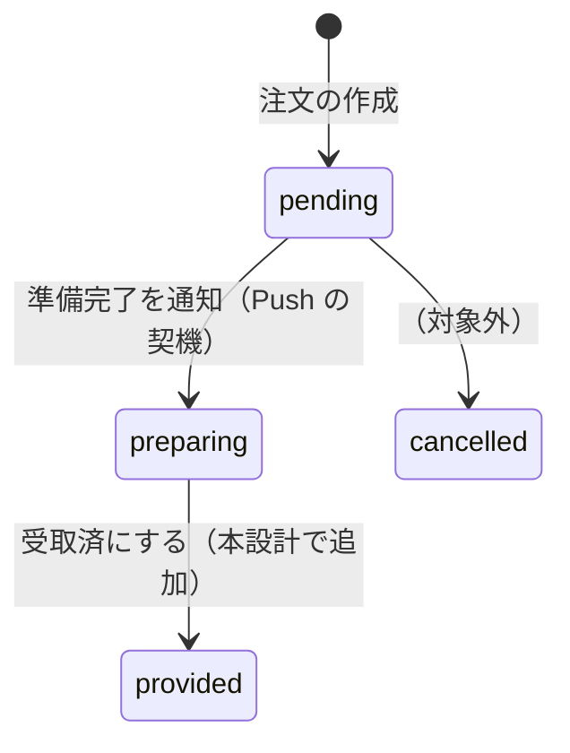
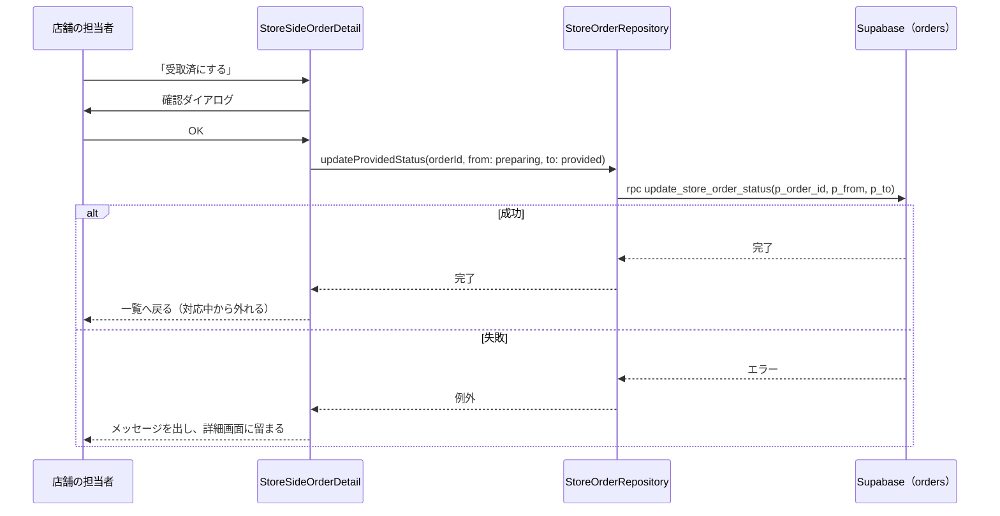

# 0011: 店舗側の注文一覧の見直しと、注文の詳細画面・受取済の記録

| 項目 | 内容 |
|---|---|
| ステータス | **Accepted**（2026-11-01 合意。実装 PR で反映。本番の適用は `db push` のあと） |
| 作成者 | Claude Code（依頼: eno-conan） |
| 作成日 / 最終更新日 | 2026-11-01 / 2026-11-01 |
| 関連 Issue / PR | 未起票（合意後に、親 Issue と実装用サブ Issue を起票する）。前提: [PR #1198](https://github.com/eno-conan/flutter-starbucks-clone/pull/1198)（店舗側のログインと設定画面） |
| 影響度ティア | **critical**（RPC・`supabase_schema/**` を変える） |
| 関連設計書 | [0006: モバイルオーダー](0006-mobile-order.md)（3.7 注文の状態）/ [0003: Push 通知](0003-push-notification.md)（`pending → preparing` が通知の契機）/ [0002](0002-login-methods-organization.md) |

## 要約（TL;DR）

- 何を変えるか: 店舗側の注文一覧を、状態が分かる見た目に直し、カードから詳細画面へ進めるようにする。「受取済」を DB に保存する。
- なぜ変えるか: 実機で、全注文が「Recieved」と出て、状態の意味が分からない。カードを押しても何も起きない。「受取済」は画面の中だけで、保存されない。
- 方式: 状態は、既存の列挙値をそのまま使う（`pending` → `preparing` → `provided`）。RPC `get_store_order_list` が状態と注文時刻を返すようにし、受取済の更新を足す。

## 1. 背景

- 現状: 店舗側の注文一覧（`orders.dart`）は、注文ごとのカードを並べる。

| # | 問題 | 詳細 |
|---|---|---|
| 1 | 状態がアプリに届いていない | 現行の RPC `get_store_order_list`（20260820100002 と 20261031120100 の版）の戻り値に、`provided_status` が無い。アプリは `item['provided_status']` を読み、`'null'` になる。「Ready」は `pending` のときだけ出るので、一度も出ず、全カードが「Recieved」になる |
| 2 | 完了した注文も一覧に出る | 2025-04 の版は `provided_status IN ('0','1')` で絞っていたが、現行の版には絞り込みが無い。受取済の注文も、増え続ける |
| 3 | 詳細画面が無い | カードの `onTap` は、コメント（`// 詳細確認画面へ`）だけで、中身が無い |
| 4 | 「受取済」が保存されない | 「Recieved」→「Completed」の切り替えは、画面の中だけ。保存用のメソッド `_updateProvidedStatusFromReadyToCompleted` は空 |
| 5 | 状態の名前が食い違う | 列挙値 `preparing` の表示名は「調理中」だが、画面では「準備完了を通知した後」の状態として使う。`provided` は「提供済」。綴りも `Recieved` になっている |
| 6 | カードの高さが固定 | 高さ 250 固定のため、商品が多いと溢れる |

## 2. ゴールと非ゴール

**ゴール:**

- 店舗の担当者が、注文ごとの状態（未受付 / 準備完了を通知済 / 受取済）を、一覧で見分けられる。
- 一覧のカードを押すと、詳細画面（受取番号・注文時刻・利用区分・状態・商品の一覧・操作ボタン）が開く。
- 「受取済」を押すと、DB に保存される。アプリを開き直しても、受取済のままになる。
- 受取済の注文は、一覧の「対応中」から外れる。

**非ゴール:**

| 非ゴール | 理由 |
|---|---|
| キャンセルの操作 | 注文後はすぐに調理を始めるため、注文後のキャンセルは受け付けない（[0006](0006-mobile-order.md) の 3.6・3.7）。列挙値 `cancelled` はそのまま残す |
| 列挙値の名前の変更（`preparing` → `ready` など） | Push 通知の条件（`pending → preparing`）や、他の SQL が、この値に依存する（0003）。表示名だけ直す |
| 過去の注文の検索・集計 | 別の機能 |
| 状態の遷移を RPC で検証する仕組み | 段階 2 として切り出す（3.5、7 の論点 1） |

## 3. 設計

### 3.1 状態の流れ

- 既存の列挙値に、次の表示名を割り当てる。名前（DB の値）は変えない。

| DB の値 | 表示名（変更後） | 現在の表示名 | 店舗側の操作 |
|---|---|---|---|
| `pending` | 未受付 | 未受付 | 「準備完了を通知」→ `preparing` へ |
| `preparing` | 準備完了（お客様の受取待ち） | 調理中 | 「受取済にする」→ `provided` へ |
| `provided` | 受取済 | 提供済 | なし |
| `cancelled` | キャンセル | キャンセル | なし（この設計では、操作を作らない） |

### 3.2 処理の流れ（受取済の記録）

- 店舗の担当者が、詳細画面で「受取済にする」を押したときの流れ。

### 3.3 データ・インターフェース

- RPC `get_store_order_list(p_user_id)` を作り直す（戻り値の列を変えるため、`DROP FUNCTION` → `CREATE`）。
    - 追加する列: `provided_status`、`created_at`（注文時刻）。
    - 絞り込み: `provided_status IN ('pending', 'preparing')`。受取済・キャンセルは返さない。
    - 絞り込み（当日）: `created_at` が、日本時間（`Asia/Tokyo`）の当日 0:00 以降の注文だけを返す。前日以前の未提供の注文は返さない（8 の 2026-11-03）。
    - 維持するもの: 本人の `user_id` でしか返さない条件（`p_user_id = auth.uid()`）、`SECURITY DEFINER`、`SET search_path`、権限（`authenticated` と `service_role` のみ）。
- 状態の更新は、RPC `update_store_order_status(p_order_id, p_from, p_to)` で行う（#1201 の段階 1。当初は、既存の REST の更新を使う案だった）。
    - 店舗の担当者だけが、自店の注文を `pending → preparing`、`preparing → provided` に進められる。エラーは SQLSTATE で返す（`42501`・`22023`・`P0002`・`55000`）。
    - 防御トリガー `trg_orders_guard_update` が、REST・RPC・`service_role` のどの経路でも、金額などの変更・`user_id` の書き換え・戻す遷移を拒否する。
    - 段階 1 の間は、旧アプリの REST の更新（RLS `update_own_or_store_orders`）も残る。段階 2 で、このポリシーを外す（実装済み。本番は未適用。6 を参照）。
- アプリのモデル `StoreOrder` に、`createdAt` を足す。`providedStatus` は、`ProvidedStatus` の列挙で扱う（`'null'` のような不正な値は、検出してログに残す）。

### 3.4 画面

| 画面 | 内容 |
|---|---|
| 注文一覧（変更） | カードに、受取番号・注文時刻・商品の点数・状態のバッジを出す。固定の高さをやめる。カード全体を押すと、詳細へ進む。「Ready」「Recieved」のボタンは、一覧から外す（操作は詳細に集約する） |
| 注文の詳細（新規） | 受取番号・注文時刻・利用区分・状態・商品の一覧（商品名・温度・サイズ・数量）。状態に応じた操作ボタン（未受付: 「準備完了を通知」、準備完了: 「受取済にする」） |

- 操作は、どちらも確認ダイアログ（`showAppConfirmDialog`）を挟む。誤タップで、お客様へ通知してしまうのを防ぐため。

### 3.5 変更するファイル（予定）

| ファイル | 区分 | 内容 |
|---|---|---|
| `supabase_schema/supabase/migrations/20261101120000_store_order_list_with_status.sql` | 新規 | `get_store_order_list` の作り直し（3.3）。版は、他と重複させない |
| `supabase_schema/supabase/migrations/20261103090000_store_order_list_today_only.sql` | 新規 | 当日（日本時間 0:00 以降）の注文だけを返す（2026-11-03 の追記） |
| `supabase_schema/supabase/tests/database/get_store_order_list_authz.test.sql` | 変更 | 列の追加・絞り込み・他人の行が返らないことを検証。当日の境界（0:00 ちょうどは返り、1 秒前は返らない）も検証 |
| `lib/screens/starbucks_store_side/model/store_order.dart` | 変更 | `createdAt` を足す |
| `lib/data/repository/store_order_repository.dart` | 変更 | `updateProvidedStatus` が、遷移元・遷移先を受け取る。更新は RPC `update_store_order_status` 経由（#1201） |
| `lib/constants/supabase_rpcs.dart` | 変更 | `updateStoreOrderStatus` を足す（#1201） |
| `supabase_schema/supabase/migrations/20261102120000_add_update_store_order_status_rpc.sql` | 新規 | RPC `update_store_order_status` と、防御トリガー `trg_orders_guard_update`（#1201 の段階 1） |
| `supabase_schema/supabase/tests/database/update_store_order_status.test.sql` | 新規 | RPC・トリガーの pgTAP（#1201） |
| `lib/constants/provided_status.dart` | 変更 | 表示名を直す（3.1）。`displayName` は、いまコードから使われていない |
| `lib/screens/starbucks_store_side/mobileorder/orders.dart` | 変更 | 一覧のカードの作り直し。タップで詳細へ |
| `lib/screens/starbucks_store_side/mobileorder/order_detail.dart` | 新規 | 詳細画面 |
| `lib/config/routes/main_routes.dart` | 変更 | 詳細画面のルート |
| `docs/content/design/0006-mobile-order.md` / `0009-navigation.md` | 変更 | 3.7 の状態の流れと、ルートの一覧 |
| 対応する `test/` | 新規・変更 | 一覧・詳細・リポジトリ |

## 4. 検討した代替案

| 案 | 長所 | 短所 | 判断 |
|---|---|---|---|
| A. 状態の更新は、既存の REST の更新を使う（#1200 で採用） | 変更が小さい。既存の RLS と、Push の契機（`pending → preparing`）に、手を入れない | 店舗の担当者が、状態以外の列も更新できる（RLS は列を絞れない）。`provided` から `pending` へ戻すなど、不正な遷移も止められない。戻すと、Push が二重に届く | #1200 の時点の方式。#1201 の段階 1 で、アプリは RPC に切り替え済み。REST の更新は、旧アプリのために、段階 2 まで残り、防御トリガーが守る |
| B. 状態の更新を、遷移を検証する RPC に集約する | 店舗の所有・遷移（`pending → preparing → provided`）・更新する列を、サーバーで強制できる | 新しい RPC・権限・テストが要り、規模が大きい。RLS の更新ポリシーを締める移行も要る | 段階 1 は実装済み（RPC `update_store_order_status` と防御トリガー `trg_orders_guard_update`。アプリは RPC に切り替え済み）。段階 2 は実装済み（マイグレーション `20261102140000_revoke_update_on_orders_stage2.sql`）。本番は未適用で、適用の前提がある（6 を参照） |
| C. 一覧のボタンで、そのまま状態を進める（詳細画面を作らない） | 実装が最小 | 商品の内容を見ないまま、通知・受取済を押せる。依頼（詳細画面が必要）に合わない | 不採用 |
| D. 列挙値の名前を `ready` などへ変える | 名前と意味が揃う | Push の条件・SQL・既存データへの影響が大きい | 不採用（表示名で解決する） |

## 5. 横断的関心事

| 観点 | 検討内容 |
|---|---|
| セキュリティ | RPC は、既存の「本人の `user_id` でしか返さない」条件と、`authenticated` のみの権限を維持する。更新の経路（A）の弱点は、4 の表のとおり。`security-agent` のレビューを受ける |
| プライバシー | 追加する列は、注文時刻と状態だけ。注文者の個人情報は返さない |
| 互換性 | 戻り値の列を追加するだけで、既存の列は残す。古いアプリは、追加の列を読まないので動く。ただし、受取済の注文が一覧に出なくなる挙動の変化は、古いアプリにも及ぶ。同様に、前日以前の注文が出なくなる挙動の変化（2026-11-03）も、古いアプリに及ぶ |
| 利用者側への影響 | 利用者側の「履歴・再注文」タブは、`pending` と `preparing` だけを出す（0006 の 3.8）。受取済になると、そのタブから消える。「受取待ち」の一覧と意味は合う |
| 性能 | 行数は、店舗ごとの対応中の注文だけ。絞り込みで、むしろ減る。`idx_orders_store_number` が使える |
| 可観測性 | 状態が不正な値のときは、`LoggerService.warn` に出す（機密情報は出さない） |
| テスト | pgTAP（RPC）・Widget（一覧・詳細）・リポジトリ。実機で、一覧 → 詳細 → 通知 → 受取済を確認する |
| アクセシビリティ | 状態は、色だけでなく文字でも示す。ボタンは、`buttonMinHeight` 以上 |

## 6. 移行とロールアウト

1. マイグレーション（RPC の作り直し）を、先に適用する。追加の列だけなので、現行のアプリは動き続ける。
2. アプリのリリース。
3. 本番への適用（`db push`）は、ユーザーが実行する。
- 戻し方: 前の版の RPC に戻すマイグレーションを足す（適用済みのマイグレーションは書き換えない）。アプリ側は、列が無いときの挙動（状態を判定できない）を、一覧に出さずログに残す。

**段階 1（状態の更新を RPC に集約。実装済み）:**

- 段階 1 の内容: RPC `update_store_order_status` と防御トリガー `trg_orders_guard_update` を入れ、アプリの更新を RPC に切り替える。RLS（`update_own_or_store_orders`）は変えない。
- 適用の順序:
    1. ユーザーが `db push`（RPC とトリガー）を実行する。
    2. 店舗側アプリをリリースする。
    3. 旧アプリが使われなくなったことを確認する（全店舗の端末）。
    4. 段階 2 の `db push` を行う。
- 段階 1 の戻し方: 新しいマイグレーションで `DROP TRIGGER` / `DROP FUNCTION` を行う。
- 旧アプリ（配布済み）は、REST の UPDATE（`pending → preparing`、`preparing → provided`）のまま動き続ける。

**段階 2（実装済み。本番は未適用）:**

- マイグレーション: `supabase_schema/supabase/migrations/20261102140000_revoke_update_on_orders_stage2.sql`。
- 内容:
    - `DROP POLICY "update_own_or_store_orders"`（`orders` の UPDATE のポリシー）。
    - `REVOKE UPDATE ON TABLE public.orders FROM PUBLIC, anon, authenticated`（`service_role` の UPDATE 権限は残す）。
    - SELECT・INSERT・DELETE のポリシーと権限、RLS の有効化は変えない。
- 効果:
    - anon・authenticated は、`orders` を REST で UPDATE できなくなる。状態の更新は、RPC `update_store_order_status` だけになる。
    - 注文者本人が REST で自分の `user_id` を NULL にする経路も、権限で止まる。
- 検証:
    - マイグレーション内の DO ブロックが、次を確かめる（違えば例外）。
        - anon・authenticated に UPDATE 権限が無い。
        - service_role に UPDATE 権限が残っている。
        - UPDATE（または ALL）のポリシーが無い。
        - 防御トリガー `trg_orders_guard_update` が残っている。
    - pgTAP: `supabase_schema/supabase/tests/database/orders_update_lockdown.test.sql`（33 件）。
    - pgTAP: `update_store_order_status.test.sql`（60 件）は、段階 2 の状態でも通るように直した。防御トリガーの検査は、トランザクション内だけ一時的に GRANT とポリシーを足して行う。
- 戻し方:
    - ポリシー `update_own_or_store_orders` を、`20260310000003_fix_rls_auth_initplan.sql` の定義で再作成する。
    - `GRANT UPDATE ON TABLE public.orders TO anon, authenticated;` を実行する。

!!! warning "適用の前提: 全店舗の端末が新しいアプリになってから適用する"
    - 全店舗の端末が、状態の更新を RPC `update_store_order_status` 経由に切り替えた版（#1212 の変更を含む）になってから、`db push` で適用する。
    - 旧アプリの REST の UPDATE は、適用のあと `42501`（permission denied for table orders）で失敗する。

!!! warning "人が手動で直すときは、トリガーを一時的に無効にする"
    - `orders` の不変の列を、ダッシュボードなどから手動で直すときは、トリガーを一時的に無効にする必要がある。
    - `service_role` でも、金額・`user_id` の変更は拒否される。
    - 無効にする作業は、人（管理者）が、SQL エディタなどで行い、終わったら、必ず再有効化する（`ALTER TABLE public.orders DISABLE TRIGGER trg_orders_guard_update;` → 修正 → `ALTER TABLE public.orders ENABLE TRIGGER trg_orders_guard_update;`）。無効にしている間は、不変の列・`user_id`・遷移の保護が外れる。

## 7. 未解決の論点

| # | 論点 | 選択肢 | 推奨 | 決める人 |
|---|---|---|---|---|
| 1 | 状態の更新を、RPC に集約するか | A のまま / 段階 2 で B | 決定済み（2026-11-01）: 段階 1 で RPC とトリガーを入れ、段階 2 で RLS を締める | eno-conan |
| 2 | 受取済の注文を、一覧に残すか | 消す（対応中だけ）/ 「受取済」の切り替えで見せる | 消す。見たいという要望が出たら足す | eno-conan |
| 3 | 準備完了の通知を押したあとの、取り消し | 取り消せない / 一定時間は戻せる | 取り消せない（Push が送られるため） | eno-conan |
| 4 | Push の文言が「準備完了」を表すか | 0003 を確認し、食い違うなら直す | 確認してから決める | Claude Code が確認 |

## 8. 決定事項と実装時の差分

- 2026-11-01: 状態の流れは、「未受付 → 準備完了を通知 → 受取済」の 3 段階。受取済は、DB に保存する。詳細画面に、注文時刻も出す（依頼者の回答）。
- 2026-11-01: 調査で、現行の RPC が `provided_status` を返さず、状態の絞り込みも無いことが分かった（1 の問題 1・2）。DB を変えない案は、成り立たない。
- 2026-11-01: 7 の論点 1〜3 は、推奨どおりに決めた（論点 1: 段階 2 で B、論点 2: 受取済は一覧から消す、論点 3: 準備完了の通知は取り消せない）。依頼者の合意。
- 2026-11-01（実装時の差分）: RPC の戻り値の列名が `eat_in_takeout` のままで、アプリが読む `usage` と合っていなかった（利用区分が常に 0）。作り直しのときに `usage` へ直した。
- 2026-11-01（実装時の差分）: 更新は、状態を条件にして行い（`provided_status = from`）、0 行なら失敗として扱う。別の端末が先に進めた場合に、上書きしないため。
- 2026-11-01: 7 の論点 1 は、段階に分けて決めた。段階 1 で RPC `update_store_order_status` と防御トリガー `trg_orders_guard_update` を入れ、段階 2 で RLS の締めと `REVOKE UPDATE` を行う（依頼者の決定）。
- 2026-11-01（レビューで分かった、段階 2 の材料）: `orders` の UPDATE の RLS（`update_own_or_store_orders`）には `WITH CHECK` が無く、列も絞っていない。店舗の担当者が `user_id` を書き換えられ、注文者本人も状態・金額を更新できる。`provided → pending` に戻して再度 `preparing` にすると、Push が再送される。案 B の RPC と、このポリシーを締める作業で解決する。#1200 の時点では悪化させていなかった。#1201 の段階 1（RPC と防御トリガー）で、REST の経路でも、`user_id` の書き換え・金額などの変更・戻す遷移（Push の再送）は塞がった。
- 2026-11-01（#1201 のレビューで分かった、段階 2 に回す項目）:
    - UPDATE のポリシー `update_own_or_store_orders` を外し、`REVOKE UPDATE ON public.orders FROM anon, authenticated` を行う（6 を参照）。防御トリガーの「不変の列」は拒否リスト方式なので、将来 `orders` に列を足したときは、ガードへの追加が要る。列の権限（`GRANT UPDATE (列)`）への切り替えも検討する。
    - 注文者本人が、REST で自分の `user_id` を NULL にできる（他人には効かない）。クライアントからの NULL 化を拒否し、NULL 化は、`auth.users` の削除による連鎖更新だけにする。
    - `orders` の INSERT のポリシー `insert_own_orders` は、`auth.uid() = user_id` だけで、`store_number`・金額・`provided_status` が自由。注文者が、他店に、任意の金額の注文を作れる。UPDATE のトリガーは、INSERT には効かない。`create_order_with_details` 経由に限定し、直接の INSERT を閉じる（別の Issue で扱う）。
    - Push の Webhook（`trg_orders_update_push_notify`）は、列が変わらない UPDATE でも動く。トリガーに `WHEN (OLD.provided_status IS DISTINCT FROM NEW.provided_status)` を付ける案がある（別の Issue で扱う）。
    - `anon` / `authenticated` に、`orders` の TRUNCATE・TRIGGER・REFERENCES の権限が付いている（`20250315231121_create_orders_table.sql` で GRANT 済み。REVOKE は見つからない）。外す。

- 2026-11-02: 段階 2 を実装した（マイグレーション `20261102140000_revoke_update_on_orders_stage2.sql`）。本番には未適用。適用の前提は 6 を参照。
- 2026-11-02（段階 2 で解消）:
    - UPDATE のポリシー `update_own_or_store_orders` を外し、`REVOKE UPDATE` を行った。
    - 注文者本人が REST で自分の `user_id` を NULL にする件は、権限で止まるため解消した。
- 2026-11-02（段階 2 のあとも残るもの。別の Issue eno-conan/flutter-starbucks-clone#1214 などで扱う）:
    - 防御トリガーの「不変の列」は、拒否リスト方式のまま。`orders` に列を足したときは、ガードへの追加が要る。クライアントは UPDATE できないため、トリガーは多層防御としての位置づけになる。
    - Push の Webhook（`trg_orders_update_push_notify`）は、列が変わらない UPDATE でも動く。
    - `anon`・`authenticated` に、`orders` の TRUNCATE・TRIGGER・REFERENCES の権限が付いている（`20250315231121_create_orders_table.sql` で GRANT 済み）。PostgREST は TRUNCATE を出せないので、Data API 経由では悪用できないが、外す（別の Issue。`20261102130000_lock_down_store_profiles_writes.sql` と同じ形）。
    - `orders` の DELETE の権限も、`anon`・`authenticated` に残っている。いまは DELETE のポリシーが無く、RLS で 0 行になる。将来 DELETE のポリシーを足すと、「DELETE して INSERT し直す」ことで、UPDATE の制限（不変の列・遷移）を迂回できる。権限を外すか、DELETE のポリシーを足さない（上の別の Issue で扱う）。
    - `orders` の INSERT のポリシー `insert_own_orders` の問題（`create_order_with_details` 経由に限定する）は、#1214 で扱う。
    - #1214 の段階 A で対応した（実装済み・本番未適用）: `insert_own_orders` を DROP し、`orders` の INSERT の権限を外す。注文の作成は RPC `create_order_with_details` だけになる（マイグレーション `20261102150000_lock_down_orders_writes.sql`）。
    - #1214 の段階 A で対応した（実装済み・本番未適用）: `orders` の TRUNCATE・TRIGGER・REFERENCES・DELETE の権限を外す。DELETE のポリシーは足していない。
- 2026-11-02（#1214 の段階 A の適用の注意）:
    - `db push` は、未適用のマイグレーションを、版の順に、まとめて全部適用する（1 本だけを選べない）。段階 A（`20261102150000`）の版は、段階 2（`20261102140000`、本番未適用）より新しいため、**段階 A を `db push` すると、段階 2 も一緒に適用される**。
    - 段階 2 は、全店舗の端末が RPC 経由の新アプリになってから適用するもの（旧アプリの REST の UPDATE が、適用後に `42501` で失敗する）。段階 A だけを先に適用する手段は無い。
    - 適用の前に、必ず `npx supabase db push --linked --dry-run` で、適用の対象を確認する。
    - 段階 A の前提「旧アプリが直接 INSERT していないこと」は、本番の API ログ（`POST /rest/v1/orders`）で確認する。ただし、ログの保持期間は短い（数日〜）ことがあり、まれにしか起動しない旧版は、ログに残らない。ログに無くても、旧版が残っている可能性は、消えない。
- 2026-11-02（#1214 の段階 A の範囲の追加。security レビューで判明）: 保守用の関数 `archive_old_orders(integer)` は、SECURITY DEFINER で、呼び出し元の確認も、保持月数の下限の検査も無く、`REVOKE` も無かった。`p_retention_months = 0` を渡すと、`orders` と、紐づくスターの履歴が、すべてアーカイブ表へ移され、元の表から消える（REST の RPC として、anon のキーだけで呼べる見込み。本番の ACL は未確認）。兄弟の関数（`archive_old_star_usage`・`cleanup_expired_user_tickets`・`cleanup_abandoned_carts` など）も同じ状態だった。段階 A のマイグレーションで、cron が呼ぶ保守用の関数の EXECUTE を、PUBLIC・anon・authenticated から外した（`service_role` と、cron（所有者）は、影響を受けない）。
- 2026-11-02（段階 B は、別の Issue へ）: RPC `create_order_with_details` の入力の検証（金額・支払い方法・店舗・受取番号・明細）は、段階 A では行わない。直接 INSERT を閉じたことで、RPC が唯一の入口になるため、検証が、より重要になる。本番の過去の注文で、違反が 0 件と確認できた検証だけを入れる方針（読み取り専用の検査 SQL `supabase_schema/supabase/snippets/preflight_step4.sql` を、本番で実行して決める）。第一段階の候補: 注文の頻度の上限（`consume_rate_limit`）、明細の件数と数量の上限、NULL・空の明細の拒否。単価と `product_sizes.price` の照合は、見送り（カートの小計がクライアントの値のため、古い単価の正規注文を拒否する）。
- 2026-11-03（#1214 の段階 B を実装。本番未適用）: RPC `create_order_with_details` に入力の検証を入れた（マイグレーション `20261103100000_validate_create_order_with_details.sql`、pgTAP `create_order_with_details_validation.test.sql`）。本番の過去の注文 67 件の事前検査（`preflight_step4.sql`）で、全ルールの違反が 0 件だった。
    - 検証ルール: 明細が配列で 1 件以上 100 件以下（各要素が `count` の正の整数と `subtotal_without_tax` の 0 以上の整数を持つ）、税抜金額 > 0、明細の小計の合計 = 税抜金額、`usage` 1 → 10%・2/3 → 8%（`p_tax_rate` があれば一致）、税額 = `floor(税抜 × 税率 / 100.0)`、支払い方法は `クレジットカード` のみ、受取番号は空でない。違反は ERRCODE `22023`。
    - 見送り: 単価と `product_sizes.price` の突き合わせ、営業時間の検査（別の Issue）。上の「第一段階の候補」のうち、明細の件数の上限（100 件まで）は入れた。数量（`count`）の上限と、注文の頻度の上限（`consume_rate_limit`）は、未実施。
    - 適用順の注意: `db push` は未適用を版の順にまとめて適用する。この版（`20261103100000`）は、段階 A（`20261102150000`）より新しいので、段階 A のあとに適用される。段階 A だけ・段階 B だけを選べない点は、段階 A と同じ。
    - 旧アプリへの影響: 旧版が `クレジットカード` 以外の支払い方法や、税率・税額が合わない値を送っていると、適用後は `22023` で失敗する。適用の前に、アプリの現行版が送る値（`クレジットカード` 固定、税率は `usage` から決まる、税額は切り捨て）と一致することを確認する。
    - 既存の pgTAP `orders_write_lockdown.test.sql` が RPC に渡していた支払い方法 `test` は、`クレジットカード` に直した。
- 2026-11-02（アプリ側の残り）: `OrderRepository.updateOrderStatus`（呼び出し元なし。REST の直接 UPDATE）は、段階 2 のあとは必ず失敗するデッドコードになる。削除は、別の機会に行う。
- 2026-11-03: 店舗側の注文一覧を、当日の注文だけにした。RPC `get_store_order_list` が、`created_at` が日本時間（`Asia/Tokyo`）の当日 0:00 以降の注文だけを返す（マイグレーション `20261103090000_store_order_list_today_only.sql`）。
    - 理由: 日をまたいで、未提供の注文がすべて一覧に残り、前日以前の注文が混ざるため。
    - 当日の決め方: 店舗ごとのタイムゾーン・営業時間は DB に無いため、既存の `get_store_wait_times` と同じく、日本時間に固定した。端末の時計・タイムゾーンには依存しない。
    - 影響: 前日以前の未提供の注文（`pending` / `preparing`）は、店舗側の一覧に出ず、一覧から受取済にもできなくなる（決定済みの仕様）。利用者側の履歴には、そのまま残る。
    - 残る課題: 一覧は、画面を開いている間に日付が変わっても、再取得するまで切り替わらない（詳細画面から戻ったとき・ログイン状態が変わったときに再取得する）。
    - 一覧と更新の可否: 「当日」の絞り込みは、一覧（`get_store_order_list`）だけにかけた。`update_store_order_status` は、日付で制限しない（自店の注文なら、前日以前の注文でも、RPC を直接呼べば状態を進められる）。一覧に出ない注文は、一覧からは操作できないだけで、権限が広がるわけではない。
    - 絞り込みは、表示の範囲であり、セキュリティの境界ではない: `orders` への直接の INSERT が閉じられる前（#1214 の段階 A の適用前）は、認証済みのユーザーが `store_number` と `created_at` を指定した注文を入れられる。この変更は、その状況を悪くしないが、よくもしない。段階 A の適用が前提。
    - 利用者側との食い違い: 前日以前の未提供の注文は、利用者側の履歴には残り、受取番号も表示される。店舗側には出ないため、店舗が把握できない。長期間、未提供のままの注文を、`cancelled` などで終わらせる運用・定期処理は、この変更の範囲外（別の課題）。

## 9. 参考

- 現行の RPC: `supabase_schema/supabase/migrations/20261103090000_store_order_list_today_only.sql`（当日の絞り込み）。その前の版: `20261101120000_store_order_list_with_status.sql`（状態を返す）、`20261031120100_restrict_get_store_order_list_to_self.sql`（本人に限る）
- 状態を返していた版: `supabase_schema/supabase/migrations/20250403220249_fix_rpc_add_condtion_provided_status.sql`
- 更新の RLS: `supabase_schema/supabase/migrations/20260310000003_fix_rls_auth_initplan.sql`（`update_own_or_store_orders`）
- 画面の既存コード: `lib/screens/starbucks_store_side/mobileorder/orders.dart`
