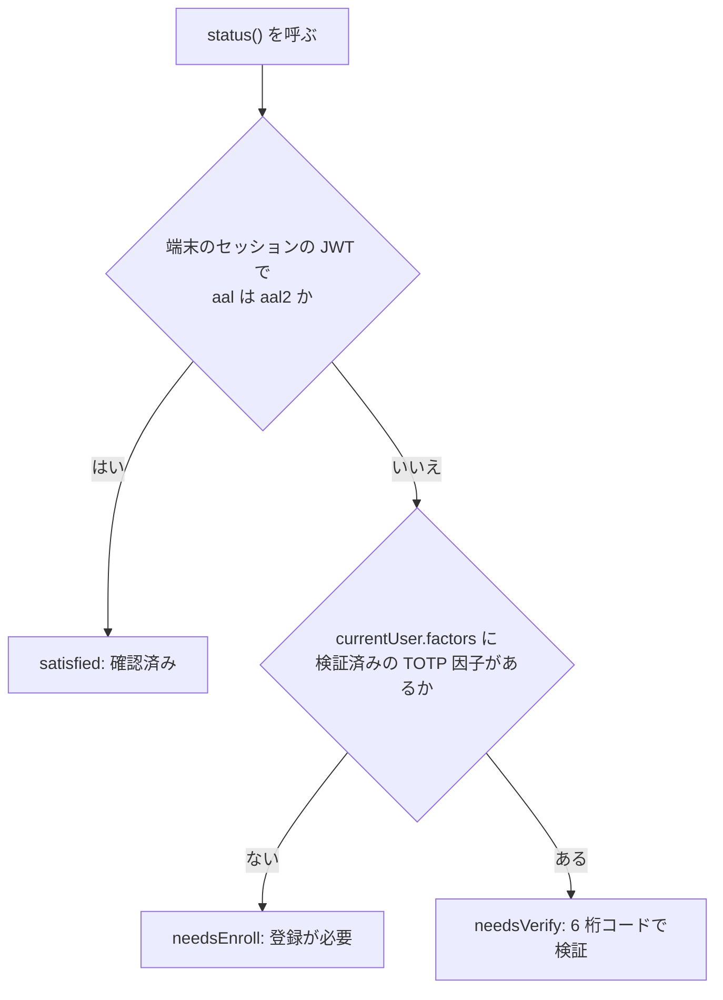
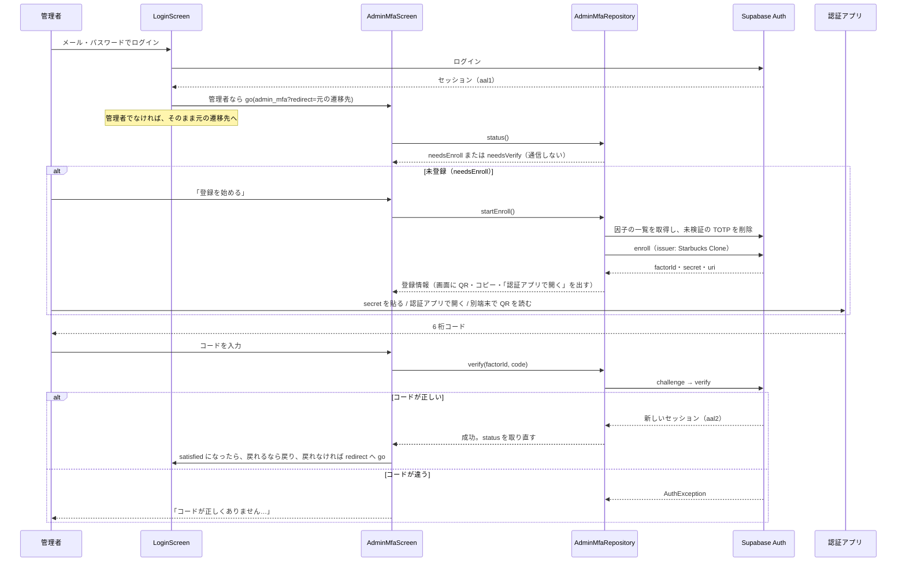
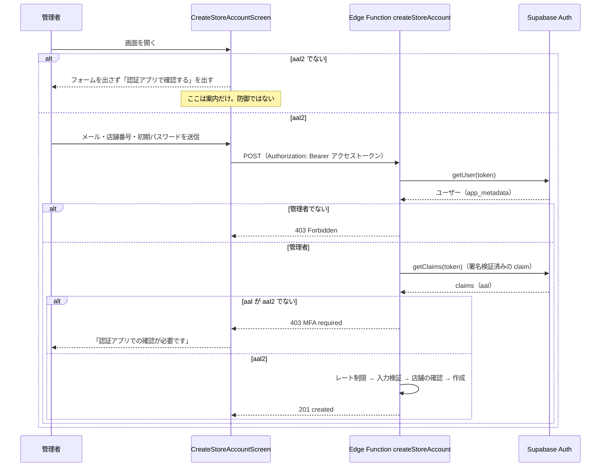

# 0012: 管理者の MFA（認証アプリでの確認）

| 項目 | 内容 |
|---|---|
| ステータス | **Implemented**（2026-11-03 に実機で、Google Authenticator での検証成功を確認） |
| 作成者 | Claude Code（依頼: eno-conan） |
| 作成日 / 最終更新日 | 2026-11-03 / 2026-11-03 |
| 関連 Issue / PR | #1205（MFA 必須化）。2026-11-03 の 429 の修正は、同じ PR に含める |
| 影響度ティア | **critical**（認証・Edge Function） |
| 関連設計書 | [0002: ログイン手段の整理](0002-login-methods-organization.md)（店舗アカウントの作り方）/ [0005: ログインとセッション管理](0005-login-and-session.md) / [0010: データベース設計](0010-database.md)（Edge Function の一覧） |

## 要約（TL;DR）

- 何をするか: 店舗アカウントを作れる管理者に、認証アプリ（TOTP の 6 桁コード）での確認を必須にする。
- なぜか: パスワードだけで通った管理者のセッションが盗まれると、任意の店舗番号の店舗アカウントを作られるため。
- 方式: Supabase Auth の MFA（TOTP）で、セッションを `aal2` にする。**本当の防御は Edge Function `createStoreAccount` が `aal2` を確かめること**。画面は、確認へ案内するだけ。

## 1. 背景

- 管理者は `app_metadata.role = 'store_admin'` のユーザー。店舗側の設定画面から、店舗アカウント（auth ユーザー + `store_profiles` の行）を作れる。
- 店舗アカウントは、その店舗の注文を読み・更新できる。管理者のセッションが盗まれると、他人の注文情報に触れる経路を作られる。
- パスワードだけで入ったセッションは `aal1`。MFA を済ませると `aal2` になる（AAL は Authenticator Assurance Level。認証の強さの段階）。

## 2. ゴールと非ゴール

**ゴール:**

- 管理者が `aal1` のままでは、`createStoreAccount` が 403 `MFA required` を返すこと。
- 管理者がログインした直後に、確認の画面へ進むこと。未登録なら登録、登録済みなら 6 桁コードの入力になること。
- スマホ 1 台で、登録から検証まで済ませられること。

**非ゴール:**

- 管理者以外（店舗アカウント・利用者）に MFA を求めない。
- 初回の登録を `aal2` で守ることは、していない（4 の既知の限界）。
- 端末をなくしたときの復旧のアプリ内機能は作らない。手順は [functions/README.md](https://github.com/eno-conan/flutter-starbucks-clone/blob/main/supabase_schema/supabase/functions/README.md) の「管理者の MFA（TOTP）と復旧」にある。

## 3. 設計

### 3.1 全体像

| 層 | 担当 | ファイル |
|---|---|---|
| 画面 | ログイン直後に、管理者だけ確認の画面へ送る | `lib/screens/starbucks_user_side/signin/login.dart`（`_navigateToHome`） |
| 画面 | 登録・コード入力。済んだら元の画面へ戻す | `lib/screens/starbucks_store_side/setting/admin_mfa.dart` |
| 画面 | 確認が済んでいなければ、フォームを出さずに確認へ案内する | `lib/screens/starbucks_store_side/setting/create_store_account.dart` |
| Provider | 状態（`adminMfaStatusProvider`）と、登録・検証の操作（`adminMfaProvider`） | `lib/provider/admin_mfa_provider.dart` |
| Repository | `supabase.auth.mfa` の薄い包み。管理者かどうかは判定しない | `lib/data/repository/admin_mfa_repository.dart` |
| 管理者の判定 | `app_metadata.role == 'store_admin'`（`userMetadata` は見ない） | `lib/provider/store_admin_provider.dart`（`isStoreAdminUser`） |
| Supabase Auth | 因子の登録・チャレンジ・検証。検証が通ると、JWT の `aal` が `aal2` になる | `config.toml` の `[auth.mfa.totp]` |
| Edge Function | `aal2` のセッションだけを通す（本当の防御） | `supabase_schema/supabase/functions/createStoreAccount/` |

### 3.2 いま必要な操作の判定（`status()`）

- **この判定は通信しない**。端末に保存されたセッションだけを読む。
- 検証済みの因子だけを数える。登録の途中でやめた未検証の因子は、数えない。
- 理由は 6 の「2026-11-03 の 429」。

### 3.3 処理の流れ 1: ログインから確認まで

- 遷移先（`redirect`）は、許可リスト（注文一覧・店舗側の設定・ホーム）にあるものだけ受け付ける。クエリは外から書き換えられるため（`AdminMfaScreen.resolveRedirect`）。
- 検証中は送信ボタンを押せない（二重送信を防ぐ）。コードとシークレットはログに出さない。

### 3.4 処理の流れ 2: 店舗アカウントの作成（防御の本体）

- 画面の案内は、サーバーが落とす前に操作を済ませやすくするだけ。画面を迂回して関数を直接呼んでも、`aal1` なら 403 になる。
- `aal` の判定は、claim が `aal2` と**完全一致**のときだけ true。無い・想定外の値は false（fail-closed。`contract.ts` の `isAal2`）。
- 管理者かどうかは `app_metadata.role` で見る。JWT の claim を自分で解読しない（`getUser` で Auth サーバーが検証する）。

### 3.5 画面に出す失敗の文言

| 場面 | 文言 | 次にできること |
|---|---|---|
| 状態を取得できない | 「状態を取得できませんでした。時間をおいて、もう一度お試しください」 | 「再読み込み」 |
| コードが違う | 「コードが正しくありません。認証アプリに表示されている最新のコードを入力してください」 | 入れ直す |
| 登録の開始・検証の通信失敗 | 「時間をおいて、もう一度お試しください」 | もう一度押す |
| 関数が 403 `MFA required` | 「認証アプリでの確認が必要です」 | 確認の画面へ |

## 4. 既知の限界

- **初回の登録は、パスワードだけ（`aal1`）でできる。** Supabase Auth の仕様で、検証済みの因子が無いうちは `aal1` で最初の因子を登録できる。管理者のパスワードを知る人が、本人より先に自分の認証アプリを登録すると、`aal2` を得られる。守れるのは、登録済みの管理者だけ。
    - 運用で塞ぐ: 管理者の役割を付与したら、すぐ本人が登録する。
    - 詳細と復旧手順は [functions/README.md](https://github.com/eno-conan/flutter-starbucks-clone/blob/main/supabase_schema/supabase/functions/README.md) の「管理者の MFA（TOTP）と復旧」。
- この端末で見える因子は、ログイン時（またはトークン更新時）にセッションへ入ったもの。別の端末で因子を登録・削除しても、この端末へ反映されるのは、次にトークンが更新されるかログインし直したとき。

## 5. 検討した代替案

| 案 | 長所 | 短所 | 採用しなかった理由 |
|---|---|---|---|
| 画面だけで確認を促す | 実装が小さい | 関数を直接呼ばれると素通り | 防御にならない。関数側で `aal2` を確かめる |
| SMS による MFA | 認証アプリが要らない | Pro プランが要る | TOTP は Pro プランが要らない（Dashboard の表示で確認） |
| 登録を QR だけにする | 実装が小さい | スマホ 1 台では、自分の画面の QR を読み取れない | シークレットのコピーと「認証アプリで開く」も出す |

## 6. 障害の記録: 2026-11-03 の 429

- 症状: 管理者でログインすると、確認の画面が「状態を取得できませんでした」で止まり、「再読み込み」でも直らない。Auth ログに `POST /token` の 429（`Request rate limit reached`）。
- 原因: `status()` が `mfa.listFactors()` を呼んでいた。`listFactors()` は、先にトークンをリフレッシュする（gotrue 2.27.3 の `gotrue_mfa_api.dart`）。`status()` は認証状態の更新で再実行されるため、リフレッシュが連鎖したとみられる（同じ 1 秒に `/token` の 200 が十数件。上限は 150 回 / 5 分 / IP）。
    - 連鎖の引き金（`User` の中身がリフレッシュのたびに変わるか）は、確認していない。
- 429 のあとに直らない理由: 429 は再試行の対象外で、gotrue はローカルのセッションを削除する（`gotrue_client.dart` の `_doRefresh`）。以降の再読み込みは、通信する前に `AuthSessionMissingException` で失敗する。ログインし直すしかない。
- 修正: `status()` は、端末のセッションの `currentUser.factors` から読み、通信しない。回帰テスト: 「状態の取得でトークンのリフレッシュ（通信）をしないこと」。
- 修正後の確認: 2026-11-03 に実機で、Google Authenticator での検証が成功した（Auth ログで `challenge` と `verify` が 200）。

## 7. 横断的関心事

| 観点 | 検討内容 |
|---|---|
| セキュリティ | 防御の本体は関数。画面は案内のみ。既知の限界は 4 |
| プライバシー | シークレット・`otpauth://` の URI・6 桁コードは、ログに出さない（`logging.md`）。エラーは型名やコードだけ出す |
| 互換性 | 管理者以外には影響しない。管理者は、ログインのたびに確認の画面を通る（`aal2` なら、すぐ戻る） |
| 性能 | `status()` は通信しない。登録の開始（`startEnroll`）は、利用者の操作で 1 回だけ一覧を取る |
| 可観測性 | 関数のログは `outcome: mfa_required`。アプリは、登録の開始・検証の成否を `LoggerService` に出す |
| テスト | `test/data/repository/admin_mfa_repository_test.dart`、`test/provider/admin_mfa_provider_test.dart`、`test/screens/starbucks_store_side/setting/admin_mfa_test.dart`、関数の `contract_test.ts` |

## 8. 未確認

- 「認証アプリで開く」で、実機の認証アプリが開くか。
- `aal2` が、トークンのリフレッシュ（約 1 時間ごと）のあとも保たれるか。
- 6 の連鎖の引き金。サーバー側（GoTrue）のソースは読んでいない。

## 9. 参考

- gotrue 2.27.3 のソース（`gotrue_mfa_api.dart`: `listFactors`・`getAuthenticatorAssuranceLevel`、`gotrue_client.dart`: `refreshSession`・`_doRefresh`、`fetch.dart`: エラーの分類）。
- Riverpod 3.4.3 のソース（`element.dart`: 同じ値のときは再通知しない）。
- Supabase の公式ドキュメントは、今回は読んでいない。
