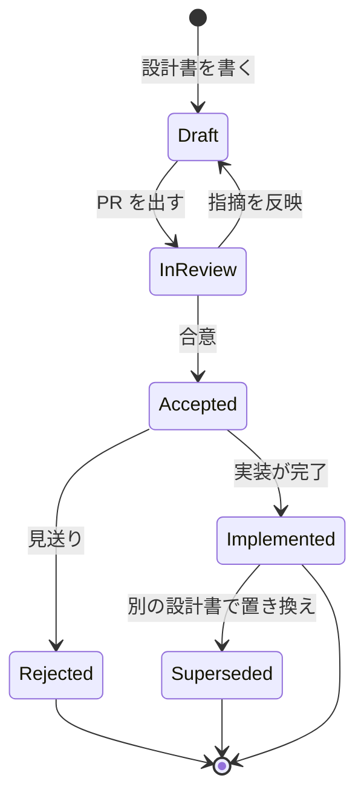

# 設計書の書き方と運用

- 目的: 「なぜその設計にしたか」を、実装の前に議論し、後から辿れるようにする。
- 参考にした考え方:
    - [Flutter: Design Documents](https://github.com/flutter/flutter/blob/master/docs/contributing/Design-Documents.md): 変更の規模に応じて、書く量とレビューの重さを変える。
    - [Design Docs at Google](https://www.industrialempathy.com/posts/design-docs-at-google/): トレードオフを中心に書く。ゴールと非ゴール、代替案、横断的関心事を必ず含める。
- テンプレートは [設計書テンプレート](template.md)。

!!! note "参照元の確認範囲"
    - Flutter の記事は、本文を読んで反映した。
    - Google の記事は、本文を取得できなかった。検索結果の要約にある標準構成（背景とスコープ / ゴールと非ゴール / 設計本体 / 代替案 / 横断的関心事）に基づく。
    - LY Corp Tech Blog の記事は、取得できなかったため、内容を反映していない。

## 1. 設計書が担う 4 つの役割

| 役割 | 設計書での表れ方 |
|---|---|
| 実装前に誤りを見つける | 背景・設計・代替案を、コードを書く前にレビューする |
| 合意を残す | ステータスと決定事項を、設計書の先頭と末尾に書く |
| 横断的な観点の漏れを防ぐ | セキュリティ・プライバシー・テスト・移行を、毎回見出しで確認する |
| 判断の履歴を残す | 採用しなかった案と、その理由を残す |

## 2. 規模に応じた使い分け

- 小さな変更に、重い設計書は書かない。
- Flutter の「ワンページャー / ツーページャー / RFC」を、このリポジトリの影響度ティア（`.claude/rules/model-routing.md`）に対応させる。

| 規模 | 書く場所 | 対象の目安 | ティア |
|---|---|---|---|
| ワンページャー | Issue または PR の説明 | 1 画面・1 サービスで閉じる機能追加、バグ修正、性能改善 | trivial / standard |
| ツーページャー | Issue または PR の説明 | 複数の画面・Provider にまたがるが、既存の API・スキーマは変えない | standard |
| 設計書 | `docs/design/NNNN-title.md`（本ディレクトリ） | 下記の「設計書が必要な変更」 | critical を含む |

**設計書が必要な変更:**

- DB スキーマ、RPC、RLS の変更。
- 認証・認可の方式変更。
- 外部サービス・新規ライブラリの導入。
- 複数の層（アプリ / Supabase / Edge Function / CI）にまたがる変更。
- 利用者のデータ移行や、後戻りしにくい変更。

!!! tip "迷ったときの基準"
    - 「半年後に、別の人がなぜこうしたのかを知りたくなるか」で決める。
    - 知りたくなるなら設計書、ならないなら PR の説明で足りる。

## 3. 設計書のライフサイクル

- Flutter の方針に合わせ、設計は PR 上で非同期にレビューし、合意を記録する。



| ステータス | 意味 | 次にすること |
|---|---|---|
| Draft | 執筆中 | PR を出す |
| In Review | レビュー中 | 指摘に答える。決まらない論点は「未解決の論点」に残す |
| Accepted | 合意済み。実装前または実装中 | 実装 PR から設計書へリンクする |
| Implemented | 実装が完了した | 「正とする場所」をコードに移す（下記） |
| Rejected | 見送り | 理由を残して閉じる。消さない |
| Superseded | 別の設計書で置き換えられた | 置き換え先へのリンクを先頭に書く |

## 4. 実装後は、コードを正とする

- Flutter の方針: 承認された設計は、ソースコードと API ドキュメントに詳しく残す。RFC を長く使う参照先にしない。
- このリポジトリでの運用:
    - 設計書には、判断の背景（なぜ）を残す。
    - 動作の詳細（どう）は、コードとコメント、`docs/` の仕様書を正とする。
    - 設計書の先頭に、実装との対応（主要ファイル）を書く。
    - 実装がずれたら、設計書を直すか、「実装時の差分」に記録する。

## 5. 書き方の原則

| # | 原則 | 具体的には |
|---|---|---|
| 1 | 問題と解決策を分ける | 背景では、現状・問題・再現手順を先に示す。解決策は設計で書く |
| 2 | ゴールと非ゴールを書く | 「やらないこと」を明示し、スコープの膨張を防ぐ |
| 3 | 代替案を残す | 採用しなかった案と、その理由を表で書く |
| 4 | トレードオフを書く | 採用案の弱点も書く |
| 5 | **シーケンス図を書く** | 処理の流れが複数の登場人物にまたがるときは、必ず図にする（下記） |
| 6 | 横断的関心事を確認する | セキュリティ・プライバシー・テスト・移行・可観測性を、見出しで確認する |
| 7 | 質問を具体的にする | 未解決の論点は「選択肢 / 推奨 / 決める人」の表にする |
| 8 | 短く書く | 長いコード・検証ログは折り畳み。付録に回す |

### シーケンス図のルール

- 対象: 認証、通知、決済、データ同期など、画面・サービス・外部システムをまたぐ流れ。
- 形式: Mermaid の `sequenceDiagram`（`pymdownx.superfences` で描画される）。
- 書き方:
    - 登場人物は、ユーザー・画面・サービス・外部サービスの順に並べる。
    - クラス名・メソッド名は、実装と同じ名前にする。
    - 正常系を 1 枚、主要な異常系・フォールバックを別の 1 枚にする。
    - 1 枚の図は、登場人物 6 つ以内、メッセージ 20 本以内を目安にする。
- 図の直前に、何の流れかを 1 行で書く。

??? example "最小のシーケンス図の例（12 行）"
    ```mermaid
    sequenceDiagram
        participant U as ユーザー
        participant UI as 画面
        participant S as XxxService
        participant SB as Supabase

        U->>UI: 操作
        UI->>S: メソッド呼び出し
        S->>SB: RPC / API
        SB-->>S: 結果
        S-->>UI: 結果
        UI-->>U: 表示
    ```

## 6. 設計書の一覧

| 番号 | タイトル | ステータス | ティア |
|---|---|---|---|
| 0001 | [パスキー導入（ログイン認証フロー刷新）](0001-passkey-introduction.md) | Implemented | critical |
| 0002 | [ログイン手段の整理（役割分担と画面の優先順位）](0002-login-methods-organization.md) | Implemented | standard |
| 0003 | [Push 通知（FCM トークン登録・配信・通知設定）](0003-push-notification.md) | Implemented | critical |
| 0004 | [会員登録（仮会員登録〜本登録）](0004-member-registration.md) | Implemented | critical |
| 0005 | [ログインとセッション管理（メール・パスワード / Google）](0005-login-and-session.md) | Implemented | critical |
| 0006 | [モバイルオーダー（店舗選択・商品・カート・注文確定・履歴）](0006-mobile-order.md) | Implemented | critical |
| 0007 | [スター・リワード（獲得・集計・有効期限・表示・交換）](0007-star-rewards.md) | Implemented | critical |
| 0008 | [会話注文（チャットと音声で、注文内容を決めてカートへ反映する）](0008-conversational-order.md) | Implemented | critical |
| 0009 | [画面遷移（ルート構成・タブ・ディープリンク・遷移の規約）](0009-navigation.md) | Implemented | standard |
| 0010 | [データベース設計（構成・アクセス経路・運用・文書の置き場）](0010-database.md) | Implemented | critical |
| 0011 | [店舗側の注文一覧の見直しと、注文の詳細画面・受取済の記録](0011-store-order-detail.md) | Accepted | critical |
| 0012 | [管理者の MFA（認証アプリでの確認）](0012-admin-mfa.md) | Implemented | critical |

!!! note "DB 関連の文書は、移さずに [0010](0010-database.md) から参照する"
    - テーブル定義書と ER 図は、実スキーマからの自動生成物のため、設計書にしない。
    - 運用ガイドは、マイグレーションと cron の近く（`supabase_schema/supabase/`）に置いたままにする。
    - 文書ごとの「正の所在」と扱いは、0010 の 3.1 に表でまとめた。

!!! warning "既存の設計書は、順次この形式に移行する"
    - 次の文書は、旧形式のまま `docs/` 配下に残っている。
    - 移行するときは、番号を振って本ディレクトリに移し、一覧に追加する。

    | 既存の文書 | 場所 |
    |---|---|
    | アーキテクチャ詳細 | `architecture/architecture.md` |

## 7. 番号の付け方

- 番号は 4 桁の連番。欠番を埋めない。
- ファイル名: `NNNN-<英小文字とハイフン>.md`。
- 設計書を新しく作るときは、一覧の最大番号に 1 を足す。
