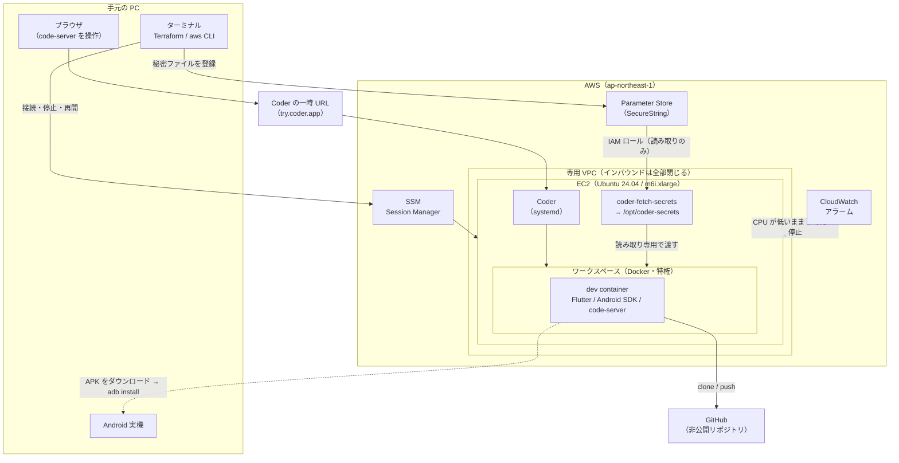
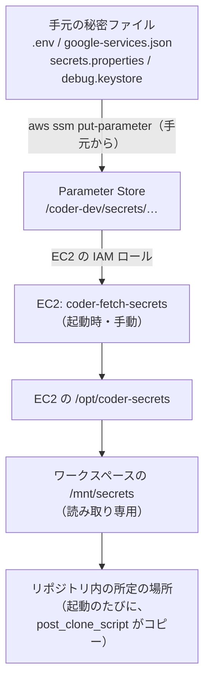

# クラウド開発環境（AWS 上の Coder）

- 目的: 手元の PC に負担をかけずに、コードの編集・解析・テスト・APK ビルドを行う。
- 方法: AWS の EC2 に Coder（クラウド開発環境の管理ツール）を載せ、ブラウザの VS Code（code-server）で開発する。
- 手順書: [infra/coder-aws/README.md](https://github.com/eno-conan/flutter-starbucks-clone/blob/main/infra/coder-aws/README.md)（コマンドと確認方法は、そちらを正とする）。
- このページ: 構成、設計判断、実際に出たつまずきと学びを残す。

## 1. 結果

| 項目 | 結果 |
|---|---|
| 解析・テスト（`scripts/run-tests.sh`） | 通る（901 件） |
| debug の APK（arm64 のみ） | 初回 513 秒、2 回目以降 約 59 秒。216 MB |
| release の APK（arm64、難読化あり） | 296 秒。42.6 MB |
| 実機での動作 | Google ログイン・地図・パスキー・App Links・通知が動いた |
| iOS のビルド・シミュレータ | できない（Linux では不可。macOS が必要） |
| Web 実行 | 動くが、このアプリは Web 向けではないので、環境の動作確認にしか使えない |
| 実機でのホットリロード | 未実装（下の「今後」を参照） |

## 2. 構成図

- EC2 は 1 台。Coder と Docker を同居させる。
- ワークスペースは Docker コンテナ（特権）で、その中で、`.devcontainer/` から dev container を起動する。
- インバウンドは全部閉じる。接続は、Session Manager（手元のターミナル）と、Coder の一時 URL（トンネル）だけ。

### 秘密ファイルの流れ

- 秘密ファイルは、リポジトリに入れず、Terraform の状態ファイルにも入れない。
- 手元から Parameter Store に登録し、EC2 が取得して、ワークスペースに読み取り専用で渡す。

## 3. 設計判断

| 判断 | 理由 | 却下した案 |
|---|---|---|
| EC2 1 台に、Coder と Docker を同居 | 個人利用で、最も簡単。ワークスペースが Docker-in-Docker を使える | ECS Fargate（特権コンテナが使えず、dev container が動かない） |
| dev container は、Coder の Dev Containers 連携で動かす | 公式の推奨。Envbuilder は保守モードになった | Envbuilder 方式の AWS テンプレート |
| インバウンドを全部閉じ、接続は Session Manager | 公開する入口が無い。SSH の鍵管理も要らない | SSH（22 番の開放） |
| Coder は一時 URL（トンネル）で公開 | ドメインも TLS 証明書も要らない。停止・再開でも URL は同じだった | 自分のドメイン（常用する段階で検討） |
| 専用 VPC を Terraform で作る | 既定 VPC に依存しない。`destroy` で一緒に消える | 既定 VPC の再作成 |
| 秘密ファイルは、EC2 側で取得して、ワークスペースに渡す | IMDS のホップ数を 1 にして、コンテナから EC2 の IAM ロールを使えなくしている。値が、状態ファイルに残らない | Terraform の `aws_ssm_parameter`（状態ファイルに平文で残る）、ホップ数を 2 に上げる |
| release の署名鍵は、クラウドに置かない | ワークスペースの中（Claude Code を含む）から読める場所に、置きたくない | 署名鍵を Parameter Store に登録 |
| 自動停止は、CPU 使用率で判断 | 追加の仕組みが要らない。基本モニタリングで足りる | 利用の有無を見る独自の仕組み |
| AWS プロバイダは 5.x に固定 | 検証したのが 5.82.2 で、6.x は未検証 | 最新の 6.x |

!!! warning "自動停止は、CPU だけで判断する"
    - 条件: CPU が 3% 未満の状態が、2 時間続いたとき。
    - IDE を開いて、コードを読んでいるだけの時間が長いと、作業中でも止まる。
    - 止まったら、`bash connect.sh` で再開し、ワークスペースを Restart する。

## 4. 費用の目安（東京リージョン、2026-11 の公式料金）

| 項目 | 単価 | 24 時間動かした場合 |
|---|---|---|
| EC2 `m6i.xlarge`（4 vCPU / 16 GB） | 0.248 USD/時 | 約 5.95 USD |
| EBS gp3 100 GB（停止中も課金） | 約 9.6 USD/月 | 約 0.32 USD |
| パブリック IPv4（起動中のみ） | 約 0.005 USD/時（公式データでは未確認） | 約 0.12 USD |

- 合計: 約 6.4 USD/日。24 時間 365 日動かすと、約 190 USD/月。
- 使わない間は、停止する。停止中は、ディスク代だけ。EC2 を終了すると、ディスク代も止まる。
- 1 日 4 時間・月 20 日の利用なら、約 30 USD/月。

## 5. つまずきと学び

!!! note "手順書の `つまずいたときの対処` と、同じ内容を、原因の観点でまとめている"
    - 症状から調べるときは、手順書の表を見る。
    - ここは、「なぜ起きたか」「何を学んだか」を残す。

??? example "つまずき一覧（15 件）"
    | 症状 | 原因 | 対処・学び |
    |---|---|---|
    | `coder.service` が `TLS is disabled` で起動しない | 待ち受けるアドレス（`CODER_HTTP_ADDRESS`）が空 | 設定ファイルに書く。起動時のスクリプトに入れた |
    | 起動時のスクリプトが Coder の導入で止まる（`HOME: parameter not set`） | cloud-init は `HOME` を設定せずに実行する。導入スクリプトは `HOME` を必要とする | スクリプトの先頭で `export HOME=/root` |
    | `git ls-remote` が `403 Write access to repository not granted` | Coder の GitHub App が、インストールされていない。「Authorized GitHub Apps」にあるのは、ログインの許可で、インストールではない | アプリのインストールページで、リポジトリを許可する |
    | dev container の起動で `config not found` | clone に失敗し、フォルダが空だった | 認証を直して Restart。`git-clone` は、フォルダが**空でない**ときだけ clone を飛ばす（ソースで確認） |
    | `build.gradle` が `Cannot convert 'null' to File` | `key.properties` が無いと、署名の設定が、設定フェーズで `null` になる | `key.properties` が無ければ、debug 鍵で署名する形に直した（PR #1254） |
    | `envied` が `not found for field` で失敗（`.env` には値がある） | envied は、`.env` が読めなくてもエラーを出さず、「見つからない」とだけ出す。`build_runner` は、`.env` の変更を検知しない | `build_runner clean` のあと、再生成。初回の失敗の原因は、確定できていない |
    | `aws ssm put-parameter` が `fully qualified name` エラー（Git Bash） | Git Bash が、`/` で始まる引数を、Windows のパスに変換する | `MSYS_NO_PATHCONV=1` を前に付ける |
    | `put-parameter` が `could not be decoded`（Git Bash） | AWS CLI が、`file://` を OS の文字コードで読む。日本語を含む `.env` で失敗 | `AWS_CLI_FILE_ENCODING=UTF-8` を付ける。`fileb://` にはしない |
    | 秘密ファイルが 0 バイトで復元される | snap 版の `aws` が、出力をファイルへ直接リダイレクトしたときだけ空になった（毎回ではない） | 出力を変数で受けて書き出す。空の結果ではファイルを置かない |
    | 地図が表示されない（`Maps SDK: Authorization failure`） | dev container が、自前の debug 鍵で署名していた。その指紋が、API キーの制限に未登録 | 共有 debug 鍵を登録して、署名を揃える。パスキー・App Links も、同時に直った |
    | debug の APK が 216 MB | `kernel_blob.bin`（129 MB）など、デバッグ専用の部分が大きい。ABI を絞っても、減らない | release にすると 42.6 MB。サイズを抑えたいなら release を使う |
    | `INSTALL_FAILED_VERSION_DOWNGRADE` | 端末に、新しいバージョンコードの配布版が入っている | アンインストールしてから入れる（データは消える） |
    | EC2 の再開後、`Workspace agent has disconnected` | EC2 の再起動で、ワークスペースのコンテナが起動しなかった | ワークスペースを Restart する |
    | 起動時のスクリプトを変えても、既存の EC2 に反映されない | cloud-init は、初回起動のときだけ実行する | `terraform apply -replace=aws_instance.coder` で作り直す |
    | `terraform apply` で、EC2 が一度止まる | `user_data` の変更は、AWS プロバイダが、停止して更新する | 想定内。起動時のスクリプトは、再実行されない |

!!! danger "`.env` の中身を見せるコマンドで、秘密を漏らした"
    - 状況: `sed 's/=.*/=<伏せる>/' .env` で、値を伏せて確認しようとした。
    - 結果: `=` を含まないコメント行（API キー）が、そのまま出た。
    - 対応: コメント行を除く（`grep -v '^#' .env | sed 's/=.*/=<伏せる>/'`）。会話に出た秘密は、漏れたものとして扱い、キーを入れ替える。

## 6. 今後の課題

- 実装済みの構成は、「動くか」を確かめるための最小構成。常用する前に、下のセキュリティ強化を行う。
- ここに書くのは、すべて**案**。未実装で、動作も未検証。

### 6.1 現状のセキュリティ上の弱い点

| 点 | 現状 | リスク |
|---|---|---|
| Coder への入口 | 一時 URL（`try.coder.app`）。URL を知っていれば、インターネットのだれでも、ログイン画面に届く | 守るものは、管理者のパスワードだけ。URL が漏れると、総当たりの対象になる |
| 秘密ファイルの置き場 | EC2 の `/opt/coder-secrets`（ファイルの権限は 0644）と、ワークスペース内のリポジトリに、平文で置く | EC2 上のだれでも、ワークスペースの中で動く何でも（Claude Code を含む）、読める |
| EC2 の IAM ロール | `/coder-dev/secrets/` の下を、すべて読める | EC2 を乗っ取られると、登録した秘密が、まとめて読まれる |
| 暗号鍵 | Parameter Store の既定の鍵（AWS マネージド）。利用の記録を、鍵の側で絞れない | 「いつ、だれが読んだか」を、追いにくい |
| `.env` の中身 | アプリの実行に不要かもしれないキー（サーバー側の API キーなど）も、まとめて登録している | 不要な秘密を、クラウドに置いている。漏れたときの影響が大きい |
| Session Manager | IAM の権限があれば、EC2 の root のシェルに入れる。操作の記録は、取っていない | IAM ユーザーの管理が甘いと、そのまま全権になる |

!!! warning "今回、実際に起きた漏えい"
    - `.env` のコメント行に残っていた API キー（Resend）が、確認用のコマンドの出力で、会話に表示された。
    - 使用中のため、キーの入れ替えは、見送っている。
    - 入れ替えを、課題として残す。

### 6.2 ドメインの設定と、IP 制限

- 目的: 入口を、自宅など、決まった場所からだけに絞る。あわせて、URL を固定する。
- 方向:
    - 自分のドメインを取得し、Coder のアクセス URL（`CODER_ACCESS_URL`）に設定する。設定すると、一時 URL（トンネル）は、使われなくなる。
    - セキュリティグループで、443 番を、自宅の IP からだけ開ける。
    - 必要なら、ワイルドカードのアクセス URL（`CODER_WILDCARD_ACCESS_URL`）も設定する。ポート転送（Web 実行の確認など）が、安定する。

| 論点 | 内容 |
|---|---|
| TLS 証明書 | 公式の文書では、Coder 自身が証明書を自動更新する仕組みは、確認できていない。リバースプロキシ（Caddy・nginx など）で、Let's Encrypt の証明書を取るか、ALB と ACM を使う案がある |
| ワイルドカード証明書 | DNS での認証（DNS-01）が要る。EC2 のロールに、Route 53 のレコード変更権限が要る（権限は、対象のゾーンだけに絞る） |
| 自宅の IP が変わる | 家庭向けの回線は、IP が変わることが多い。変わるたびに、セキュリティグループの更新が要る。自動更新の仕組みか、別の方式（下）が要る |
| 外出先から使えない | IP 制限だと、自宅の外から、入れない |
| 費用 | ドメインは、年 16 USD 前後（`.com`）。ALB を使うと、月額の固定費が増える（金額は、AWS の料金ページで確認する） |

??? example "IP 制限の代わりに考えられる方式（4 件）"
    | 方式 | 概要 | 評価 |
    |---|---|---|
    | Tailscale（VPN）に入口を閉じる | 公開の入口をなくし、VPN に入った端末だけが届く | 外出先からも使える。実機のホットリロード（下）の案と、同じ仕組みを使える |
    | Cloudflare Access などの認証つきの入口 | 入口で、ログインを要求する | 外部サービスが増える |
    | Coder の SSO（OIDC）連携 | Coder のログインを、Google などに任せる | 公式の文書で確認が要る。パスワードだけに頼らなくなる |
    | 現状のまま（強いパスワードだけ） | 追加の対策なし | 常用には、弱い |

### 6.3 秘密情報の管理の強化

- 目的: Parameter Store 経由とはいえ、秘密が平文で、広い範囲から読める状態を、狭める。

| 案 | 内容 | 効果 |
|---|---|---|
| クラウドに置くものを絞る | アプリの実行に必要なものだけを置く。サーバー側の API キー（メール送信、生成 AI など）は、アプリの `.env` に入れず、Supabase の Edge Function の秘密に置く | 漏れたときの影響を減らす。**最初にやる価値が大きい** |
| 開発用の鍵を分ける | 本番とは別の、開発用の鍵・プロジェクトを使い、権限と上限を絞る | EC2 が漏れても、本番に届かない |
| ファイルの権限を狭める | `/opt/coder-secrets` を 0600 にし、ワークスペースのユーザーだけが読めるようにする | 他のユーザー・プロセスから、読めなくする |
| 暗号鍵を自分の鍵にする | Parameter Store の SecureString を、自分で作った KMS の鍵で暗号化し、鍵のポリシーで、読める主体を絞る | 利用の記録（CloudTrail）が、鍵の側にも残る。読める主体を、細かく絞れる |
| 取得の記録とアラーム | `ssm:GetParameter` の呼び出しを、CloudTrail で記録し、想定外の読み取りに通知する | 漏えいの検知 |
| Secrets Manager への移行 | 自動ローテーションが使える。費用が増える | 鍵の入れ替えを、仕組みにできる |
| ワークスペースを、秘密から切り離す | Claude Code などを動かす環境と、秘密を持つ環境を分ける | ワークスペース内の暴走や、プロンプトの悪用から、秘密を守る |
| Session Manager の記録 | セッションの操作を、S3 や CloudWatch Logs に残す。IAM ユーザーに MFA を要求する | EC2 に入った操作の追跡 |
| 秘密の入れ替え手順 | 入れ替えの手順を、文書にする（キーの発行、Parameter Store の更新、`coder-fetch-secrets`、Restart） | 漏れたときに、すぐ動ける |

!!! tip "リポジトリの既存の対策との関係"
    - リポジトリには、Claude が `.env` などを読むことを止める hooks（`credential-guard` など）がある。
    - クラウドの dev container の中でも有効か、未確認。確認が要る。

### 6.4 機能面の未検証・未実装

!!! question "未検証・未実装"
    - 実機のホットリロード: 実機を Tailscale 経由でクラウドにつなぎ、ADB のワイヤレスデバッグで `flutter run` する案。つながるかは、未確認。
    - 復元の順序: `post_clone_script` が、dev container の起動より前に終わるかは、公式で確認していない。
    - 管理者アカウントの作成を、自動化できるか（`coder login` の非対話オプションは、未確認）。
    - 自動停止の閾値: CPU 3% × 2 時間が、実際の使い方に合うか。
    - 一時 URL の仕様（有効期間・制限）は、公式で確認していない。停止・再開では、同じだった（1 回の確認）。
    - Firebase 系プラグインの更新（Kotlin Gradle Plugin の警告。将来の Flutter でビルドが失敗する予告）。
