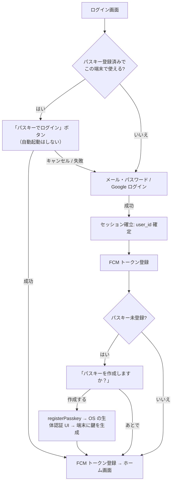
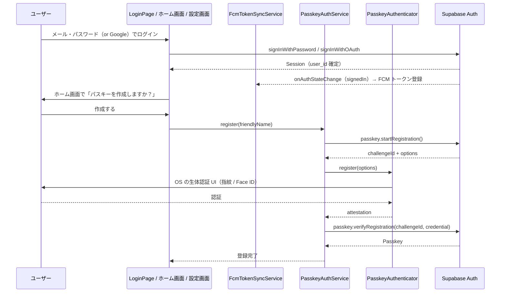
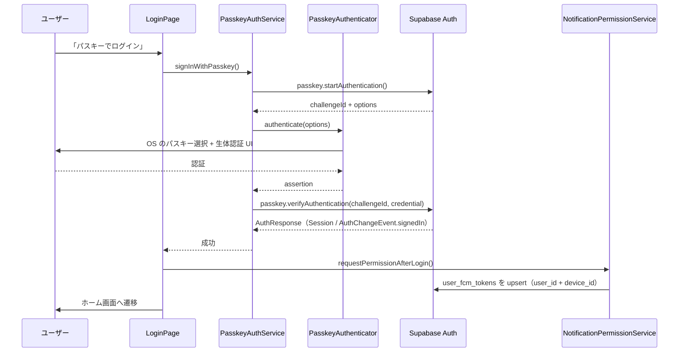
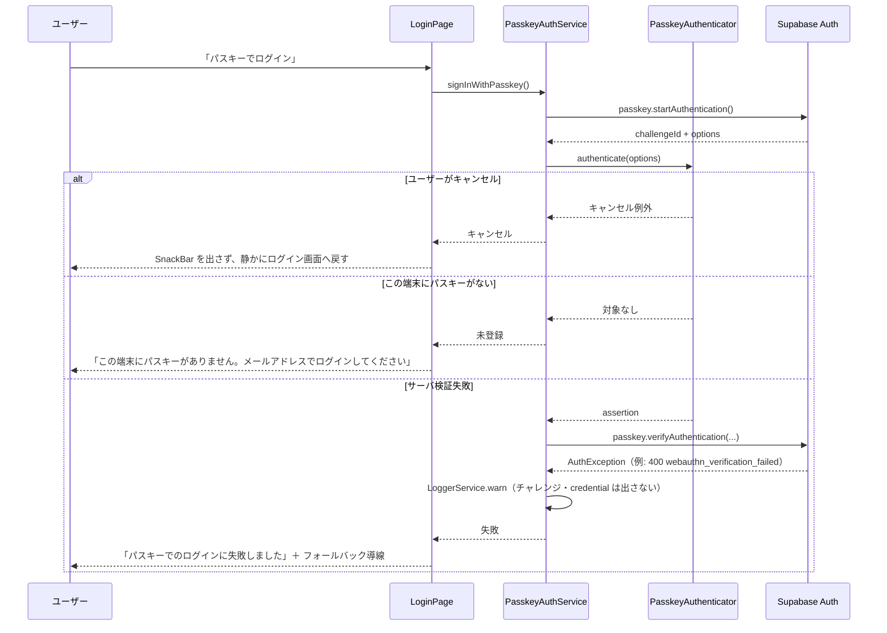
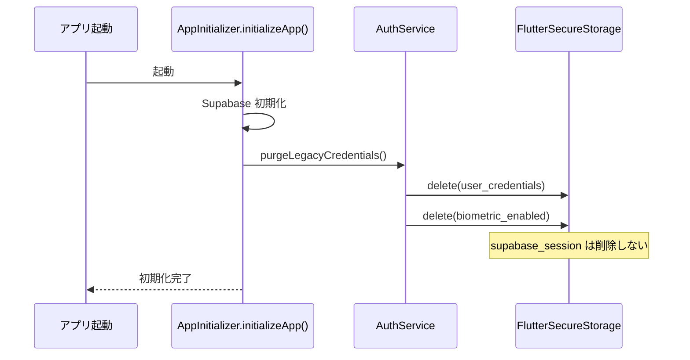
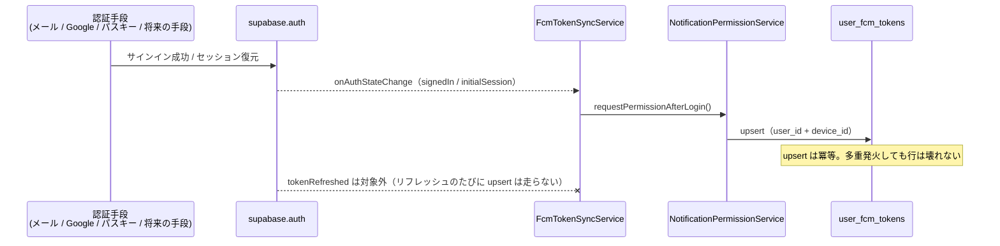
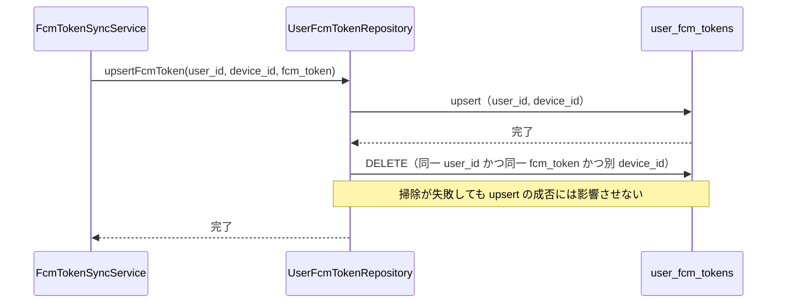
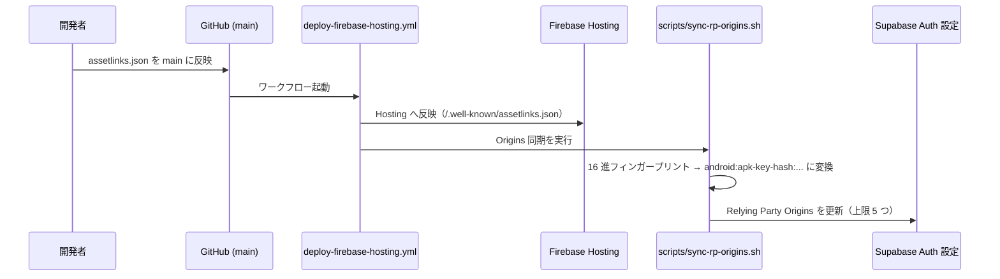

# 0001: パスキー導入（ログイン認証フロー刷新）

| 項目 | 内容 |
|---|---|
| ステータス | **Implemented** |
| 作成者 | 旧設計書から移行（履歴は `git log --follow` を参照） |
| 課題・見直しの管理 | 親 Issue [#1063](https://github.com/eno-conan/flutter-starbucks-clone/issues/1063)（課題は、サブ Issue で管理する） |
| 関連 Issue | [#807 認証関係のIssue](https://github.com/eno-conan/flutter-starbucks-clone/issues/807) / [#697 パスキー実装について](https://github.com/eno-conan/flutter-starbucks-clone/issues/697) / [#472](https://github.com/eno-conan/flutter-starbucks-clone/issues/472) |
| 影響度ティア | **critical**（`lib/services/**`・`pubspec.yaml`・`android/**`・`ios/**` を含む） |
| モデル・レビュー | 計画 = Opus / 実装 = Sonnet / 必須レビュー = code-reviewer + qa-agent + security-agent |
| 置き換え | 旧 `starbucks_user_side/signin/passkey-design.md`（本書へ移動） |

**実装との対応（実装後は、コードを正とする）:**

| 役割 | ファイル |
|---|---|
| パスキーのラッパー | `lib/services/passkey_auth_service.dart` |
| Provider の登録 | `lib/provider/service_providers.dart`（`passkeyAuthServiceProvider`） |
| 登録提案のポリシー | `lib/services/passkey_prompt_policy.dart` |
| 状態管理 | `lib/provider/passkey_state_provider.dart` |
| ログイン画面 | `lib/screens/starbucks_user_side/signin/login.dart` / `widgets/passkey_login_button.dart` |
| 登録提案ダイアログ | `lib/shared/widgets/dialogs/passkey_registration_prompt.dart` |
| パスキー管理画面 | `lib/screens/starbucks_user_side/setting/passkey_setting/main.dart` |
| FCM 登録の一元化 | `lib/services/fcm_token_sync_service.dart` / `lib/app/app.dart`（`start()` の起動） |
| 旧認証情報のパージ | `lib/services/auth_service.dart`（`purgeLegacyCredentials`）/ `lib/config/app_initializer.dart` |
| `device_id` の是正（アプリ側） | `lib/core/services/device/device_id_service.dart` / `lib/data/repository/user_fcm_tokens.dart`（古い行の自己修復） |
| `device_id` の是正（DB 側） | `supabase_schema/supabase/migrations/20260819000001_fix_user_fcm_tokens_device_id.sql` |
| 依存 | `pubspec.yaml`（`supabase_flutter` / `passkeys`） |
| Android の紐づけ | `public/.well-known/assetlinks.json` / `scripts/sync-rp-origins.sh` / `.github/workflows/deploy-firebase-hosting.yml` |

## 要約（TL;DR）

- 何を変えるか: 端末にパスワード原本を保存する「指紋認証ログイン」をやめ、Supabase ネイティブのパスキー（WebAuthn）によるサーバ認証に置き換える。
- なぜ変えるか: 現行方式は、指紋認証がサーバ認証になっておらず、パスワード原本を端末に置いている（OWASP Mobile M1 / M9 に抵触）。
- 採用する方式: Supabase ネイティブ Passkey。認証プロバイダを動かさないため、`auth.users.id` が不変になり、FCM トークンが壊れない。
- 最重要の制約: **FCM トークン登録・プッシュ通知を一切壊さない。**

## 1. 背景

### 1.1 導入前のログイン体験と問題点

- 導入前は、ログイン成功後に「指紋認証を有効にしますか？」と尋ね、メールアドレスとパスワードを `FlutterSecureStorage` に JSON で保存していた。
- 2 回目以降は、ログイン画面の表示と同時に `local_auth` の指紋認証 UI を自動起動していた。成功すると、保存済みのパスワードで `signInWithPassword` を再実行していた。

| # | 問題 | 要点 |
|---|---|---|
| 1 | パスワード原本を端末に保存している | 暗号化ストレージとはいえ、OWASP Mobile M9（安全でないデータストレージ）/ M1（不適切な認証情報の使用）に抵触する |
| 2 | 指紋認証がサーバ側の認証になっていない | `local_auth` の成功は「端末のロックが解除できた」ことしか証明しない。実際のサーバ認証は保存済みパスワードの再送で、フィッシング耐性はゼロ |
| 3 | Google ログインは自動ログインできない | セッション切れ時は「再度Googleログインが必要です」で終わる |
| 4 | ログイン画面のロジックが 1 つの `StatefulWidget`（941 行）に集中している | 認証・保存・FCM・UI が混在し、テスト・レビューが困難 |

### 1.2 導入前の問題点

- 1.1 の表に統合した。3.2.5 と 4.2 の「1.1 の問題 #N」は、この表の番号を指す。

## 2. ゴールと非ゴール

**ゴール:**

- 指紋（生体）認証を、**パスキー（WebAuthn）による本物のサーバ認証**に置き換える。
- 端末からパスワード原本を排除する。
- 既存のメール・パスワード / Google ログインは、フォールバックとして残す。
- **FCM トークン登録・プッシュ通知を一切壊さない。**（最優先の制約）

**非ゴール:**

| 非ゴール | 理由 |
|---|---|
| iOS のパスキー対応 | Apple Team ID がリポジトリ内に存在せず、値を特定できない（3.6.3 参照）。当面対象外 |
| メール・パスワード / Google ログインの廃止 | パスキーが使えない端末・ユーザーのフォールバックとして常に残す |
| パスキー単体での新規ユーザー作成 | Supabase の仕様で不可能。パスキーは「既存ユーザーに追加する認証手段」（3.1.3） |
| 再ログイン時の `is_notify` 上書きの是正 | 設計時は既存挙動の変更になるためスコープ外とした（7. の論点 #5） |
| Corbado（`corbado_auth`）の採用 | 4. 検討した代替案を参照 |

## 3. 設計

### 3.1 方式: Supabase ネイティブ Passkey

#### 3.1.1 利用可能なこと

- Supabase Auth のパスキーは、Beta で提供されている（2026-05-28 に提供開始）。
- Flutter クライアントは、`supabase_flutter` 2.15.0 以降で使える。
- `supabase_flutter` は、端末側の WebAuthn を実装していない。`PasskeyAuthenticatorInterface` の実装を呼び出し側が渡す設計のため、`passkeys` プラグインを追加した。
- API の使い方は、コードを正とする。experimental な API の呼び出しは、`lib/services/passkey_auth_service.dart` に閉じ込めている。
- 依存のバージョンは `pubspec.yaml`、上流のソースは 8. 参考を参照。

#### 3.1.2 層ごとの責務

| 層 | 責務 | 備考 |
|---|---|---|
| OS（Credential Manager） | 鍵の生成、生体認証 UI、署名 | Android は別 Activity を起こす |
| `passkeys` プラグイン（`PasskeyAuthenticator`） | OS のセレモニーを呼び出す | `PasskeyAuthenticatorInterface` を実装 |
| `PasskeyAuthService` | `supabase_flutter` の拡張メソッド呼び出しを、このクラスに閉じ込める | experimental API の影響範囲を限定する |
| Supabase Auth | チャレンジ発行、署名検証、セッション発行 | Auth（GoTrue）v2.188.0 以降が必要（3.6.1） |

#### 3.1.3 重要な仕様上の前提

- **パスキーは「既存ユーザーに追加する認証手段」。** パスキー単体で、新規ユーザーを作ることはできない。
    - `registerPasskey()` は、サインイン済み（非匿名）ユーザーを要求する。
    - → **この仕様が、本設計の安全性を担保している。** ユーザーは必ず既存の `auth.users.id` を持ったままパスキーを追加するため、`user_id` が変化することはない。
- サインインは **discoverable credentials（Resident Key）** を使う。ユーザーはメールアドレスを入力せず、OS のパスキー選択 UI から直接ログインできる。
- Supabase 側で「Enable Passkey authentication」を有効にする必要がある（既定は無効）。

### 3.2 導入後の認証フロー

#### 3.2.1 全体像

- 初回登録・2回目以降のログイン・フォールバックの 3 つの経路がある。



#### 3.2.2 パスキー登録シーケンス

- 登録は、ログイン完了と FCM 登録の**後**に行う（3.4.2 #5 の事故を避けるため、順序を厳守）。
- 提案は、ログイン手段を問わず、ホーム画面で出る（`maybePromptPasskeyRegistration`。[0002 の 3.3.2](0002-login-methods-organization.md)）。
- FCM 登録は、`signedIn` を契機に `FcmTokenSyncService` が行う（3.4.3）。



#### 3.2.3 パスキーログインシーケンス

- ログインに成功すると、`user_fcm_tokens` が既存と同じ経路で upsert される。



#### 3.2.4 異常系・フォールバックのシーケンス

- キャンセル、未登録、サーバ検証失敗の 3 つの分岐を、1 枚にまとめる。
- 各分岐の UI 挙動は、3.7.3 の表と対応する。



#### 3.2.5 Google 認証との関係

- Google ログインしたユーザーも、ログイン直後にパスキーを登録できる（`registerPasskey()` は「どうやってログインしたか」を問わない）。
- **現状「セッション切れ時にアカウント再選択が必要」だった Google ユーザーも、2 回目以降はパスキーで一発ログインできる。**
- 1.1 の問題 #3 が解消される。

#### 3.2.6 自動起動をやめる理由

- 導入前は、画面表示と同時に指紋認証 UI を自動起動している（`_initializeBiometricAuth()`）。
- パスキーでは、**ユーザー操作を起点にする**方針へ変える。理由:
    - OS のパスキー UI はモーダルで、意図せず出るとキャンセル操作を強いる。
    - キャンセル例外のハンドリングが、自動起動だと煩雑になる。
    - 「メール・パスワードでログインしたいだけ」のユーザーの導線を塞がない。

### 3.3 既存の生体認証まわりの廃止・移行

#### 3.3.1 廃止するもの

| 対象 | 場所 | 対応 |
|---|---|---|
| `user_credentials`（メール・パスワードの JSON） | secure storage | **削除**。移行処理で既存端末からも消す |
| `biometric_enabled` | secure storage | **削除** |
| `_storeCredentials` / `_getStoredCredentials` / `_hasStoredCredentials` / `_isBiometricEnabled` / `_toggleBiometricAuth` | `login.dart` | 削除 |
| `_performBiometricLogin` / `_performSavedCredentialsLogin` | `login.dart` | 削除 |
| `_promptToEnableBiometricAuth` / `_promptToSaveCredentialsForNonBiometric` / `_promptToUseSavedCredentials` | `login.dart` | パスキー登録提案ダイアログに置換 |
| `LocalAuthentication` の直接利用 | `login.dart` | 削除（生体認証 UI は OS がパスキーセレモニー内で出す） |

#### 3.3.2 移行処理（1 回だけ実行）

- アプリ起動時に、旧キーが残っていれば無条件で削除する。
- 呼び出し位置: `AppInitializer.initializeApp()` 内（Supabase 初期化後）。
- 削除の流れを、次の図に示す。



- 実装: `AuthService.purgeLegacyCredentials`（`lib/services/auth_service.dart`）。旧キー `user_credentials` と `biometric_enabled` だけを削除する。

!!! danger "セッションには触らない"
    - `supabase_session`（`SecureSessionStorage` のキー）は、削除対象外。
    - これを消すと、全ユーザーが強制ログアウトになり、FCM 再登録の嵐になる。

#### 3.3.3 `local_auth` 依存の扱い

- `local_auth` の利用箇所は、`login.dart` のみだった。
- 将来、アプリ再開時の再ロック（e チケット表示前の本人確認など）で使う可能性はあった。
- 本対応のスコープ外として、実装フェーズ 4 で判断することにしていた。
- 結果: 現在の `pubspec.yaml` に `local_auth` は無い。

### 3.4 FCM トークンを壊さないための設計（最重要）

#### 3.4.1 なぜ壊れないのか

- `user_fcm_tokens` は、`(user_id, device_id)` の複合主キー。
- `user_id` は、`supabase.auth.currentUser.id` を使っている。
- パスキーは、既存 `auth.users` 行に紐づく追加認証手段。よって **`user_id` は変化しない。**
- 既存の `user_fcm_tokens` 行はそのまま有効。パスキーログイン後の upsert は、同じ行を更新する。
- 通知設定（`is_notify`）は、端末ごとの行に持つ。同じユーザーでも、端末ごとに異なる設定ができる。
    - 通知設定画面は、**この端末の行（`user_id` と `device_id`）だけ**を読み書きする。他の端末の設定は変更しない。
    - 再ログインでは、既存行の `is_notify` を更新しない（初回登録時だけ、OS の許可状態を書く）。
    - ログアウトでは行を削除せず、`fcm_token` だけを空にする。行を消すと、再ログインで行が作り直され、`is_notify` が OS の許可状態に戻るため。

- 実装: `AuthService.setFcmTokenAndNotifySetting`（`lib/services/auth_service.dart`）が、`_supabase.auth.currentUser?.id` を `user_id` に使う。この取得元が変わらなければ安全。

#### 3.4.2 それでも壊れうるケースと対策

| # | 壊れ方 | 原因 | 対策 |
|---|---|---|---|
| 1 | パスキーでログインしたのに FCM トークンが登録されない | 導入前は、FCM 登録が「`_navigateToHome()` の中」「OAuth コールバック」「アプリ起動時」の **3 箇所に散在**していた。パスキーログインの新経路がどれも通らないと登録が漏れる | **3.4.3 の一元化を実施する**（本設計の必須項目） |
| 2 | 通知許可ダイアログが二重に出る / 遷移前に出る | 導入前は、`_navigateToHome()` が `context.go` の 1.5 秒後に許可要求する暫定実装だった | 一元化にあわせて、遷移完了後に 1 回だけ走るようにする |
| 3 | Android で `device_id` が端末ごとに一意になっておらず、FCM トークン登録が一意制約違反で失敗する | `DeviceIdService` が Android で `AndroidDeviceInfo.id`（= `android.os.Build.ID`）を返していた。これは **OS ビルドの識別子**であり、同じビルドで動く全端末で同じ値になる。加えて `user_fcm_tokens_device_id_unique` が device_id をグローバルにユニークにしているため、テーブル全体で 1 ビルドあたり 1 行しか入らない | **既存バグ（別アカウントかどうかに関係なく発生する）**。フェーズ 3-b で対処（3.4.4 参照） |
| 4 | ログアウトしても古いトークン行が残る | 導入前は、`signOutWithEmailAndPasswordAndDevice()`（トークン削除つき）に **呼び出し元が 1 つもなかった**。設定画面・店舗側画面はいずれも、削除をしない `signOutWithEmailAndPassword()` を呼んでいた | **既存バグ**。フェーズ 3-a で対処（後始末を `signOutWithEmailAndPassword()` 本体に取り込み、呼び出し側の書き忘れが起きない形にした。のちに、行の削除から `fcm_token` を空にする方式へ変更した。`is_notify` を次のログインへ引き継ぐため） |
| 5 | パスキー登録の生体認証 UI 中にアプリが一時停止し、復帰時に FCM 初期化が走らない | Android の Credential Manager は別 Activity を起こす | 登録は「ログイン完了 → FCM 登録済み」の**後**に行う順序を厳守（3.2.2 のシーケンス順） |

#### 3.4.3 FCM トークン登録の一元化（必須）

- 導入前の 3 つの起点を、`onAuthStateChange` の 1 箇所に集約する。
- 集約後の流れを、次の図に示す。



??? info "導入前と変更後の起点の対比（10 行）"
    ```
    【導入前】
      login.dart          _navigateToHome() → requestPermissionAfterLogin()
      app.dart            _handleOAuthCallback() → requestPermissionAfterLogin()
      app.dart            _initializeApp()（既存セッションあり）→ requestPermissionAfterLogin()

    【変更後】
      app.dart            FcmTokenSyncService.start()（アプリ起動時に 1 回）
      fcm_token_sync_service.dart
        onAuthStateChange の signedIn / initialSession → 登録をキューに積む → requestPermissionAfterLogin()
        onTokenRefresh                                   → 同じキューで登録し直す
    ```

!!! success "効果"
    - 認証手段が何であっても（メール・パスワード / Google / パスキー / 将来の追加手段）、FCM トークン登録が自動で走る。
    - 新しいログイン経路を足すたびに、登録処理を書き足す必要がなくなる。
    - 3.4.2 #1 の事故が、構造的に起きなくなる。

**注意点:**

- `signedIn` は `tokenRefreshed` とは別イベント。リフレッシュのたびに upsert は走らない。
- `initialSession` はセッション復元時に発火する。起動時登録（旧 `_initializeApp` の分岐）を置き換えられる。
- upsert は冪等なので、多重発火しても行は壊れない。
- 導入前は、`FirebaseMessaging.instance.onTokenRefresh` のリスナーが、`login.dart` の `_setupAuthStateListener()` 内で **auth イベントごとに購読が増える**実装だった（リスナー多重登録）。
    - 一元化で、`FcmTokenSyncService.start()` がアプリ起動時に 1 回だけ購読する。2 回目以降の `start()` は何もしない。

#### 3.4.4 ついでに直す既存バグ（フェーズ 3）

| # | 内容 | 要点 |
|---|---|---|
| 1 | ログアウト時のトークン削除 | 呼び出し側を差し替えるのではなく、`signOutWithEmailAndPassword()` 自身がデバイス ID を解決して `fcm_token` を空にする（行は残す。`is_notify` を引き継ぐため）。呼び出し側が削除を書き忘れる余地をなくすため。使われていなかった `signOutWithEmailAndPasswordAndDevice()` は削除した |
| 2 | `device_id` の是正 | 問題は 2 層あり、両方を直す必要があった（下記 (a) アプリ側 / (b) DB 側） |
| 3 | 古い device_id 行の自己修復 | 実行順序を守れなかった場合の保険（下記） |

**(a) アプリ側: device_id が端末ごとに一意でない（根本原因）**

- `DeviceIdService` は、Android で `AndroidDeviceInfo.id` を返していた。
- device_info_plus のドキュメントコメントは *"Either a changelist number, or a label like 'M4-rc20'"*。つまり、これは `android.os.Build.ID`（OS ビルドの識別子）であって、端末固有 ID ではない。
- `TQ3A.230805.001` のような値が、同じ OS ビルドの全端末で共通になる。
- **対策:** Android には信頼できる端末固有 ID が存在しないため、**初回起動時に UUID v4 を生成して、セキュアストレージへ永続化する**方式に変更した。
- iOS の `identifierForVendor` は、ベンダー単位・端末単位で一意なので、従来どおり使う。

**(b) DB 側: グローバルユニーク制約**

- `user_fcm_tokens_device_id_unique` を削除し、複合主キー `(user_id, device_id)` のみで一意性を担保する。
- 同一端末に複数ユーザーの行が並ぶが、`pushNotify` は `user_id` で絞るため、送信先は正しい。
- あわせて、更新されることのなくなった不正な device_id の行を削除する。
    - Android の `Build.ID`。
    - 20260314000001 で付与した `legacy_<user_id>`。
- 該当ユーザーは、次回アプリ起動時に `FcmTokenSyncService` が `initialSession` を契機に再登録する。**再ログインは不要。**

- マイグレーション: `supabase_schema/supabase/migrations/20260819000001_fix_user_fcm_tokens_device_id.sql`（ユニークインデックスの削除と、不正な `device_id` 行の削除）。

!!! warning "実行順序に注意"
    - アプリ側 (a) をリリースする**前**にマイグレーションだけを流すと、同じ不正な device_id が入り直すため、効果がない。

!!! note "`user_id` 単独のインデックスは不要"
    - 複合主キー `(user_id, device_id)` の btree が先頭列で効く。
    - そのため、`pushNotify` の `user_id` 絞り込みはそのまま機能する。

**古い device_id 行の自己修復（保険）**

- 起きうる問題: 上記の実行順序を守れず、アプリ側のリリース前にマイグレーションを適用した場合。
    - `Build.ID` の行が入り直す。
    - アプリ更新後に、**同じ端末に対して古い行と新しい行の 2 行が並ぶ**。
    - FCM トークンはアプリインストール単位で一意なので、**両方の行が同じトークンを持ち、`pushNotify` が同じ端末へ通知を 2 回送ってしまう。**
- 対策: 手動 SQL での再掃除に頼ると、忘れたときに気づけない。そのため、`UserFcmTokenRepository.upsertFcmToken()` が、登録直後に「同一ユーザー・同一 `fcm_token`・別 `device_id`」の行を削除するようにした。
- 安全な理由: この条件に当てはまる行は、同じインストールが過去に別の `device_id` で登録した残骸に限られる（別端末なら必ず別のトークンになる）。
- 効果:
    - 今後 `device_id` の生成方式を変更しても、行が自動的に収束する。
    - 掃除の失敗は、upsert 自体の成否に影響させない。



### 3.5 パスキー管理（設定画面）

- 設定画面から、登録済みパスキーの一覧・追加・削除ができる。
- 画面は `lib/screens/starbucks_user_side/setting/passkey_setting/main.dart`。
- 呼び出す API は `PasskeyAuthService.list()` / `register()` / `delete()`。
- 管理画面に持たせる項目の推奨は、8. 参考の「パスキーを管理する | Android Developers」を参照する。

### 3.6 プラットフォーム設定

- パスキーは、RP ID（ドメイン）とアプリの紐づけが必須。
- 本リポジトリは、すでに Firebase Hosting のドメイン（`FIREBASE_HOSTING_DOMAIN`）で App Links / Universal Links を運用している。
- そのため、**同じドメインを RP ID に流用する。**

#### 3.6.1 Supabase ダッシュボード（Authentication → Passkeys）

| 設定 | 値 |
|---|---|
| Enable Passkey authentication | 有効 |
| Relying Party Display Name | `すたば`（Android の `android:label` に合わせる。生体認証プロンプトに出る）<br>※ iOS の `CFBundleDisplayName` は `Testing App` でズレているが、**iOS は当面対象外**のため Android 側に揃える |
| Relying Party ID | `FIREBASE_HOSTING_DOMAIN` の裸ドメイン（スキーム・ポート・パスなし） |
| Relying Party Origins | `https://<FIREBASE_HOSTING_DOMAIN>` に加えて **Android アプリのオリジンが必須**（3.6.2 参照） |

!!! danger "Auth（GoTrue）v2.188.0 以降が必要（**最重要**）"
    - パスキーのエンドポイントは、v2.188.0 以降でしか提供されない。
    - それより古いプロジェクトでは、`/auth/v1/passkeys/*` が **プレーンテキストの `404 page not found`** を返し、パスキーは一切動作しない。

- ダッシュボードに設定 UI が表示されても、サーバが対応しているとは限らない。実際のバージョンは、`/auth/v1/health` で確認する。
- 確認と更新の手順（Postgres のアップグレード、`pgjwt` の事前削除など）と、このリポジトリでの実績は、[Supabase](../project/supabase.md) の「パスキー（Supabase Auth）」に移した。

#### 3.6.2 Android アプリのオリジンを登録する（**必須**）

- Android のネイティブアプリは、WebAuthn のオリジンが `android:apk-key-hash:<署名証明書の SHA-256 を base64url 化した値>` になる。
- `https://` のオリジンしか登録していないと、**OS のセレモニーは成功するのに、サーバ検証で 400 `webauthn_verification_failed` になる。**
- Origins は **上限 5 つ**。`https://` で 1 つ使うため、Android のオリジンは最大 4 つまで。

!!! tip "手作業は不要"
    - 16 進のフィンガープリントからの変換と Supabase への反映は、`scripts/sync-rp-origins.sh` が行う（変換と二重管理の同期は、[Android 署名鍵の管理](../project/android-signing-keys.md) の 3 章）。
    - `assetlinks.json` が `main` に入ると、`deploy-firebase-hosting.yml` が Hosting への反映と同時に自動で同期する。
    - 署名鍵の管理方針と、手動での確認方法は [Android 署名鍵の管理](../project/android-signing-keys.md) を参照。



#### 3.6.3 Android: Digital Asset Links と iOS の扱い

**Android:**

- `public/.well-known/assetlinks.json` に、**`delegate_permission/common.get_login_creds` のエントリを追加**する。
- 既存の `handle_all_urls` エントリは、そのまま残す（消すと App Links が壊れる）。
- `firebase deploy --only hosting` で反映する。
- `minSdk 29` は、Credential Manager の要件を満たす。
- **API 34 未満では、Google Play services 経由**になる。実機検証は、API 33 と API 34+ の両方で行う。
- 端末に画面ロック（PIN / 指紋 / 顔）が設定されていないと、パスキーは作成できない。
- 実装: `public/.well-known/assetlinks.json`（`get_login_creds` のエントリ）。

**iOS（当面対象外）:**

!!! warning "iOS のパスキー対応は、現時点で予定していない"
    - Apple Team ID がリポジトリ内（`DEVELOPMENT_TEAM` など）に存在せず、値を特定できない。
    - Team ID を確定しないまま `apple-app-site-association` を配置すると、**iOS のパスキーが「エラーも出ずに動かない」状態**になる。かえって切り分けが難しい。
    - そのため、プレースホルダを含むファイルは配置しない方針とした。
    - 3.6.1 の Relying Party Display Name（現在は Android に合わせて `すたば`）は、iOS 対応時に再検討する。

??? info "将来 iOS に対応する場合の 3 手順（どれか 1 つでも欠けると動作しない）"
    1. `ios/Runner/Runner.entitlements` に `webcredentials` を追加する（既存の `applinks` は残す）。

        ```xml
        <key>com.apple.developer.associated-domains</key>
        <array>
            <string>applinks:$(FIREBASE_HOSTING_DOMAIN)</string>
            <string>webcredentials:$(FIREBASE_HOSTING_DOMAIN)</string>
        </array>
        ```

    2. `public/.well-known/apple-app-site-association` を新規作成する（拡張子なしファイル）。`<TEAM_ID>` は、Apple Developer アカウントの実値に置き換える。

        ```json
        {
          "webcredentials": {
            "apps": ["<TEAM_ID>.com.enoconan.testingappv2"]
          }
        }
        ```

    3. `firebase.json` の `headers` に、Content-Type 指定を追加する。
        - 拡張子がないため、既定では `application/json` にならない。
        - `rewrites` の `"**" → /index.html` より実ファイルが優先されるため、rewrites の変更は不要。

        ```json
        {
          "source": "/.well-known/apple-app-site-association",
          "headers": [{ "key": "Content-Type", "value": "application/json" }]
        }
        ```

#### 3.6.4 CI への影響

- `.github/workflows/app.yml` は、`FIREBASE_HOSTING_DOMAIN` を Secrets から注入している。
- RP ID を同ドメインに揃えるため、**CI 側の追加変数は不要。**

### 3.7 コード構成

#### 3.7.1 追加・変更ファイル

- 追加・変更したファイルは、冒頭の「実装との対応」を参照する（コードを正とする）。
- 次の 3 つは、iOS を対象外にしたため、実装していない（3.6.3 参照）。

| ファイル | 内容 |
|---|---|
| `firebase.json` | AASA の Content-Type ヘッダ |
| `public/.well-known/apple-app-site-association` | iOS の紐づけ |
| `ios/Runner/Runner.entitlements` | `webcredentials` の追加 |

#### 3.7.2 `PasskeyAuthService` の責務

- `supabase_flutter` のパスキー API は experimental のため、直接呼び出す箇所をこのクラスに閉じ込める。
- 端末側の利用可否判定には、`PasskeyAuthenticator.getAvailability()` を使う。
    - プラットフォームごとに戻り値の型が異なる。実装時に、パッケージのソースで最終確認する。
- 状態管理は、Riverpod 3.0 `Notifier`（`StateNotifierProvider` は使わない）。
- ログは `LoggerService.info` / `LoggerService.warn` を使う。**チャレンジ・credential・passkeyId をログに出さない。**
- 非同期処理後の `context` 利用前に、`context.mounted` チェックを入れる。

- 実装: `lib/services/passkey_auth_service.dart`（`isAvailable` / `register` / `signIn` / `list` / `delete`）。

#### 3.7.3 エラーハンドリング方針

| 例外 | UI 挙動 |
|---|---|
| ユーザーキャンセル | SnackBar を出さず、静かにログイン画面へ戻す |
| パスキー未登録 / 対象なし | 「この端末にパスキーがありません。メールアドレスでログインしてください」 |
| `AuthException`（サーバ検証失敗） | 「パスキーでのログインに失敗しました」＋ `LoggerService.warn` |
| プラットフォーム設定不備（asset links / AASA） | 開発時のみ詳細ログ。ユーザーにはフォールバック導線を提示 |

### 3.8 FCM の回帰検証項目

- 実装後、次を実機で確認する。
- **全項目 pass が完了条件。**

| # | シナリオ | 期待結果 |
|---|---|---|
| 1 | メール・パスワードでログイン | `user_fcm_tokens` に該当 `(user_id, device_id)` 行が upsert される |
| 2 | Google でログイン | 同上 |
| 3 | **パスキーでログイン** | 同上（`user_id` が 1 と同一であること） |
| 4 | パスキー登録の前後で `user_id` が変わらない | `auth.users.id` が不変 |
| 5 | パスキーログイン後にプッシュ通知を送信 | 端末で受信できる |
| 6 | アプリ再起動（セッション保持） | `initialSession` で再登録され、通知が届く |
| 7 | ログアウト → パスキーで再ログイン | 同じ行に `fcm_token` が再設定され、通知が届く |
| 8 | 通知設定 OFF → パスキーで再ログイン | `is_notify` が意図せず 1 に戻らないこと（既存行の値を維持する。7. の論点 #5。ログアウトでは行を削除せず `fcm_token` だけ空にするため、ログアウトを挟んでも維持される） |
| 9 | 同一 OS ビルドの Android 端末 2 台で同一ユーザーがログイン | `device_id` が別々になり、2 行が並ぶこと（マルチデバイス対応の回帰確認） |
| 10 | 同一 OS ビルドの Android 端末で別ユーザーがログイン | 一意制約違反が発生せず、それぞれの行が登録されること |
| 11 | アプリ再起動後も `device_id` が変わらない | セキュアストレージから同じ UUID が読み出されること（起動のたびに行が増えない） |
| 12 | `Build.ID` 時代の行が残った状態でログイン | 同一ユーザー・同一トークンの古い行が自動削除され、1 端末につき 1 行になること（通知が重複しない） |

#### 3.8.1 自動テストで確認できる範囲（Issue #1066）

- 実機の確認は、完了条件のまま変わらない。単体テストは、それを置き換えない。
- 目的: 実機に出す前に、通知の登録が壊れる退行を早く検知する。
- 範囲: Supabase・Firebase・passkeys は差し替えているため、「こちらのコードが正しく依頼するか」までを確認する。

| 3.8 の項目 | 自動テストで確認できる範囲 | 実機で確認すること |
|---|---|---|
| #1・#2・#3・#7 | ログイン手段によらず、`signedIn` を受けて登録が依頼される。`tokenRefreshed`・`signedOut` では依頼されない | `user_fcm_tokens` に行が保存されること。#3 の `user_id` が #1 と同一であること |
| #6 | 起動時の `initialSession` で登録が依頼される。未ログインの起動では依頼されない | 再起動後に通知が届くこと |
| #11 | 初回に UUID v4 を 1 つだけ生成して保存し、同時に呼んでも同じ値を返す | アプリを再起動しても同じ値が読み出されること。生成結果を `static` で保持するため、同じテスト実行の中では再起動を再現できない |

- 上の 2 行のテスト: `test/services/fcm_token_sync_service_test.dart`
- #11 のテスト: `test/core/services/device/device_id_service_test.dart`
- 自動では確認できない項目: #4・#5・#8・#9・#10・#12。実機で確認する（#8・#12 は実バックエンドの状態も見る）。

??? info "3.8 の項目に含まれない自動テスト"
    | 対象 | 確認すること | テスト |
    |---|---|---|
    | FCM トークンの更新 | トークン更新を受けて登録が依頼される。ログインしていなければ依頼されない。本物の FCM が更新することは確認できない | `test/services/fcm_token_sync_service_test.dart` |
    | 登録処理の実行 | 失敗しても次のイベントで登録できる。前の登録が終わるまで次を始めない | 同上 |
    | 旧ログイン情報の削除 | 旧キー（`user_credentials`・`biometric_enabled`）だけを消し、`supabase_session` は消さない。削除に失敗しても例外を出さない | `test/services/auth_service_test.dart` |
    | パスキー失敗の変換 | 3.7.3 の表の文言と挙動（キャンセルは何も出さない・パスキー無し・サーバ検証の失敗・設定不備）。登録・一覧・削除・利用可否の判定 | `test/services/passkey_auth_service_test.dart` |

    - `FcmTokenSyncService` は、テストで Firebase を初期化せずに済むよう、トークン更新のストリームを省略可能な引数 `tokenRefreshStream` で受け取る。省略時は `FirebaseMessaging.instance.onTokenRefresh` を購読する（本番）。

## 4. 検討した代替案

### 4.1 結論: Supabase ネイティブ Passkey を採用する

- Issue #697 の PoC では Corbado（`corbado_auth`）を検証していたが、**本実装では採用しない。**

| 観点 | Supabase ネイティブ Passkey（採用） | Corbado（不採用） |
|---|---|---|
| ユーザー ID の連続性 | `auth.users.id` がそのまま維持される | Corbado 側に別 ID 体系ができ、Supabase の `user_id` と二重管理になる |
| **FCM トークンへの影響** | **なし**（`user_fcm_tokens.user_id` は不変） | **致命的**（`user_id` が変わると既存トークン行が全て孤児化する） |
| RLS / 既存テーブル | そのまま使える | JWT の発行元が変わるため RLS を全面見直し |
| 追加依存 | `passkeys` プラグインのみ | `corbado_auth` + Corbado アカウント運用 |
| 費用 | Supabase に内包 | 外部 SaaS の従量課金 |
| 成熟度 | **Beta**（API が変わりうる） | 外部 SaaS として提供済み |

!!! success "決め手"
    - ユーザーからの最重要要件は、「FCM トークンがこれまで通り機能すること」。
    - よって、**認証プロバイダを Supabase から動かさない選択肢しかない。**

### 4.2 そのほかの案

| 案 | 長所 | 短所 | 採用しなかった理由 |
|---|---|---|---|
| 現行方式の維持（`local_auth` + 保存済みパスワード） | 変更が不要 | 1.1 の問題 #1〜#3 が残る | OWASP M1 / M9 に抵触し続ける |
| GA まで待つ | API 変更の影響を受けない | 問題が残る期間が延びる | フォールバックが常に残り、影響はパスキー経路に限定される（7. #1） |

## 5. 横断的関心事

| 観点 | 検討内容 |
|---|---|
| セキュリティ | パスワード原本を端末から排除する。パスキーはサーバ側で署名を検証する（フィッシング耐性あり）。`supabase_session` は削除しない。Android のオリジンを RP Origins に登録する（3.6.2） |
| プライバシー | 生体情報は端末内に留まり、アプリ・サーバには渡らない。サーバが保持するのは公開鍵と表示名（`friendlyName`） |
| 互換性 | 既存の `auth.users.id` を維持するため、`user_fcm_tokens` ほか既存テーブルと RLS はそのまま使える。API 34 未満は Google Play services 経由 |
| 可観測性 | `LoggerService.info` / `warn` を使う。チャレンジ・credential・passkeyId はログに出さない |
| テスト | 3.8 の FCM 回帰検証項目（全項目 pass が完了条件）。実機は API 33 と API 34+ の両方 |
| CI | `.github/workflows/app.yml` に追加変数は不要（3.6.4）。`deploy-firebase-hosting.yml` が Origins を同期する（3.6.2） |
| アクセシビリティ・多言語 | 該当なし（OS 標準のパスキー UI を使う） |

### 5.1 失敗の症状と原因の切り分け

- Android ネイティブのオリジンを Relying Party Origins に登録することは必須（3.6.2）。
- 症状ごとの切り分けは、運用手順として次に移した。
    - Auth の `404 page not found`: [Supabase](../project/supabase.md) の「パスキー（Supabase Auth）」
    - `DomainNotAssociatedException` / 400 `webauthn_verification_failed`: [Android 署名鍵の管理](../project/android-signing-keys.md) の 6 章

## 6. 移行とロールアウト

### 6.1 実装フェーズ

- 実施した順序と、各フェーズを終える条件。進捗は設計書では管理しない（親 Issue [#1063](https://github.com/eno-conan/flutter-starbucks-clone/issues/1063) で管理する）。
- 3.4.2 の「フェーズ 3-a・3-b」と、3.4.4 の「フェーズ 3」は、この表の番号を指す。

| フェーズ | 内容 | 完了条件 |
|---|---|---|
| **0. 事前準備**（コード変更なし） | Supabase ダッシュボードでパスキー有効化、RP ID / Origins 設定 | ダッシュボードで有効化済み |
| **1. プラットフォーム設定** | `assetlinks.json` / `firebase deploy`（AASA・entitlements・`firebase.json` は、iOS 対象外のため見送り。3.6.3） | Android 実機で OS のパスキー UI が起動する |
| **2. FCM 一元化（先行実施）** | `onAuthStateChange` への集約、`onTokenRefresh` 多重購読の修正 | **パスキーを入れる前**に 3.8 の #1・#2・#5・#6 が pass |
| **3-a. ログアウト時のトークン削除** | `signOutWithEmailAndPassword()` 内で `fcm_token` を空にする（行は残す） | ログアウト後にその端末へ通知が届かない |
| **3-b. `device_id` の是正** | Android の device_id を UUID 永続化方式へ変更＋マイグレーション | 同一 OS ビルドの別端末・別ユーザーでもトークンが正しく登録される |
| **4. パスキー本実装** | `passkeys` 追加、`PasskeyAuthService`、ログイン画面改修、旧ログイン情報のパージ | 3.8 の全項目が pass |
| **5. パスキー管理 UI** | 設定画面からの一覧・追加・削除 | 複数端末でパスキーを登録・削除できる |

!!! warning "フェーズ 2 を、パスキー実装より先に完了させる"
    - FCM の一元化を済ませておけば、フェーズ 4 でパスキーログイン経路を足しても、FCM 登録は自動的に追随する。
    - 「パスキーを入れたら通知が来なくなった」という、切り分け困難な事故を、構造的に防げる。

### 6.2 戻し方

- パスキー経路に問題が出ても、メール・パスワード / Google ログインが常に残るため、ログイン不能にはならない。
- 旧 `user_credentials` は起動時に削除済みのため、旧方式（保存済みパスワードでの自動ログイン）には戻らない。
- `user_id` が変わらないため、FCM トークン行は、戻しても壊れない。

## 7. 未解決の論点と決定事項

| # | 論点 | 選択肢 | 推奨 | 状況 |
|---|---|---|---|---|
| 1 | **Supabase Passkey が Beta であること** | (a) Beta を承知で採用 (b) GA まで待つ | **(a)**。個人開発アプリであり、フォールバック（メール・パスワード / Google）が常に残るため、API 変更時の影響はパスキー経路に限定される | 決定: (a) |
| 2 | **`experimental_member_use` 警告への対処** | (a) `analysis_options.yaml` に `errors: experimental_member_use: ignore` を追加 (b) `PasskeyAuthService` にのみ抑制コメントを書く | **(a)**。本プロジェクトは抑制コメントを原則禁止しており、(b) は pre-commit でブロックされる。ただし `analysis_options.yaml` の変更は Claude Hooks でブロックされるため、**ユーザー自身の手による変更が必要** | 決定: (a) |
| 3 | **旧 `user_credentials` の即時削除** | (a) 起動時に無条件削除 (b) パスキー登録完了後に削除 | **(a)**。パスワード原本を端末に残す期間を最短にする。(b) はパスキーを登録しないユーザーで永久に残る | 決定: (a) |
| 4 | **`local_auth` 依存の扱い** | (a) 残す (b) pubspec から削除 | フェーズ 4 時点で他に用途がなければ **(b)**。依存を減らすほうが供給網リスクが下がる | 決定: (b) |
| 5 | **再ログイン時の `is_notify` 上書き**（3.8 #8） | (a) 現行どおり 1 に戻す (b) 既存値を尊重する | 設計時点では、既存挙動の変更になるためスコープ外とし、別 Issue 化を推奨 | 決定: (b)。`UserFcmTokenRepository.upsertFcmToken()` が、既存行では `is_notify` を更新しない（初回登録時のみ OS の許可状態を書く） |

- 課題・進捗は、設計書ではなく Issue で管理する（親 Issue: [#1063](https://github.com/eno-conan/flutter-starbucks-clone/issues/1063)）。

## 8. 参考

- [Passkeys for Supabase Auth (Beta) · supabase Discussion #46458](https://github.com/orgs/supabase/discussions/46458)
- [Passkey authentication | Supabase Docs](https://supabase.com/docs/guides/auth/passkeys)
- [supabase_flutter | pub.dev](https://pub.dev/packages/supabase_flutter)
- [supabase-flutter `supabase_passkey.dart`](https://github.com/supabase/supabase-flutter/blob/main/packages/supabase_flutter/lib/src/supabase_passkey.dart)
- [passkeys | pub.dev](https://pub.dev/packages/passkeys)
- [corbado/flutter-passkeys](https://github.com/corbado/flutter-passkeys)
- [パスキーを管理する | Android Developers](https://developer.android.com/identity/passkeys/manage-passkeys?hl=ja)（パスキー管理画面の推奨: 作成・一覧・名前変更・削除、最後の 1 件を削除するときの警告。3.5 の参考）
- Issue [#807](https://github.com/eno-conan/flutter-starbucks-clone/issues/807) / [#697](https://github.com/eno-conan/flutter-starbucks-clone/issues/697) / [#472](https://github.com/eno-conan/flutter-starbucks-clone/issues/472)
