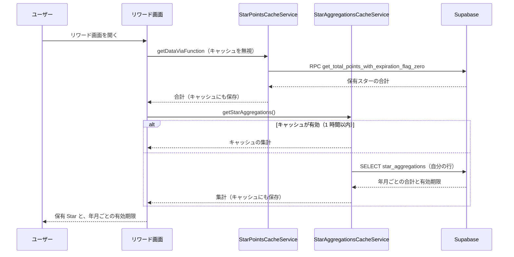
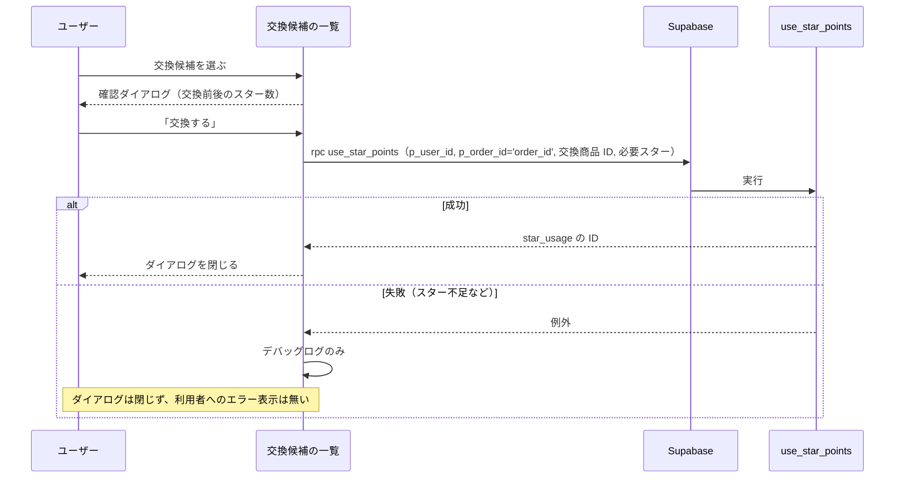

# 0007: スター・リワード（獲得・集計・有効期限・表示・交換）

| 項目 | 内容 |
|---|---|
| ステータス | **Implemented** |
| 影響度ティア | **critical**（RPC、`supabase_schema/**`、`lib/services/**` を含む） |
| 課題・見直しの管理 | 親 Issue [#1113](https://github.com/eno-conan/flutter-starbucks-clone/issues/1113)（課題は、サブ Issue で管理する）。作成元は [#1079](https://github.com/eno-conan/flutter-starbucks-clone/issues/1079) |
| 関連設計書 | [0006: モバイルオーダー](0006-mobile-order.md)（注文の確定でスターを付与する） |
| 対象外 | e チケットの表示・利用、支払い（カード）、会員ステータスの判定 |

**実装との対応（実装後は、コードを正とする）:**

| 役割 | ファイル |
|---|---|
| リワード画面（保有スター・有効期限・交換ボタン） | `lib/screens/starbucks_user_side/rewards/rewards_screen.dart` と `sections/*.dart` |
| 獲得・交換・失効の履歴画面 | `.../rewards/history/star_history_screen.dart` / `lib/services/rewards/star_history_service.dart` |
| 交換候補の一覧と交換 | `lib/screens/starbucks_user_side/star_reward_exchange/` |
| スターの付与 | `lib/services/mobile_order_pay/star_acquisition_service.dart` → `lib/data/repository/star_acquisition_repository.dart` |
| 保有スター・集計のキャッシュ | `lib/services/home/star_points_cache_service.dart` / `star_aggregations_cache_service.dart` |
| 集計の取得 | `lib/data/repository/star_aggregations_repository.dart` |

## 要約（TL;DR）

- 何を実現するか: 注文の金額に応じてスターを貯め、貯まったスターを e チケット（交換商品）と交換できる。
- 貯める: 注文の確定のあと、獲得スターを `star_acquisitions` に記録し、年月ごとの合計（`star_aggregations`）に加算する。
- 有効期限: 対象年月の **13 か月後の 1 日**。年月ごとの合計が、期限の単位になる。
- 使う: 交換するとき、**期限の近い年月の合計から順に**差し引く。

## 1. 背景

- スターは、購入額に応じて貯まり、一定数で交換できるポイント。
- 貯めた時期によって有効期限が違うため、年月ごとに集計して持つ。
- 画面には、保有スターの合計と、年月ごとの有効期限を表示する。

## 2. ゴールと非ゴール

**ゴール:**

- 注文のたびに、獲得スターを記録し、年月ごとの合計に加算する。
- 保有スターの合計と、年月ごとの有効期限を表示する。
- スターを交換し、期限の近いものから消費する。
- 退会時は、スターの集計を削除し、獲得・利用の履歴は匿名化して残す。

**非ゴール:**

| 非ゴール | 理由 |
|---|---|
| 会員ステータス（ゴールド等）の判定 | 会員ステータス画面は、説明の表示だけ |
| 期限切れスターの自動的な失効 | 失効させる仕組みは、現状のコードに無い（3.4） |
| 交換による e チケットの発行 | 交換の処理は、スターの消費の記録だけを行う（3.6） |

## 3. 設計

### 3.1 スターの獲得

- 獲得のタイミングは、注文の確定のあと（[0006 の 3.6](0006-mobile-order.md)）。
- 獲得スターは、**税込合計 ÷ 60** を、小数第 2 位で切り捨てた値。アプリ側で計算する。
- 登録は、RPC `handle_star_acquisition(p_user_id, p_order_id, p_category, p_acquired_points)` が行う。
    1. `star_acquisitions` に 1 行追加する（`(order_id, category)` は一意）。
    2. 今月（`YYYYMM`）の `star_aggregations` に加算する。行が無ければ作る。
- `category` は、1〜3。モバイルオーダーは 2 で登録する。
- 関数の中で例外が起きると、例外は投げず、`{status: 'error', message}` を返す。

### 3.2 データ

| テーブル | 役割 | 主な列 |
|---|---|---|
| `star_acquisitions` | 獲得履歴 | `user_id`、`order_id`、`category`（1〜3）、`acquired_points`（0 以上）。`(order_id, category)` が一意 |
| `star_aggregations` | ユーザー・年月ごとの合計 | `(user_id, target_year_month)` が主キー、`total_points`（0 以上）、`expiration_datetime`、`expiration_flag` |
| `star_usage` | 利用履歴 | `user_id`、`order_id` または `exchange_item_id`（どちらか必須）、`point_used`（0 以上） |
| `star_rewards_exchange_items` | 交換商品のマスタ | `id`、`short_name`、`name`、`image_url`、`points` |

- `expiration_datetime` は、`star_aggregations` への INSERT / UPDATE のたびに、トリガー（`set_star_aggregation_expiration`）が `対象年月の 1 日 + 13 か月` に設定する。
- 退会時: `star_aggregations` は削除する（獲得・利用の履歴から再計算できる派生データのため）。`star_acquisitions` と `star_usage` は、行を残して `user_id` を NULL にする。
- アーカイブ: 18 か月以上前の獲得履歴・利用履歴は、ジョブがアーカイブテーブル（`star_acquisitions_archive` / `star_usage_archive`）へ退避する。

### 3.3 保有スターの表示

- 保有スターの合計は、RPC `get_total_points_with_expiration_flag_zero` で取る。`expiration_flag = false` の `total_points` の合計を返す。
- この RPC は、ユーザーを引数に取らず、RLS（`auth.uid() = user_id`）で自分の行に絞る。
- 取得の結果は、端末の SQLite のキャッシュ（有効 1 時間）に保存する。
- 画面ごとの扱い:
    - リワード画面: 毎回キャッシュを無視して取得する。
    - ホーム画面: 表示時に、キャッシュを更新する（完了は待たない）。
- 有効期限の一覧は、`star_aggregations` から `target_year_month`, `total_points`, `expiration_datetime` を、年月の昇順で取る。キャッシュ（有効 1 時間）を使う。画面は、既定で 3 件、「過去分を見る」で全件を表示する。

### 3.4 有効期限

- 期限は、`target_year_month` の 1 日から 13 か月後（例: 2026 年 3 月分は、2027 年 4 月 1 日）。
- 期限は、年月ごとの合計に付く。同じ月に貯めたスターは、まとめて同じ日に期限を迎える。
- **失効の処理は、現状のコードに無い。**
    - `expiration_flag` を `true` にする処理（ジョブ・関数）が、リポジトリに見当たらない。
    - 保有スターの合計（3.3）は `expiration_flag = false` の合計のため、期限を過ぎた年月の分も、フラグが立たない限り、含まれる。
    - 交換（3.6）も、期限を確認しない。

### 3.5 スターの利用（RPC `use_star_points`）

- `use_star_points(p_user_id, p_order_id, p_exchange_item_id, p_point_used)` は、次の順に処理する。
    1. `p_point_used` が 0 以下なら、例外。
    2. 保有スターの合計（`star_aggregations` の `total_points` の合計）が、不足していれば、例外。
    3. `star_usage` に 1 行追加する。
    4. `expiration_datetime` が近い年月から順に、`total_points` を減らす。
    5. すべて消費できなければ、例外。
- 例外が起きると、全体がロールバックされる。戻り値は、`star_usage` の ID。
- 関数は、呼び出した本人の権限（`SECURITY INVOKER`）で動く。`star_usage` への INSERT は、RLS で本人の行だけに限る。

### 3.6 スターの交換

- 「スターリワードに交換」から、交換候補の一覧を開く。画面には、保有スターと、「利用可能な eTicket」への導線が出る。
- 交換候補は、**アプリ内に固定で持つ**（6 件）。`star_rewards_exchange_items` のマスタは、アプリから参照していない。

| ID | 候補 | 必要スター |
|---|---|---|
| 1 | カスタマイズ | 30 |
| 2 | フード 300 | 90 |
| 3 | フード 500 | 130 |
| 4 | ドリンク 800 | 190 |
| 5 | コーヒー豆 1900 | 400 |
| 6 | オリジナルグッズ | 400 |

- 交換ボタンを押すと、確認ダイアログ（交換前後のスター数、「交換した場合、戻すことはできません」「有効期限から近いものから交換されます」）が出る。
- 「交換する」で、`use_star_points` を呼ぶ。`p_order_id` には、固定の文字列 `order_id` を渡す。

- 交換では、`user_tickets`（e チケット）を発行する処理は無い。スターの消費の記録（`star_usage`）だけを行う。

### 3.7 履歴の画面

- 「Star獲得・交換・失効履歴」の画面は、購入履歴を月ごとにまとめて表示する。
- 現状、取得元は**固定のダミーデータ**（5 件）で、`purchase_history` を参照していない。

### 3.8 エラーの表示

| 場面 | 表示 |
|---|---|
| 保有スターの取得失敗 | 画面には出さず、ログに記録する（合計は 0 のまま） |
| 有効期限の取得失敗 | 画面には出さない（一覧は空の表示 `星集計データがありません`） |
| 交換の失敗 | 画面には出さない（デバッグログのみ） |

## 4. 検討した代替案

- 有効期限の管理を、年月ごとの集計（`star_aggregations`）に持たせ、獲得の 1 件ごとには持たせない形にしている。
- ほかの代替案の記録は、見つからなかった。

## 5. 横断的関心事

| 観点 | 検討内容 |
|---|---|
| セキュリティ | `star_aggregations` は RLS で本人の行だけ。`star_usage` の INSERT は本人の行だけ（20261011 のマイグレーション）。獲得のスター数はアプリが計算して渡す。`handle_star_acquisition` は、引数の `p_user_id` を `auth.uid()` と照合しない |
| プライバシー | 退会時、履歴は匿名化し、集計は削除する |
| 互換性 | `expiration_flag` は、元は数値で、boolean に変更された（列名・RPC 名は据え置き） |
| 性能 | 保有スターと集計は、端末のキャッシュ（1 時間）を使う。リワード画面の保有スターは、毎回取り直す |
| 可観測性 | 取得の失敗は `LoggerService` に記録する。交換の成功 / 失敗もデバッグ時のみ記録する |
| テスト | スターの付与（`StarAcquisitionService`）の単体テストと、リワード画面の Widget テストがある。キャッシュのサービス、交換の画面、`use_star_points` / `handle_star_acquisition` の DB テストは見当たらない |

## 6. 参考

- [0006: モバイルオーダー](0006-mobile-order.md)
- `supabase_schema/supabase/supabase_table_definitions.md`（テーブル定義。自動生成）
