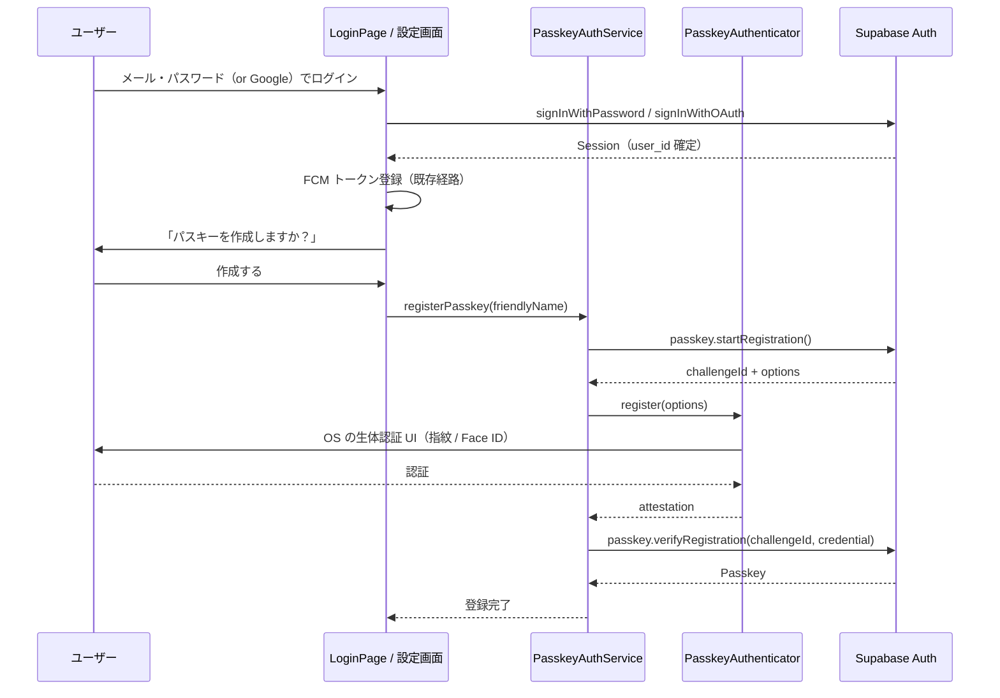
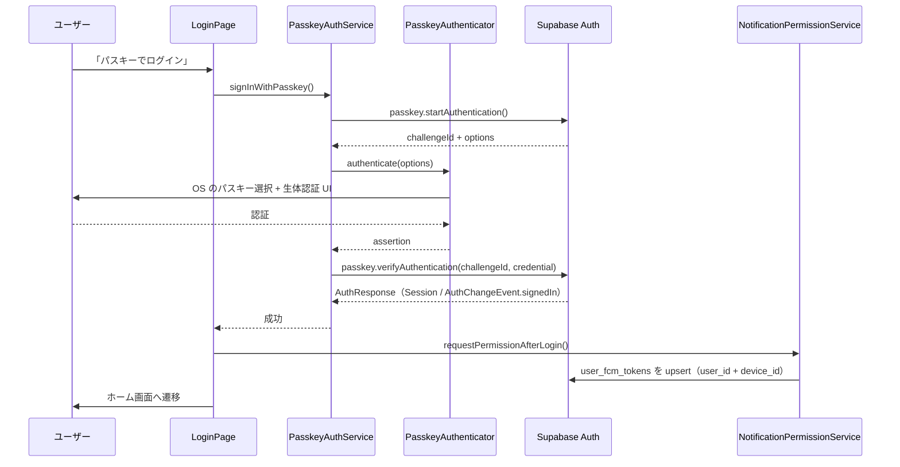

# パスキー導入 設計書（ログイン認証フロー刷新）

- 関連 Issue: [#807 認証関係のIssue](https://github.com/eno-conan/flutter-starbucks-clone/issues/807) / [#697 パスキー実装について](https://github.com/eno-conan/flutter-starbucks-clone/issues/697)
- 影響度ティア: **critical**（`lib/services/**`・`pubspec.yaml`・`android/**`・`ios/**` を含む）
    - 計画 = Opus / 実装 = Sonnet
    - 必須レビュー = code-reviewer + qa-agent + security-agent

## 1. 背景と目的

### 1.1 現状のログイン体験

現在のログイン画面（`lib/screens/starbucks_user_side/signin/login.dart`）の流れ:

```
初回:   メールアドレス・パスワード（または Google）でログイン
          ↓
        「指紋認証を有効にしますか？」ダイアログ
          ↓
        secure storage に認証情報を保存

2回目:  ログイン画面を開くと自動的に指紋認証 UI が起動
          ↓
        指紋認証成功 → secure storage から認証情報を読み出す
          ↓
        signInWithPassword(email, password) を再実行してセッション取得
```

### 1.2 現状の問題点

| # | 問題 | 詳細 |
|---|---|---|
| 1 | **パスワードを端末に平文 JSON で保存している** | `_storeCredentials()` が `type` / `email` / `password` を JSON 化して `FlutterSecureStorage` に保存している。暗号化ストレージとはいえ、パスワード原本を端末に置くのは OWASP Mobile M9（安全でないデータストレージ）/ M1（不適切な認証情報の使用）に抵触する |
| 2 | **指紋認証がサーバ側の認証になっていない** | `local_auth` の成功は「端末のロックが解除できた」ことしか証明しない。実際のサーバ認証は保存済みパスワードの再送であり、フィッシング耐性はゼロ |
| 3 | **Google ログインは自動ログインできない** | `_performBiometricLogin()` の `type == 'google'` 分岐は `refreshSession()` を試みるだけで、セッション切れ時は「再度Googleログインが必要です」で終わる |
| 4 | **ログイン画面のロジックが 941 行の StatefulWidget に集中** | 認証・secure storage・FCM・UI が同一クラスに混在し、テスト・レビューが困難 |

### 1.3 本設計のゴール

- 指紋（生体）認証を、**パスキー（WebAuthn）による本物のサーバ認証**に置き換える。
- 端末からパスワード原本を排除する。
- 既存のメール・パスワード / Google ログインは、フォールバックとして残す。

!!! warning "最重要制約: FCM トークン登録・プッシュ通知を一切壊さない"
    本設計で最も優先する制約。

## 2. 方式選定

### 2.1 結論: Supabase ネイティブ Passkey を採用する

- Issue #697 の PoC では Corbado（`corbado_auth`）を検証していたが、**本実装では採用しない。**

| 観点 | Supabase ネイティブ Passkey | Corbado |
|---|---|---|
| ユーザー ID の連続性 | `auth.users.id` がそのまま維持される | Corbado 側に別 ID 体系ができ、Supabase の `user_id` と二重管理になる |
| **FCM トークンへの影響** | **なし**（`user_fcm_tokens.user_id` は不変） | **致命的**（`user_id` が変わると既存トークン行が全て孤児化する） |
| RLS / 既存テーブル | そのまま使える | JWT の発行元が変わるため RLS を全面見直し |
| 追加依存 | `passkeys` プラグインのみ | `corbado_auth` + Corbado アカウント運用 |
| 費用 | Supabase に内包 | 外部 SaaS の従量課金 |

!!! success "決め手"
    - ユーザーからの最重要要件は、「FCM トークンがこれまで通り機能すること」。
    - よって、**認証プロバイダを Supabase から動かさない選択肢しかない。**
    - Issue #697 の最終コメント「これは単体で別プロジェクト立ち上げた方がいいかも」とも整合する（Corbado 検証は別プロジェクトへ）。

### 2.2 利用可能なことの確認（2026-08 時点、ソース確認済み）

- Supabase Auth のパスキーは、2026-05-28 に **Beta** で提供開始された。
- Flutter クライアントは `supabase_flutter` **2.15.0 以降**で使える。
- 本リポジトリの `pubspec.yaml` は、すでに `supabase_flutter: ^2.17.1` を指定している。**依存追加なしで、サーバ側 API は使える。**
- 確認したソース: `supabase-flutter` リポジトリ `packages/supabase_flutter/lib/src/supabase_passkey.dart`

??? example "コード例（2026-08 時点、ソース確認済み）（14 行）"
    ```dart
    @experimental
    extension AuthClientPasskey on AuthClient {
      /// サインイン済みユーザーに新しいパスキーを登録する
      Future<Passkey> registerPasskey(
        PasskeyAuthenticatorInterface authenticator, {
        String? friendlyName,
      });

      /// パスキーでサインインする（既存セッション不要）
      Future<AuthResponse> signInWithPasskey(
        PasskeyAuthenticatorInterface authenticator, {
        String? captchaToken,
      });
    }
    ```

低レベル API（`supabase.auth.passkey`）:

| メソッド | 用途 |
|---|---|
| `startRegistration({String? friendlyName})` | 登録チャレンジ取得 |
| `verifyRegistration({required String challengeId, required Map<String, dynamic> credential})` | 登録検証 |
| `startAuthentication({String? captchaToken})` | 認証チャレンジ取得 |
| `verifyAuthentication({required String challengeId, required Map<String, dynamic> credential})` | 認証検証 → `AuthResponse` |
| `list()` | 登録済みパスキー一覧 |
| `update({required String passkeyId, required String friendlyName})` | 表示名変更 |
| `delete({required String passkeyId})` | 削除 |

- `supabase_flutter` は、端末側の WebAuthn セレモニーを **自前で実装していない**。
- `PasskeyAuthenticatorInterface` の実装を呼び出し側が渡す設計になっているため、`passkeys` プラグインを追加する。

```yaml
# pubspec.yaml に追加
passkeys: ^2.22.3   # PasskeyAuthenticator implements PasskeyAuthenticatorInterface（2.21.0 以降）
```

- 確認したソース: `corbado/flutter-passkeys` リポジトリ `packages/passkeys/passkeys/lib/authenticator.dart`（`class PasskeyAuthenticator implements PasskeyAuthenticatorInterface`）。

!!! note "`supabase_flutter` 2.17.1 時点での拡張の宣言"
    - 2.17.1 では `extension GoTrueClientPasskey on GoTrueClient` になっている（`main` ブランチでは `AuthClient` へリネーム済み）。
    - いずれも、呼び出し側は `supabase.auth.signInWithPasskey(...)` で変わらない。
    - 実装時に、インストール済みバージョンのソースで最終確認する。

### 2.3 重要な仕様上の前提

- **パスキーは「既存ユーザーに追加する認証手段」。** パスキー単体で、新規ユーザーを作ることはできない。
    - `registerPasskey()` は、サインイン済み（非匿名）ユーザーを要求する。
    - → **この仕様が、本設計の安全性を担保している。** ユーザーは必ず既存の `auth.users.id` を持ったままパスキーを追加するため、`user_id` が変化することはない。
- サインインは **discoverable credentials（Resident Key）** を使う。ユーザーはメールアドレスを入力せず、OS のパスキー選択 UI から直接ログインできる。
- Supabase 側で「Enable Passkey authentication」を有効にする必要がある（既定は無効）。

## 3. 導入後の認証フロー

### 3.1 全体像

```
┌─ 初回（パスキー未登録） ────────────────────────────────┐
│ メール・パスワード or Google でログイン                  │
│   ↓ セッション確立（user_id 確定）                       │
│ FCM トークン登録                                        │
│   ↓                                                     │
│ 「パスキーを作成しますか？」ダイアログ                   │
│   ↓ はい                                                │
│ registerPasskey() → OS の生体認証 UI → 端末に鍵を生成    │
└────────────────────────────────────────────────────────┘

┌─ 2回目以降（パスキー登録済み・セッション切れ） ──────────┐
│ ログイン画面を開く                                       │
│   ↓ パスキーが使える端末か判定                           │
│ 「パスキーでログイン」ボタン（自動起動はしない）          │
│   ↓                                                     │
│ signInWithPasskey() → OS の生体認証 UI                   │
│   ↓ 成功 = サーバ側で署名検証 → セッション確立            │
│ FCM トークン登録（既存と同じ経路）→ ホーム画面            │
└────────────────────────────────────────────────────────┘

┌─ フォールバック ───────────────────────────────────────┐
│ パスキー非対応端末 / 登録なし / ユーザーがキャンセル      │
│   → 従来のメール・パスワード / Google ログインを表示      │
└────────────────────────────────────────────────────────┘
```

### 3.2 パスキー登録シーケンス



### 3.3 パスキーログインシーケンス



### 3.4 Google 認証との関係

- Google ログインしたユーザーも、ログイン直後にパスキーを登録できる（`registerPasskey()` は「どうやってログインしたか」を問わない）。
- **現状「セッション切れ時にアカウント再選択が必要」だった Google ユーザーも、2 回目以降はパスキーで一発ログインできる。**
- 1.2 の問題 #3 が解消される。

### 3.5 自動起動をやめる理由

- 現状は、画面表示と同時に指紋認証 UI を自動起動している（`_initializeBiometricAuth()`）。
- パスキーでは、**ユーザー操作を起点にする**方針へ変える。理由:
    - OS のパスキー UI はモーダルで、意図せず出るとキャンセル操作を強いる。
    - キャンセル例外のハンドリングが、自動起動だと煩雑になる。
    - 「メール・パスワードでログインしたいだけ」のユーザーの導線を塞がない。

## 4. 既存の生体認証まわりの廃止・移行

### 4.1 廃止するもの

| 対象 | 場所 | 対応 |
|---|---|---|
| `user_credentials`（メール・パスワードの JSON） | secure storage | **削除**。移行処理で既存端末からも消す |
| `biometric_enabled` | secure storage | **削除** |
| `_storeCredentials` / `_getStoredCredentials` / `_hasStoredCredentials` / `_isBiometricEnabled` / `_toggleBiometricAuth` | `login.dart` | 削除 |
| `_performBiometricLogin` / `_performSavedCredentialsLogin` | `login.dart` | 削除 |
| `_promptToEnableBiometricAuth` / `_promptToSaveCredentialsForNonBiometric` / `_promptToUseSavedCredentials` | `login.dart` | パスキー登録提案ダイアログに置換 |
| `LocalAuthentication` の直接利用 | `login.dart` | 削除（生体認証 UI は OS がパスキーセレモニー内で出す） |

### 4.2 移行処理（1 回だけ実行）

- アプリ起動時に、旧キーが残っていれば無条件で削除する。

```dart
/// 旧 local_auth 方式で保存していたログイン情報を削除する（パスキー移行）
/// パスワード原本を端末に残さないため、パスキー登録の有無に関わらず削除する
Future<void> purgeLegacyCredentials() async {
  await _storage.delete(key: 'user_credentials');
  await _storage.delete(key: 'biometric_enabled');
}
```

- 呼び出し位置: `AppInitializer.initializeApp()` 内（Supabase 初期化後）。

!!! danger "セッションには触らない"
    - `supabase_session`（`SecureSessionStorage` のキー）は、削除対象外。
    - これを消すと、全ユーザーが強制ログアウトになり、FCM 再登録の嵐になる。

### 4.3 `local_auth` 依存の扱い

- `local_auth` の利用箇所は、`login.dart` のみ。
- ただし将来、アプリ再開時の再ロック（e チケット表示前の本人確認など）で使う可能性がある。
- そのため、**pubspec からの削除は本対応のスコープ外**とする。
- 未使用依存として残すか削除するかは、実装フェーズ 4 で判断する。

## 5. FCM トークンを壊さないための設計（最重要）

### 5.1 なぜ壊れないのか

- `user_fcm_tokens` は、`(user_id, device_id)` の複合主キー。
- `user_id` は、`supabase.auth.currentUser.id` を使っている。

```dart
// lib/services/auth_service.dart
Future<void> setFcmTokenAndNotifySetting(String fcmToken, bool isNotify, {
  required String deviceId, String? deviceName,
}) async {
  final userId = _supabase.auth.currentUser?.id;   // ← ここが変わらなければ安全
  ...
}
```

- パスキーは、既存 `auth.users` 行に紐づく追加認証手段。よって **`user_id` は変化しない。**
- 既存の `user_fcm_tokens` 行はそのまま有効。パスキーログイン後の upsert は、同じ行を更新する。

### 5.2 それでも壊れうるケースと対策

| # | 壊れ方 | 原因 | 対策 |
|---|---|---|---|
| 1 | パスキーでログインしたのに FCM トークンが登録されない | 現状 FCM 登録は「`_navigateToHome()` の中」「OAuth コールバック」「アプリ起動時」の **3 箇所に散在**している。パスキーログインの新経路がどれも通らないと登録が漏れる | **5.3 の一元化を実施する**（本設計の必須項目） |
| 2 | 通知許可ダイアログが二重に出る / 遷移前に出る | `_navigateToHome()` が `context.go` の 1.5 秒後に許可要求している暫定実装 | 一元化にあわせて、遷移完了後に 1 回だけ走るようにする |
| 3 | Android で `device_id` が端末ごとに一意になっておらず、FCM トークン登録が一意制約違反で失敗する | `DeviceIdService` が Android で `AndroidDeviceInfo.id`（= `android.os.Build.ID`）を返していた。これは **OS ビルドの識別子**であり、同じビルドで動く全端末で同じ値になる。加えて `user_fcm_tokens_device_id_unique` が device_id をグローバルにユニークにしているため、テーブル全体で 1 ビルドあたり 1 行しか入らない | **既存バグ（別アカウントかどうかに関係なく発生する）**。フェーズ 3-b で対処済（5.4 参照） |
| 4 | ログアウトしても古いトークン行が残る | `signOutWithEmailAndPasswordAndDevice()`（トークン削除つき）に **呼び出し元が 1 つもない**。設定画面・店舗側画面はいずれも `signOutWithEmailAndPassword()` を呼んでいる | **既存バグ**。フェーズ 3-a で対処済（削除処理を `signOutWithEmailAndPassword()` 本体に取り込み、呼び出し側の書き忘れが起きない形にした） |
| 5 | パスキー登録の生体認証 UI 中にアプリが一時停止し、復帰時に FCM 初期化が走らない | Android の Credential Manager は別 Activity を起こす | 登録は「ログイン完了 → FCM 登録済み」の**後**に行う順序を厳守（3.2 のシーケンス順） |

### 5.3 FCM トークン登録の一元化（必須）

現状の 3 つの起点を、`onAuthStateChange` の 1 箇所に集約する。

```
【現状】
  login.dart          _navigateToHome() → requestPermissionAfterLogin()
  app.dart            _handleOAuthCallback() → requestPermissionAfterLogin()
  app.dart            _initializeApp()（既存セッションあり）→ requestPermissionAfterLogin()

【変更後】
  app.dart（アプリ全体で 1 箇所）
    supabase.auth.onAuthStateChange
      .where((d) => d.event == AuthChangeEvent.signedIn
                 || d.event == AuthChangeEvent.initialSession)
      .listen((d) => notificationService.requestPermissionAfterLogin());
```

!!! success "効果"
    - 認証手段が何であっても（メール・パスワード / Google / パスキー / 将来の追加手段）、FCM トークン登録が自動で走る。
    - 新しいログイン経路を足すたびに、登録処理を書き足す必要がなくなる。
    - 5.2 #1 の事故が、構造的に起きなくなる。

注意点:

- `signedIn` は `tokenRefreshed` とは別イベント。リフレッシュのたびに upsert は走らない。
- `initialSession` はセッション復元時に発火する。起動時登録（現 `_initializeApp` の分岐）を置き換えられる。
- upsert は冪等なので、多重発火しても行は壊れない。
- 既存の `FirebaseMessaging.instance.onTokenRefresh` リスナーは、`login.dart` の `_setupAuthStateListener()` 内で **auth イベントごとに購読が増える**実装になっている（リスナー多重登録）。
    - 一元化の際に、アプリ起動時 1 回の購読へ修正する。

### 5.4 ついでに直す既存バグ（フェーズ 3）

3 件とも実装済み。

1. **ログアウト時のトークン削除**
    - 呼び出し側を差し替えるのではなく、`signOutWithEmailAndPassword()` 自身がデバイス ID を解決して、トークン行を削除するようにした。
    - 呼び出し側が削除を書き忘れる余地をなくすため。
    - 使われていなかった `signOutWithEmailAndPasswordAndDevice()` は削除した。
2. **`device_id` の是正**: 問題は 2 層あり、両方を直す必要があった。
3. **古い device_id 行の自己修復**: 実行順序を守れなかった場合の保険。

#### (a) アプリ側: device_id が端末ごとに一意でない（根本原因）

- `DeviceIdService` は、Android で `AndroidDeviceInfo.id` を返していた。
- device_info_plus のドキュメントコメントは *"Either a changelist number, or a label like 'M4-rc20'"*。つまり、これは `android.os.Build.ID`（OS ビルドの識別子）であって、端末固有 ID ではない。
- `TQ3A.230805.001` のような値が、同じ OS ビルドの全端末で共通になる。
- **対策:** Android には信頼できる端末固有 ID が存在しないため、**初回起動時に UUID v4 を生成して、セキュアストレージへ永続化する**方式に変更した。
- iOS の `identifierForVendor` は、ベンダー単位・端末単位で一意なので、従来どおり使う。

#### (b) DB 側: グローバルユニーク制約

- `user_fcm_tokens_device_id_unique` を削除し、複合主キー `(user_id, device_id)` のみで一意性を担保する。
- 同一端末に複数ユーザーの行が並ぶが、`pushNotify` は `user_id` で絞るため、送信先は正しい。
- あわせて、更新されることのなくなった不正な device_id の行を削除する。
    - Android の `Build.ID`。
    - 20260314000001 で付与した `legacy_<user_id>`。
- 該当ユーザーは、次回アプリ起動時に `FcmTokenSyncService` が `initialSession` を契機に再登録する。**再ログインは不要。**

```sql
-- supabase_schema/supabase/migrations/20260819000001_fix_user_fcm_tokens_device_id.sql
DROP INDEX IF EXISTS public.user_fcm_tokens_device_id_unique;

DELETE FROM public.user_fcm_tokens
  WHERE device_id !~* '^[0-9a-f]{8}-[0-9a-f]{4}-[0-9a-f]{4}-[0-9a-f]{4}-[0-9a-f]{12}$';
```

!!! warning "実行順序に注意"
    アプリ側 (a) をリリースする**前**にマイグレーションだけを流すと、同じ不正な device_id が入り直すため、効果がない。

!!! note "`user_id` 単独のインデックスは不要"
    複合主キー `(user_id, device_id)` の btree が先頭列で効くため、`pushNotify` の `user_id` 絞り込みはそのまま機能する。

#### 3. 古い device_id 行の自己修復

- **起きうる問題:** 上記の実行順序を守れず、アプリ側のリリース前にマイグレーションを適用した場合。
    - `Build.ID` の行が入り直す。
    - アプリ更新後に、**同じ端末に対して古い行と新しい行の 2 行が並ぶ**。
    - FCM トークンはアプリインストール単位で一意なので、**両方の行が同じトークンを持ち、`pushNotify` が同じ端末へ通知を 2 回送ってしまう。**
- **対策:** 手動 SQL での再掃除に頼ると、忘れたときに気づけない。そのため、`UserFcmTokenRepository.upsertFcmToken()` が、登録直後に「同一ユーザー・同一 `fcm_token`・別 `device_id`」の行を削除するようにした。
- **安全な理由:** この条件に当てはまる行は、同じインストールが過去に別の `device_id` で登録した残骸に限られる（別端末なら必ず別のトークンになる）。
- **効果:**
    - 今後 `device_id` の生成方式を変更しても、行が自動的に収束する。
    - 掃除の失敗は、upsert 自体の成否に影響させない。

### 5.5 FCM の回帰検証項目

- 実装後、次を実機で確認する。
- **全項目 pass が完了条件。**

| # | シナリオ | 期待結果 |
|---|---|---|
| 1 | メール・パスワードでログイン | `user_fcm_tokens` に該当 `(user_id, device_id)` 行が upsert される |
| 2 | Google でログイン | 同上 |
| 3 | **パスキーでログイン** | 同上（`user_id` が 1 と同一であること） |
| 4 | パスキー登録の前後で `user_id` が変わらない | `auth.users.id` が不変 |
| 5 | パスキーログイン後にプッシュ通知を送信 | 端末で受信できる |
| 6 | アプリ再起動（セッション保持） | `initialSession` で再登録され、通知が届く |
| 7 | ログアウト → パスキーで再ログイン | 行が復活し、通知が届く |
| 8 | 通知設定 OFF → パスキーで再ログイン | `is_notify` が意図せず 1 に戻らないこと（※現行実装は再ログインで 1 に戻る。既存挙動として維持するか要判断） |
| 9 | 同一 OS ビルドの Android 端末 2 台で同一ユーザーがログイン | `device_id` が別々になり、2 行が並ぶこと（マルチデバイス対応の回帰確認） |
| 10 | 同一 OS ビルドの Android 端末で別ユーザーがログイン | 一意制約違反が発生せず、それぞれの行が登録されること |
| 11 | アプリ再起動後も `device_id` が変わらない | セキュアストレージから同じ UUID が読み出されること（起動のたびに行が増えない） |
| 12 | `Build.ID` 時代の行が残った状態でログイン | 同一ユーザー・同一トークンの古い行が自動削除され、1 端末につき 1 行になること（通知が重複しない） |

## 6. プラットフォーム設定

- パスキーは、RP ID（ドメイン）とアプリの紐づけが必須。
- 本リポジトリは、すでに Firebase Hosting のドメイン（`FIREBASE_HOSTING_DOMAIN`）で App Links / Universal Links を運用している。
- そのため、**同じドメインを RP ID に流用する。**

### 6.1 Supabase ダッシュボード（Authentication → Passkeys）

| 設定 | 値 |
|---|---|
| Enable Passkey authentication | 有効 |
| Relying Party Display Name | `すたば`（Android の `android:label` に合わせる。生体認証プロンプトに出る）<br>※ iOS の `CFBundleDisplayName` は `Testing App` でズレているが、**iOS は当面対象外**のため Android 側に揃える |
| Relying Party ID | `FIREBASE_HOSTING_DOMAIN` の裸ドメイン（スキーム・ポート・パスなし） |
| Relying Party Origins | `https://<FIREBASE_HOSTING_DOMAIN>` に加えて **Android アプリのオリジンが必須**（6.1.2 参照） |

#### 6.1.1 前提: Auth サーバのバージョン（**最重要**）

!!! danger "Auth（GoTrue）v2.188.0 以降が必要"
    - パスキーのエンドポイントは、v2.188.0 以降でしか提供されない。
    - それより古いプロジェクトでは、`/auth/v1/passkeys/*` が **プレーンテキストの `404 page not found`** を返し、パスキーは一切動作しない。

- **ダッシュボードに設定 UI が表示されることは、サーバが対応していることを意味しない。**
    - 設定画面はプラットフォーム側から配信されており、実際に動いている Auth コンテナとは別物。
- 実際に動いているバージョンは、`/auth/v1/health` を叩いて確認する（ダッシュボードの表示より確実）。
- Auth を上げる方法:
    - Supabase Cloud では、Auth / PostgREST / Postgres がプラットフォームのイメージとして一体で更新される。
    - そのため、**Postgres のアップグレード**を行う（Settings → Infrastructure → Service versions）。
    - 未サポート拡張が残っていると、アップグレードがブロックされる。
- 本リポジトリでの実績: Auth 2.176.1 → 2.195.0。`pgjwt` の削除が事前条件だった（マイグレーション 20260819000002 を参照）。

#### 6.1.2 Android アプリのオリジンを登録する（**必須**）

- Android のネイティブアプリは、WebAuthn のオリジンが `android:apk-key-hash:<署名証明書の SHA-256 を base64url 化した値>` になる。
- `https://` のオリジンしか登録していないと、**OS のセレモニーは成功するのに、サーバ検証で 400 `webauthn_verification_failed` になる。**
- `assetlinks.json` に登録済みの 16 進フィンガープリントから、次の変換で求める。

```python
raw = binascii.unhexlify(fingerprint.replace(':', ''))
origin = 'android:apk-key-hash:' + base64.urlsafe_b64encode(raw).decode().rstrip('=')
```

- Origins は **上限 5 つ**。`https://` で 1 つ使うため、Android のオリジンは最大 4 つまで。

!!! tip "手作業は不要"
    - この変換と Supabase への反映は、`scripts/sync-rp-origins.sh` が行う。
    - `assetlinks.json` が `main` に入ると、`deploy-firebase-hosting.yml` が Hosting への反映と同時に自動で同期する。
    - 署名鍵の管理方針と、手動での確認方法は [Android 署名鍵の管理](../../project/android-signing-keys.md) を参照。

### 6.2 Android: Digital Asset Links

- `public/.well-known/assetlinks.json` に、**`delegate_permission/common.get_login_creds` のエントリを追加**する。
- 既存の `handle_all_urls` エントリは、そのまま残す（消すと App Links が壊れる）。

```json
[
  { "relation": ["delegate_permission/common.handle_all_urls"], "target": { "... 既存のまま ..." : "" } },
  {
    "relation": ["delegate_permission/common.get_login_creds"],
    "target": {
      "namespace": "android_app",
      "package_name": "com.enoconan.testingappv2",
      "sha256_cert_fingerprints": ["... 既存と同じ 3 つ ..."]
    }
  }
]
```

- `firebase deploy --only hosting` で反映する。
- `minSdk 29` は、Credential Manager の要件を満たす。
- **API 34 未満では、Google Play services 経由**になる。実機検証は、API 33 と API 34+ の両方で行う。
- 端末に画面ロック（PIN / 指紋 / 顔）が設定されていないと、パスキーは作成できない。

### 6.3 iOS: Associated Domains（**当面対象外**）

!!! warning "iOS のパスキー対応は、現時点で予定していない"
    - Apple Team ID がリポジトリ内（`DEVELOPMENT_TEAM` など）に存在せず、値を特定できない。
    - Team ID を確定しないまま `apple-app-site-association` を配置すると、**iOS のパスキーが「エラーも出ずに動かない」状態**になる。かえって切り分けが難しい。
    - そのため、プレースホルダを含むファイルは配置しない方針とした。
    - 6.1 の Relying Party Display Name（現在は Android に合わせて `すたば`）は、iOS 対応時に再検討する。

??? info "将来 iOS に対応する場合の 3 手順（どれか 1 つでも欠けると動作しない）"
    1. `ios/Runner/Runner.entitlements` に `webcredentials` を追加する（既存の `applinks` は残す）。

        ```xml
        <key>com.apple.developer.associated-domains</key>
        <array>
            <string>applinks:$(FIREBASE_HOSTING_DOMAIN)</string>
            <string>webcredentials:$(FIREBASE_HOSTING_DOMAIN)</string>
        </array>
        ```

    2. `public/.well-known/apple-app-site-association` を新規作成する（拡張子なしファイル）。`<TEAM_ID>` は、Apple Developer アカウントの実値に置き換える。

        ```json
        {
          "webcredentials": {
            "apps": ["<TEAM_ID>.com.enoconan.testingappv2"]
          }
        }
        ```

    3. `firebase.json` の `headers` に、Content-Type 指定を追加する。
        - 拡張子がないため、既定では `application/json` にならない。
        - `rewrites` の `"**" → /index.html` より実ファイルが優先されるため、rewrites の変更は不要。

        ```json
        {
          "source": "/.well-known/apple-app-site-association",
          "headers": [{ "key": "Content-Type", "value": "application/json" }]
        }
        ```

### 6.4 CI への影響

- `.github/workflows/app.yml` は、`FIREBASE_HOSTING_DOMAIN` を Secrets から注入している。
- RP ID を同ドメインに揃えるため、**CI 側の追加変数は不要。**

## 7. コード構成案

### 7.1 追加・変更ファイル

| ファイル | 区分 | 内容 |
|---|---|---|
| `lib/services/passkey_auth_service.dart` | 新規 | パスキー登録・ログイン・一覧・削除のラッパー。`supabase_flutter` の拡張メソッドを呼ぶのは、このファイルだけに閉じる |
| `lib/provider/service_providers.dart` | 変更 | `passkeyAuthServiceProvider` を追加 |
| `lib/provider/passkey_state_provider.dart` | 新規 | Riverpod 3.0 `Notifier` で、パスキー利用可否・登録済み一覧を保持 |
| `lib/screens/starbucks_user_side/signin/login.dart` | 変更 | `local_auth` 依存の削除、パスキーログインボタン・登録提案ダイアログの追加 |
| `lib/screens/starbucks_user_side/setting/passkey_setting/main.dart` | 新規 | パスキーの一覧・追加・削除（設定画面から遷移） |
| `lib/services/fcm_token_sync_service.dart` | 新規（実装済） | FCM 登録の `onAuthStateChange` 一元化（5.3） |
| `lib/app/app.dart` | 変更（実装済） | `FcmTokenSyncService.start()` の起動、個別登録の削除 |
| `lib/config/app_initializer.dart` | 変更 | `purgeLegacyCredentials()` の呼び出し（4.2） |
| `lib/services/auth_service.dart` | 変更 | 旧ログイン情報の削除ユーティリティ、ログアウト経路の整理 |
| `pubspec.yaml` | 変更 | `passkeys` を追加 |
| `public/.well-known/assetlinks.json` | 変更 | `get_login_creds` 追加 |
| ~~`firebase.json`~~ | 見送り | AASA の Content-Type ヘッダ。iOS 対象外（6.3 参照） |
| ~~`public/.well-known/apple-app-site-association`~~ | 見送り | iOS 対象外（6.3 参照） |
| ~~`ios/Runner/Runner.entitlements`~~ | 見送り | iOS 対象外（6.3 参照） |
| `lib/core/services/device/device_id_service.dart` | 変更（実装済） | Android の device_id を UUID v4 の永続化方式へ（5.4-2a） |
| `lib/data/repository/user_fcm_tokens.dart` | 変更（実装済） | 古い device_id 行の自己修復（5.4-3） |
| `supabase_schema/supabase/migrations/20260819000001_fix_user_fcm_tokens_device_id.sql` | 新規（実装済） | ユニーク制約の削除と不正行の削除（5.4-2b） |

### 7.2 `PasskeyAuthService` の責務

??? example "コード例（25 行）"
    ```dart
    /// パスキー（WebAuthn）認証を扱うサービス
    ///
    /// supabase_flutter のパスキー API は experimental のため、
    /// 直接呼び出す箇所をこのクラスに閉じ込める。
    class PasskeyAuthService {
      PasskeyAuthService(this._supabase, this._authenticator);

      final SupabaseClient _supabase;
      final PasskeyAuthenticatorInterface _authenticator;

      /// この端末でパスキーが利用可能か
      Future<bool> isAvailable();

      /// サインイン済みユーザーにパスキーを登録する
      Future<void> register({String? friendlyName});

      /// パスキーでサインインする
      Future<void> signIn();

      /// 登録済みパスキーの一覧
      Future<List<Passkey>> list();

      /// パスキーを削除する
      Future<void> delete(String passkeyId);
    }
    ```

- 端末側の利用可否判定には、`PasskeyAuthenticator.getAvailability()` を使う。
    - プラットフォームごとに戻り値の型が異なる。実装時に、パッケージのソースで最終確認する。
- 状態管理は、Riverpod 3.0 `Notifier`（`StateNotifierProvider` は使わない）。
- ログは `LoggerService.info` / `LoggerService.warn` を使う。**チャレンジ・credential・passkeyId をログに出さない。**
- 非同期処理後の `context` 利用前に、`context.mounted` チェックを入れる。

### 7.3 エラーハンドリング方針

| 例外 | UI 挙動 |
|---|---|
| ユーザーキャンセル | SnackBar を出さず、静かにログイン画面へ戻す |
| パスキー未登録 / 対象なし | 「この端末にパスキーがありません。メールアドレスでログインしてください」 |
| `AuthException`（サーバ検証失敗） | 「パスキーでのログインに失敗しました」＋ `LoggerService.warn` |
| プラットフォーム設定不備（asset links / AASA） | 開発時のみ詳細ログ。ユーザーにはフォールバック導線を提示 |

## 8. 実装フェーズ

| フェーズ | 内容 | 完了条件 |
|---|---|---|
| **0. 事前準備**（コード変更なし） | Supabase ダッシュボードでパスキー有効化、RP ID / Origins 設定 | ダッシュボードで有効化済み |
| **1. プラットフォーム設定** | assetlinks.json / AASA / entitlements / firebase.json / `firebase deploy` | Android・iOS 実機で OS のパスキー UI が起動する |
| **2. FCM 一元化（先行実施）** ✅実装済 | `onAuthStateChange` への集約、`onTokenRefresh` 多重購読の修正 | **パスキーを入れる前**に 5.5 の #1・#2・#5・#6 が pass |
| **3-a. ログアウト時のトークン削除** ✅実装済 | `signOutWithEmailAndPassword()` 内でトークン行を削除 | ログアウト後にその端末へ通知が届かない |
| **3-b. `device_id` の是正** ✅実装済 | Android の device_id を UUID 永続化方式へ変更＋マイグレーション | 同一 OS ビルドの別端末・別ユーザーでもトークンが正しく登録される |
| **4. パスキー本実装** | `passkeys` 追加、`PasskeyAuthService`、ログイン画面改修、旧ログイン情報のパージ | 5.5 の全項目が pass |
| **5. パスキー管理 UI** | 設定画面からの一覧・追加・削除 | 複数端末でパスキーを登録・削除できる |

!!! warning "フェーズ 2 を、パスキー実装より先に完了させる"
    - FCM の一元化を済ませておけば、フェーズ 4 でパスキーログイン経路を足しても、FCM 登録は自動的に追随する。
    - 「パスキーを入れたら通知が来なくなった」という、切り分け困難な事故を、構造的に防げる。

## 9. 要判断事項（実装前にユーザー確認が必要）

| # | 論点 | 選択肢 | 推奨 |
|---|---|---|---|
| 1 | **Supabase Passkey が Beta であること** | (a) Beta を承知で採用 (b) GA まで待つ | **(a)**。個人開発アプリであり、フォールバック（メール・パスワード / Google）が常に残るため、API 変更時の影響はパスキー経路に限定される |
| 2 | **`experimental_member_use` 警告への対処** | (a) `analysis_options.yaml` に `errors: experimental_member_use: ignore` を追加 (b) `PasskeyAuthService` にのみ抑制コメントを書く | **(a)**。本プロジェクトは抑制コメントを原則禁止しており、(b) は pre-commit でブロックされる。ただし `analysis_options.yaml` の変更は Claude Hooks でブロックされるため、**ユーザー自身の手による変更が必要** |
| 3 | **旧 `user_credentials` の即時削除** | (a) 起動時に無条件削除 (b) パスキー登録完了後に削除 | **(a)**。パスワード原本を端末に残す期間を最短にする。(b) はパスキーを登録しないユーザーで永久に残る |
| 4 | **`local_auth` 依存の扱い** | (a) 残す (b) pubspec から削除 | フェーズ 4 時点で他に用途がなければ **(b)**。依存を減らすほうが供給網リスクが下がる |
| 5 | **再ログイン時の `is_notify` 上書き**（5.5 #8） | (a) 現行どおり 1 に戻す (b) 既存値を尊重する | 既存挙動の変更になるため本設計のスコープ外。別 Issue 化を推奨 |

### 実機検証で確定した事項

- 当初「未確定の調査事項」としていた、**「Android ネイティブのオリジンを Relying Party Origins に登録する必要があるか」**は、実機検証の結果、**必要**と確定した（6.1.2）。
- 失敗の症状ごとに原因が切り分けられるため、記録しておく。

| 症状 | 原因 |
|---|---|
| エンドポイントが `404 page not found`（プレーンテキスト） | Auth サーバがパスキー未対応（6.1.1） |
| `DomainNotAssociatedException` | `assetlinks.json` の配信不備、または署名鍵が未登録 |
| OS のセレモニーは成功するが 400 `webauthn_verification_failed` | RP Origins に Android のオリジンが未登録（6.1.2） |

!!! tip "切り分けの指標"
    - **OS のセレモニーが成功した時点で、`assetlinks.json` と署名鍵は正しいことが確定する。**
    - 紐づけが失敗していれば、認証情報の生成まで到達しないため。
    - この 2 つを切り分ける指標として使える。

## 10. 参考

- [Passkeys for Supabase Auth (Beta) · supabase Discussion #46458](https://github.com/orgs/supabase/discussions/46458)
- [Passkey authentication | Supabase Docs](https://supabase.com/docs/guides/auth/passkeys)
- [supabase_flutter | pub.dev](https://pub.dev/packages/supabase_flutter)
- [supabase-flutter `supabase_passkey.dart`](https://github.com/supabase/supabase-flutter/blob/main/packages/supabase_flutter/lib/src/supabase_passkey.dart)
- [passkeys | pub.dev](https://pub.dev/packages/passkeys)
- [corbado/flutter-passkeys](https://github.com/corbado/flutter-passkeys)
- Issue [#807](https://github.com/eno-conan/flutter-starbucks-clone/issues/807) / [#697](https://github.com/eno-conan/flutter-starbucks-clone/issues/697) / [#472](https://github.com/eno-conan/flutter-starbucks-clone/issues/472)
